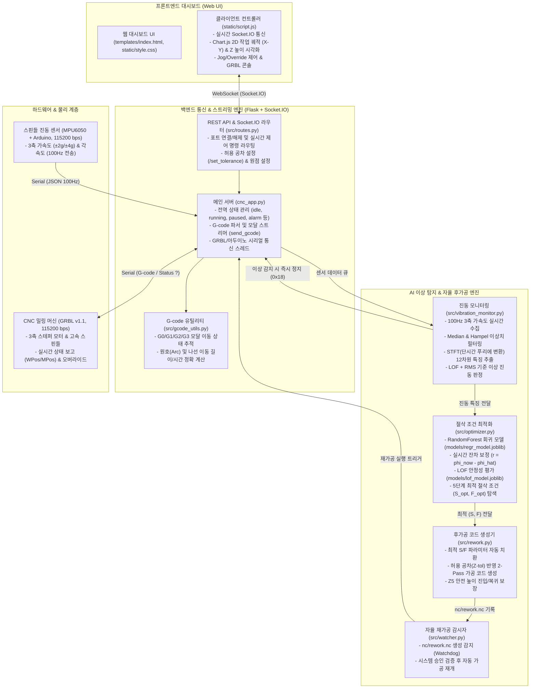

# CNC 밀링 머신 실시간 모니터링 및 자율제어 스마트 가공 시스템

GRBL(v1.1) 기반 CNC 밀링 머신과 스핀들에 장착된 3축 가속도/자이로 센서(MPU6050)를 연동하여, 웹 대시보드에서 가공 경로와 장비 상태를 실시간 모니터링 및 제어하고, 가공 중 발생하는 **이상 진동(채터, Chatter)을 실시간으로 탐지하여 즉시 긴급 정지 → 최적 절삭 조건 탐색 → 2-Pass 재가공 NC 코드 자동 생성 → 자율 재가공**을 수행하는 스마트 제조 자율제어 시스템입니다.

---

## 1. 시스템 아키텍처 및 흐름도

### 1.1 전체 시스템 아키텍처
본 시스템은 웹 브라우저 클라이언트, Flask + Socket.IO 백엔드 제어 서버, AI 이상 탐지 및 최적화 엔진, 그리고 GRBL 머신 및 아두이노 센서 하드웨어의 4계층으로 구성되어 있습니다.



---

### 1.2 이상 진동 감지 및 자율 재가공 동작 시퀀스

가공 중 이상 진동 발생부터 자동 복구까지의 자율 제어 루프는 다음과 같이 수행됩니다.

```mermaid
sequenceDiagram
    autonumber
    participant S as MPU6050 센서
    participant APP as 서버 (cnc_app.py)
    participant MON as 모니터 (vibration_monitor.py)
    participant OPT as 최적화 (optimizer.py)
    participant REW as 후가공 (rework.py)
    participant CNC as GRBL 머신
    participant UI as 웹 UI (script.js)

    Note over CNC,APP: 정상 G-code 가공 진행 중 (약 100Hz 모니터링)
    S->>APP: 3축 가속도 데이터 스트리밍 (JSON)
    APP->>MON: 진동 데이터 버퍼링 (1000샘플 단위)
    MON->>MON: Median/Hampel 필터링 & STFT 특징 추출
    MON->>MON: LOF 이상치 + RMS 임계치 초과 판정 (1초 지속)
    
    Note over MON,CNC: [1단계: 즉시 긴급 정지]
    MON->>APP: 이상 진동 확정 알림
    APP->>CNC: 소프트 리셋 전송 (Ctrl-X / 0x18)
    CNC-->>APP: 가공 즉각 중단 (스핀들/모터 정지)
    APP->>UI: 이상 감지 알림 및 긴급정지 UI 반영
    APP->>APP: data/Vibration_detection.csv 기록

    Note over MON,OPT: [2단계: 최적 절삭 조건 탐색]
    APP->>CNC: GRBL 알람 해제 명령 ($X)
    MON->>OPT: 이상 시점 진동 특징 및 현재 조건(S, F) 전달
    OPT->>OPT: RandomForest 예측 + 실시간 잔차 보정 + LOF 평가 (5단계 탐색)
    OPT-->>MON: 최적 조건 도출 (S_opt, F_opt)

    Note over MON,REW: [3단계: 2-Pass 재가공 G-code 생성]
    MON->>REW: 원본 NC 코드 + 최적 조건 + 허용 공차(Z_tol) 전달
    REW->>REW: 1차 패스(정상 깊이) + 2차 패스(Z - tol) 생성 (안전높이 Z5 적용)
    REW->>APP: nc/rework.nc 파일 저장 완료

    Note over APP,CNC: [4단계: 자율 재가공 시작]
    APP->>APP: Watchdog 감시자(watcher.py) 파일 변경 검증
    APP->>CNC: rework.nc 스트리밍 자동 시작
    APP->>UI: 자율 재가공 시작 알림 및 가공 궤적 재표시
```

---

## 2. 프로젝트 디렉토리 구조 (전수 인벤토리)

프로젝트 루트([`ProjectLab_System/`](file:///d:/Project_Lab/02_공모전_및_경진대회/ProjectLab%202026/ProjectLab_System))는 유지보수성과 확장성을 위해 기능별로 모듈화되어 있습니다.

```text
ProjectLab_System/
├── cnc_app.py                  # [메인 서버] Flask, Socket.IO, GRBL/아두이노 시리얼 통신, G-code 스트리머
├── requirements.txt            # [의존성] Python 라이브러리 명세서
├── README.md                   # [문서] 시스템 종합 가이드 및 사용자 매뉴얼
├── .gitignore                  # [Git] 버전 관리 제외 규칙 (가상환경, 임시 로그 등)
│
├── src/                        # [핵심 백엔드 로직 모듈]
│   ├── routes.py               # REST API 라우트 및 Socket.IO 양방향 이벤트 핸들러
│   ├── vibration_monitor.py    # 신호 필터링, STFT 특징 추출, LOF/RMS 이상 진동 실시간 탐지기
│   ├── optimizer.py            # RandomForest + 잔차 보정 + LOF 기반 5단계 최적 절삭 조건 탐색기
│   ├── rework.py               # 2-Pass 자율 재가공 G-code(nc/rework.nc) 생성기 (Z 안전높이 처리)
│   ├── watcher.py              # nc/rework.nc 생성 감지용 Watchdog 파일 핸들러 (서버 내장형)
│   ├── gcode_utils.py          # G0/G1/G2/G3 모달(Modal) 상태 추적 및 원호/나선 이동 거리 계산기
│   └── arduino_sensor.py       # 독립형 아두이노 시리얼 리더 및 가상 센서 시뮬레이터 (테스트용)
│
├── models/                     # [사전 학습 AI 모델]
│   ├── regr_model.joblib       # 절삭 조건(S, F)에 따른 진동 특징 예측 MultiOutput RandomForest 회귀 모델
│   └── lof_model.joblib        # 정상 절삭 영역 평가용 LocalOutlierFactor (novelty=True) 모델
│
├── data/                       # [실시간 런타임 데이터 및 학습셋]
│   ├── current_position.txt    # 가공 시작 시점의 기계 좌표(MPos Z축) 기록
│   ├── Vibration_detection.csv # 이상 진동 감지 시점(시간, 위치 X/Y/Z, 스핀들 오버라이드) 기록
│   └── 학습 데이터/            # 정상 가공 조건별 MPU6050 센서 수집 데이터셋 (19개 CSV 파일)
│
├── nc/                         # [NC G-code 파일]
│   ├── O0527.txt               # 직선/모달 절삭 테스트용 G-code
│   ├── O0807.txt               # 2.5D 윤곽 가공 테스트용 G-code
│   ├── O1001.nc                # CAM 생성 복합 원호/포켓 가공 G-code
│   └── rework.nc               # 이상 감지 시 시스템이 자동 생성하는 2-Pass 재가공 코드
│
├── arduino/                    # [아두이노 센서 펌웨어]
│   ├── MPU6050/                # MPU6050 3축 가속도/자이로 기본 펌웨어 (115200 bps, 100Hz, 권장)
│   │   └── MPU6050.ino
│   ├── MPU6050_standalone/     # MPU6050 단독 동작용 펌웨어
│   │   └── MPU6050.ino
│   └── arduino_example/        # 아날로그 센서(ADXL335 + LM35) 예제 펌웨어
│       └── sensor_example.ino
│
├── templates/                  # [웹 템플릿]
│   └── index.html              # 다크 테마 반응형 CNC 제어 및 실시간 모니터링 대시보드
│
├── static/                     # [프론트엔드 정적 리소스]
│   ├── script.js               # Socket.IO 클라이언트, Chart.js 2D/Z 궤적 시각화, 제어 로직
│   ├── style.css               # 관제 센터 스타일 다크 UI, 게이지, 버튼 애니메이션
│   ├── favicon.ico             # 웹 파비콘
│   └── alert.txt               # 사운드 에셋 안내 파일
│
├── scripts/                    # [관리 및 학습 유틸리티]
│   ├── train_models.py         # 3축 STFT 데이터 기반 회귀/LOF 모델 오프라인 학습 스크립트
│   └── test_arduino_sensor.py  # 센서 모듈 시뮬레이션 및 포트 연결 테스트 스크립트
│
├── docs/                       # [상세 기술 문서]
│   └── README_ARDUINO.md       # 아두이노 배선도, 라이브러리 설치 및 센서 연동 매뉴얼
│
├── analysis/                   # [시스템 분석 보고서]
│   ├── analyze.md              # 프로젝트 구조 및 코드 전수 분석 보고서
│   ├── analyze2.md             # 실제 CNC 장비 구동 로그 기반 결함 분석 및 해결 가이드
│   └── full.md                 # 시스템 전체 기능 및 구현 세부 보고서
│
└── logs/                       # [가공 런타임 로그]
    ├── .gitkeep
    └── cnc_log_*.csv           # 매 가공 시 실제 WPos 좌표, 상태, 시간 기록 로그 (자동 생성)
```

---

## 3. 핵심 기능 및 기술 구현

### 3.1 실시간 가공 경로 및 장비 모니터링
- **실제 공작물 좌표(WPos) 기반 렌더링**: G-code 지령 좌표가 아닌 GRBL이 `?` 쿼리에 응답하는 실제 장비 좌표를 파싱하여 Chart.js 기반 2D 작업 궤적(X-Y) 및 Z 높이 변화를 실시간 플롯합니다.
- **네트워크 최적화**: 매 렌더링 주기마다 전체 경로 대신 새롭게 추가된 점(델타 좌표)만 전송(`ui_sent_len` 관리)하여 브라우저 메모리 부하와 통신 지연을 방지합니다.
- **실시간 오버라이드 & 조그 제어**: 가공 중에도 스핀들 속도(±10%, ±1%, 100% 리셋) 및 이송 속도를 GRBL 1.1 실시간 바이트 코드로 즉각 변경할 수 있으며, 정지 상태에서는 미세 조그(Jog) 이동과 공작물 원점 설정(`G10 L20 P1`)을 지원합니다.

### 3.2 표준 모달(Modal) G-code 파서 ([`src/gcode_utils.py`](file:///d:/Project_Lab/02_공모전_및_경진대회/ProjectLab 2026\ProjectLab_System\src\gcode_utils.py))
- `G0`, `G1`, `G2`, `G3` 이동 모드와 좌표계(`G90`/`G91`), 작업 평면(`G17`/`G18`/`G19`), 피드(`F`), 스핀들(`S`)의 모달 상태를 완벽히 유지합니다.
- `X30 F70`처럼 이동 코드(G1 등)가 생략된 표준 CAM 코드도 직전 모드로 정확히 해석하여 이동 소요 시간을 계산함으로써, 플래너 버퍼 고갈로 인한 **가공 중 스핀들 조기 정지(`M5`)나 버퍼 폭주 사고를 원천 차단**합니다.
- 원호 보간(`G2`/`G3`)의 중심점 오프셋(`I`, `J`, `K`) 및 반경(`R`) 형식, 나선(Helical) 이동의 3D 공간상 실제 이동 거리를 정확히 계산합니다.

### 3.3 고감도 실시간 이상 진동(Chatter) 탐지 ([`src/vibration_monitor.py`](file:///d:/Project_Lab/02_공모전_및_경진대회/ProjectLab 2026\ProjectLab_System\src\vibration_monitor.py))
- **노이즈 필터링**: MPU6050 센서의 100Hz 3축 가속도 신호에 Median 필터와 Hampel Filter(MAD 기반 이상치 제거)를 순차 적용하여 임펄스 노이즈를 제거합니다.
- **STFT 주파수 특징 추출**: 슬라이딩 윈도우(크기 100, 스텝 25)를 통해 3개 축에 대해 Short-Time Fourier Transform을 수행하고, 축별 4개 통계량(평균 진폭, 최대 진폭, 에너지, 스펙트럼 중심)으로 총 12차원의 특징 벡터를 구성합니다.
- **이중 판정 알고리즘**:
  1. **LOF (Local Outlier Factor)**: 고차원 정상 가공 특징 밀도와 실시간 특징 벡터 간의 이상치 판정.
  2. **통계적 RMS 베이스라인**: 초기 정상 구간 대비 RMS 진폭 급증(임계치 1.5배) 여부 교차 검증.
  3. 최근 윈도우 내 이상 비율이 70% 이상이고 1초 이상 지속될 때 최종 채터 발생으로 확정합니다.

### 3.4 5단계 자율 절삭 조건 최적화 ([`src/optimizer.py`](file:///d:/Project_Lab/02_공모전_및_경진대회/ProjectLab 2026\ProjectLab_System\src\optimizer.py))
- 회귀 모델(`regr_model.joblib`)이 입력 절삭 조건($S \in [16000, 24000]\text{ RPM}$, $F \in [50, 150]\text{ mm/min}$)에 따른 12차원 진동 특징을 예측합니다.
- 이상 발생 시점의 실측 특징값($\phi_{now}$)과 예측값($\hat{\phi}$) 간의 **실시간 잔차($r = \phi_{now} - \hat{\phi}$)**를 보정하여 예측 정밀도를 극대화합니다.
- 후보 절삭 조건을 격자 탐색(Grid Search)하여, LOF 점수가 안전 임계값($\tau$) 이하인 영역 중 생산성(MRR $\propto S \times F$)과 공구 안정성을 최적화하는 최적 조건($S_{opt}, F_{opt}$)을 5단계 평가로 도출합니다.

### 3.5 2-Pass 안전 후가공 코드 자동 생성 ([`src/rework.py`](file:///d:/Project_Lab/02_공모전_및_경진대회/ProjectLab 2026\ProjectLab_System\src\rework.py))
- **1차 패스 (진동 완화 재가공)**: 도출된 최적 절삭 조건($S_{opt}, F_{opt}$)을 적용하여 이상 발생 경로를 원본 깊이로 1차 안정 가공합니다.
- **2차 패스 (공차 정밀 다듬질)**: 가공 시 입력받은 허용 공차(0.0 ~ 1.0mm)를 반영하여 모든 절대좌표 Z를 미세하게 추가 하강($Z - tolerance$) 가공함으로써 채터 자국을 완전히 제거합니다.
- **Z5 안전 충돌 방지**: 각 패스 시작 시 반드시 공구를 안전 높이($Z+5.0\text{mm}$)로 상승시킨 후 첫 가공 좌표(X, Y)로 수평 급속 이동(`G0`)하고, 이후 수직 하강하여 가공을 시작하므로 소재 측면이나 바이스와의 공구 충돌을 방지합니다.

---

## 4. 설치 및 환경 설정

### 4.1 시스템 요구사항
- **운영체제**: Windows 10 / 11, Linux, macOS
- **Python**: Python 3.10 ~ 3.13 (기존 학습 모델이 scikit-learn 1.7.2로 직렬화되어 있음)
- **하드웨어**:
  - GRBL v1.1 호환 CNC 밀링 머신 컨트롤러
  - 아두이노 보드 (Uno, Nano, Mega 등) + MPU6050 센서 모듈 (스핀들 마운트 부착)
  - USB 시리얼 케이블 2개 (CNC용 1개, 아두이노용 1개)

### 4.2 파이썬 가상환경 생성 및 패키지 설치

> [!NOTE]
> 저장소에 포함된 기존 `venv/`는 다른 환경의 경로가 지정되어 있을 수 있으므로, 반드시 로컬 환경에서 신규 가상환경을 생성하여 사용하세요.

```bash
# 1. 저장소 디렉토리 이동
cd ProjectLab_System

# 2. Python 가상환경 생성
python -m venv .venv

# 3. 가상환경 활성화
# Windows (PowerShell):
.venv\Scripts\Activate.ps1
# Windows (CMD):
.venv\Scripts\activate.bat
# Linux / macOS:
source .venv/bin/activate

# 4. 의존성 패키지 설치
pip install --upgrade pip
pip install -r requirements.txt
```

### 4.3 아두이노 센서 펌웨어 업로드 및 배선

자세한 내용은 [`docs/README_ARDUINO.md`](file:///d:/Project_Lab/02_공모전_및_경진대회/ProjectLab%202026/ProjectLab_System/docs/README_ARDUINO.md)를 참조하세요.

1. **하드웨어 배선 (I2C 통신)**:
   - `VCC` $\rightarrow$ 아두이노 5V (레귤레이터 내장 모듈) 또는 3.3V
   - `GND` $\rightarrow$ 아두이노 GND
   - `SDA` $\rightarrow$ Uno/Nano의 `A4` (Mega는 `Pin 20`)
   - `SCL` $\rightarrow$ Uno/Nano의 `A5` (Mega는 `Pin 21`)
2. **Arduino IDE 라이브러리 설치**:
   - `MPU6050` (by Electronic Cats / I2Cdevlib)
   - `ArduinoJson` (v6.x)
3. **펌웨어 업로드**:
   - [`arduino/MPU6050/MPU6050.ino`](file:///d:/Project_Lab/02_공모전_및_경진대회/ProjectLab%202026/ProjectLab_System/arduino/MPU6050/MPU6050.ino) 파일을 열고 보드 및 포트 지정 후 업로드합니다 (115200 bps, 100Hz 샘플링).

---

## 5. 실행 및 사용 방법

### 5.1 메인 시스템 실행

```bash
# 가상환경 활성화 상태에서 실행
python cnc_app.py
```

서버가 구동되면 웹 브라우저를 열고 다음 주소로 접속합니다:
👉 **`http://localhost:5000`**

*(별도의 `watcher.py`는 실행할 필요가 없습니다. 서버 내부에서 자동으로 감시 스레드가 구동됩니다.)*

---

### 5.2 작업 단계별 상세 가이드


1. **GRBL 컨트롤러 포트 연결**:
   - 웹 대시보드 좌측 상단 "컨트롤러 연결"에서 CNC가 연결된 COM 포트를 선택하고 `연결` 클릭.
   - 머신이 알람(`Alarm`) 상태인 경우 `알람해제` 버튼(`$X`)을 클릭하여 대기(`Idle`) 상태로 전환.
2. **아두이노 진동 센서 연결**:
   - "센서 데이터" 패널에서 아두이노 COM 포트를 선택하고 `연결` 클릭.
   - 실시간 가속도 값 `ACC(X: ..., Y: ..., Z: ...)`가 정상 수신되는지 확인.
3. **공작물 원점(Work Zero) 설정**:
   - Jog 버튼(X+, X-, Y+, Y-, Z+, Z-)을 사용하여 절삭 시작 위치로 공구를 이동.
   - `X축 영점`, `Y축 영점`, `Z축 영점` 또는 `전체 영점 설정` 버튼 클릭 (`G10 L20 P1 X0 Y0 Z0`).
4. **허용 공차(Tolerance) 입력**:
   - 이상 진동 발생 시 2차 패스에서 추가로 절삭할 허용 공차(단위: mm, 범위: `0.0` ~ `1.0`)를 입력하고 `공차 설정` 클릭.
5. **NC 코드 파일 로드**:
   - "G-code 파일 선택"에서 실행할 NC 코드([`nc/O0527.txt`](file:///d:/Project_Lab/02_공모전_및_경진대회/ProjectLab%202026/ProjectLab_System/nc/O0527.txt) 등)를 선택하고 `파일 로드` 클릭.
   - 화면에 총 라인 수와 예상 경로가 로드됩니다.
6. **가공 시작 및 실시간 모니터링**:
   - `가공 시작` 버튼 클릭.
   - 실제 작업 좌표(WPos)에 따른 실시간 공구 경로와 Z축 높이, 센서 진동 그래프를 모니터링합니다.
   - 필요 시 스핀들/이송 오버라이드 버튼으로 속도를 미세 조정할 수 있습니다.
7. **이상 진동 감지 및 자율 재가공 관찰**:
   - 가공 중 비정상 진동이 감지되면 시스템이 **자동으로 즉시 긴급 정지**하고, 최적화 모델을 거쳐 `nc/rework.nc`를 생성한 후 **자동으로 자율 재가공을 시작**합니다.

---

## 6. 안전 제약 및 인터록 정책

작업자의 안전과 장비 및 공작물 보호를 위해 시스템 전반에 강력한 인터록 정책이 적용되어 있습니다.

- **가공 중 하드웨어 조작 인터록**: 가공 진행 중(`running`) 또는 일시정지(`paused`) 상태에서는 조그 이동, 원점 설정, 알람 해제, 수동 GRBL 콘솔 명령, 시리얼 포트 연결 해제 등 위험을 유발할 수 있는 UI 조작이 강제로 비활성화됩니다.
- **GRBL 에러 감지 및 자동 보호**: GRBL로부터 `error:` 응답을 수신하면 시스템은 즉시 피드 홀드(`!`)를 전송하여 일시정지 상태로 전환하고, 오류가 발생한 G-code 라인을 화면에 경고합니다.
- **허용 공차 상한 제한**: 과절삭 및 공구 파손을 원천 차단하기 위해 입력 가능한 허용 공차는 최대 `1.0mm`로 하드웨어적/소프트웨어적으로 엄격히 제한됩니다.
- **G28 / G30 안전 고도 처리**: NC 파일 내에 테이블 충돌을 유발할 수 있는 `G28`/`G30`(원점 복귀) 명령이 포함된 경우, 시스템은 반드시 안전 높이(`G0 Z5`) 상승 후 수평 이동(`G0 X0 Y0`)하도록 명령을 안전하게 치환하여 실행합니다.
- **재가공 파일 무결성 및 인가 검증**: `nc/rework.nc` 감시자는 시스템 내부에서 이상 진동 루틴을 거쳐 공식 발급된 인가 플래그(`_rework_authorized`)가 존재하는 경우에만 자동 가공을 실행합니다. 외부 사용자의 단순 텍스트 편집이나 파일 저장은 무시됩니다.

---

## 7. 버전 이력 및 진행 사항 (v1.0.1)

### 📌 v1.0.1 주요 개선 내역

1. **G-code 모달(Modal) 파서 신설 및 버퍼 폭주 해결 ([`src/gcode_utils.py`](file:///d:/Project_Lab/02_공모전_및_경진대회/ProjectLab%202026/ProjectLab_System/src/gcode_utils.py))**:
   - 표준 모달 이동 명령(`G0/G1/G2/G3`) 및 좌표계 추적기 구현.
   - `X30 F70`과 같이 이동 코드가 생략된 줄에서 대기 시간 없이 0초 만에 통과하여 스핀들이 조기 정지(`M5`)되거나 GRBL 버퍼가 폭주하던 치명적 결함을 완벽히 해결.
   - 복합 곡선/원호 가공(`O1001.nc`)의 나선 및 아크 이동 거리 계산 지원.
2. **프로젝트 아키텍처 전면 모듈화 및 디렉토리 표준화**:
   - 루트에 산재해 있던 백엔드 소스를 `src/`로 통합, 학습 데이터는 `data/`, 펌웨어는 `arduino/`, 문서는 `docs/`, 분석 보고서는 `analysis/`로 체계화.
   - 타 PC 기준의 하드코딩 절대 경로(`C:\Users\ace\...`)를 모두 제거하고 프로젝트 루트 기준 상대 경로(`BASE_DIR`)로 표준화.
3. **자율 재가공 감시자(Watchdog) 서버 내장화**:
   - 별도 프로세스로 실행해야 했던 `watcher.py`를 `cnc_app.py` 내부 백그라운드 스레드로 완전 통합.
   - 다중 실행으로 인한 중복 재가공 충돌 방지 및 안전 인가 토큰 검증 로직 탑재.
4. **GRBL 시리얼 통신 안정성 및 타임아웃 재전송 로직 수정**:
   - G-code 스트리밍 중 타임아웃 재전송 시 중복 라인이 전송되던 논리 오류 수정.
   - 상태 질의(`?`)와 G-code 전송 간 시리얼 버퍼 간섭 제거.
5. **실시간 렌더링 성능 최적화**:
   - 웹 클라이언트(Chart.js)로 전체 가공 경로를 반복 전송하던 방식을 신규 점만 델타로 전송(`ui_sent_len`)하도록 개선하여 장시간 가공 시 브라우저 렉 현상 해결.
6. **안전 인터록 및 공차 검증 강화**:
   - 가공 중 오조작 방지 락, 공차 최대값(1.0mm) 제한, G28/G30 안전 고도 치환 적용.

---

## 8. 라이선스 및 문의
- **프로젝트**: ProjectLab 2026 - CNC 스마트 가공 자율제어 시스템
- **주관**: 경남대학교 산학협력단 / 프로젝트 LAB
- **특허 출원 관련**: CNC 가공공정에 대한 진동 데이터 학습 기반 실시간 이상탐지 및 자율제어 시스템
