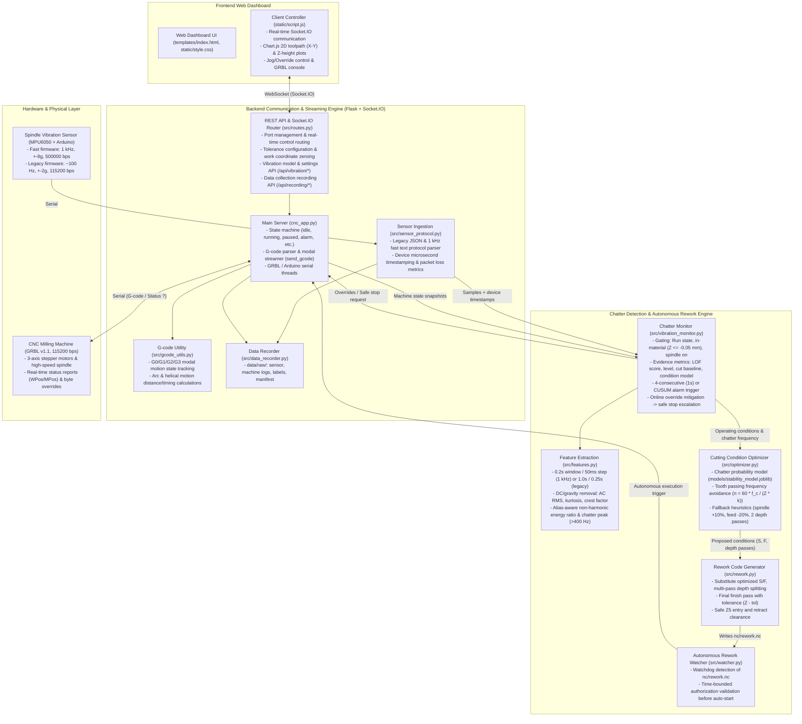
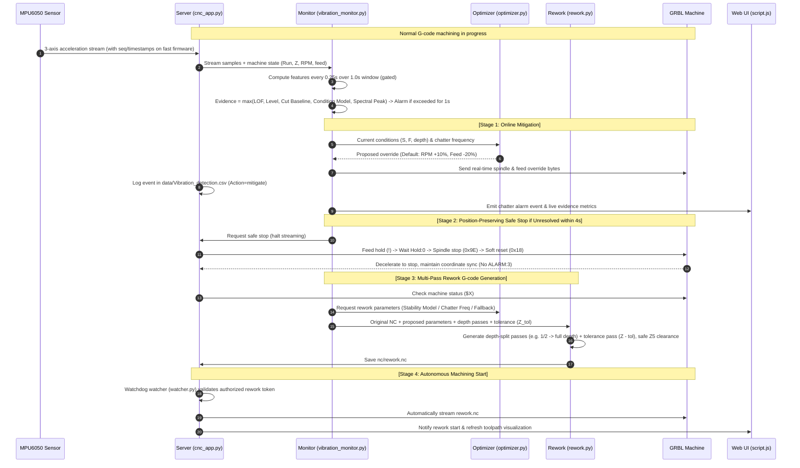
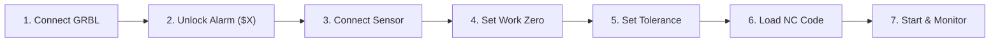

# CNC Milling Machine Real-Time Monitoring & Autonomous Smart Machining System

A smart manufacturing autonomous control system that integrates a GRBL (v1.1) 3-axis CNC milling machine with a spindle-mounted 3-axis accelerometer (MPU6050). It provides real-time toolpath and machine status monitoring and control via a web dashboard, detects **chatter vibrations in real time**, and performs **immediate online override adjustments (speed/feed) → position-preserving deceleration stop on persistent vibration → optimal cutting condition proposal → depth-split rework NC code generation → autonomous rework execution**. Experiment NC generation, sensor/machine data recording, dataset building, model training, and evaluation toolchains are fully integrated.

> For algorithmic analysis and design rationales, see [`edit_analysis.md`](edit_analysis.md). For proposal analysis and the P01–P13 phased restructuring roadmap, see [`edit_analysis2.md`](edit_analysis2.md). For historical code modifications, see [`edit_log.md`](edit_log.md).

---

## 1. System Architecture & Workflows

### 1.1 Overall System Architecture
The system consists of four layers: Frontend Web Dashboard, Backend Communication & Streaming Server (Flask + Socket.IO), AI Chatter Detection & Autonomous Control Engine, and Hardware (GRBL Controller + Arduino Sensor).



---

### 1.2 Chatter Detection & Autonomous Rework Sequence

The autonomous closed-loop control from chatter detection to self-healing rework is executed as follows:



---

## 2. Project Directory Structure

The project root ([`ProjectLab_System/`](file:///d:/Project_Lab/02_공모전_및_경진대회/ProjectLab%202026/ProjectLab_System)) is structured into modular packages:

```text
ProjectLab_System/
├── cnc_app.py                  # [Core Server] Flask, Socket.IO, GRBL & Arduino serial streamer
├── requirements.txt            # [Dependencies] Validated pinned Python packages (Python 3.12 - 3.14)
├── setup.bat / setup.sh        # [Setup] Virtual environment (.venv) creation + install + environment verification
├── run.bat / run.sh            # [Launcher] Run server with .venv Python executable
├── README.md                   # [Documentation] Comprehensive system guide and technical manual
├── edit_log.md                 # [Documentation] Historical change log (newest on top)
├── edit_analysis.md            # [Documentation] Detection & optimization redesign analysis (2026-10-31)
├── edit_analysis2.md           # [Documentation] cnc_edit_guide1031.md review and P01-P13 roadmap
├── cnc_edit_guide1031.md       # [Proposal] Engineering guidelines and recommendations
├── .gitignore                  # [Git] Version control exclusions (.venv, data/raw, logs, etc.)
├── .gitattributes              # [Git] End-of-line normalization (CRLF for .bat, LF for .sh)
├── .venv/                      # (Ignored) Local isolated virtual environment
│
├── src/                        # [Backend Core Modules]
│   ├── routes.py               # REST API endpoints and Socket.IO bidirectional event handlers
│   ├── features.py             # Feature computation (window by sensor rate, DC removal, AC RMS, kurtosis, spectral)
│   ├── vibration_monitor.py    # Chatter monitor (gating, multi-evidence scoring, online mitigation, safe stop)
│   ├── optimizer.py            # Cutting condition proposal (stability model -> chatter frequency -> fallback)
│   ├── rework.py               # Rework G-code generator (depth-split passes + tolerance finish, safe Z5 height)
│   ├── sensor_protocol.py      # Sensor format parser (legacy JSON & fast text, device timestamp tracking)
│   ├── data_recorder.py        # Data collection recorder (data/raw/ sensor, machine logs, and manifest)
│   ├── watcher.py              # In-process Watchdog file observer for nc/rework.nc
│   ├── gcode_utils.py          # Modal G-code parser (G0/G1/G2/G3, planes, arc/helical length calculation)
│   └── arduino_sensor.py       # Standalone sensor reader and synthetic simulator utility
│
├── models/                     # [Trained ML Models]
│   ├── stability_model.joblib  # (Generated by train_models.py) Speed/feed/depth -> chatter probability
│   ├── condition_model.joblib  # (Generated by train_models.py) Speed/feed/depth -> expected stable vibration
│   └── legacy/                 # Obsolete models (incompatible units, preserved for reference)
│
├── data/                       # [Runtime Data & Datasets]
│   ├── current_position.txt    # Records machine coordinate (MPos Z) at machining start
│   ├── Vibration_detection.csv # Event log recorded upon chatter detection (mitigate / stop)
│   ├── 학습 데이터/            # Sensor CSV datasets (19 normal cutting files; '이상' file excluded)
│   ├── raw/                    # (Ignored) Experiment runs: <run_id>_sensor.csv, <run_id>_machine.csv, manifest.csv
│   ├── dataset/                # (Ignored) Processed window features and labels for training
│   ├── synthetic/              # (Ignored) Benchmark synthetic runs generated by make_synthetic_runs.py
│   └── detector_settings.json  # (Ignored) Persisted runtime detector settings (online mitigation, CUSUM)
│
├── nc/                         # [NC G-code Files]
│   ├── O0527.txt               # Linear and modal cutting test program
│   ├── O0807.txt               # 2.5D contouring test program
│   ├── O1001.nc                # CAM-generated complex 3D helical/pocket program
│   ├── experiments/            # Experiment NC programs and plan.csv (generated by make_experiment_nc.py)
│   └── rework.nc               # System-generated autonomous rework code
│
├── arduino/                    # [Sensor Firmware]
│   ├── MPU6050_fast/           # Fast firmware (1 kHz, +-8g, 184 Hz LPF, 500000 bps, recommended)
│   │   └── MPU6050_fast.ino
│   ├── MPU6050/                # Legacy firmware (~100 Hz, +-2g, 115200 bps)
│   │   └── MPU6050.ino
│   ├── MPU6050_standalone/     # Standalone firmware replica
│   │   └── MPU6050.ino
│   └── arduino_example/        # Analog sensor (ADXL335 + LM35) example sketch
│       └── sensor_example.ino
│
├── templates/                  # [Web UI]
│   └── index.html              # Dark-themed responsive dashboard for CNC monitoring and control
│
├── static/                     # [Static Web Assets]
│   ├── script.js               # Socket.IO client, Chart.js 2D/Z visualization, and control logic
│   ├── style.css               # Control center dark UI layout and animations
│   ├── vendor/                 # Local vendor libraries for offline operation (chart.js, socket.io)
│   ├── favicon.ico             # Web icon
│   └── alert.txt               # Audio asset notice
│
├── scripts/                    # [Automation & Utility Scripts]
│   ├── setup_env.py            # Automated venv creation, package installation, and verification
│   ├── check_env.py            # Runtime environment health check (Python, dependencies, models, assets)
│   ├── make_experiment_nc.py   # Experiment NC generator (ramp cut, grid combinations, air cut)
│   ├── build_dataset.py        # Dataset builder: data/raw -> data/dataset window features and labels
│   ├── train_models.py         # Model training: stability classification & condition regression with CV
│   ├── evaluate_detector.py    # Detector evaluation: detection rate, latency from label start, false alarms
│   ├── make_synthetic_runs.py  # Synthetic benchmark run generator with ground truth labels
│   └── test_arduino_sensor.py  # Serial sensor module test utility
│
├── tests/                      # [Automated Test Suite]
│   ├── run_tests.py            # Unified test runner (unit, ui, e2e, bench)
│   ├── unit_checks.py          # Unit & integration tests for features, protocol, optimizer, and detector
│   ├── e2e_checks.py           # End-to-end workflow verification with GRBL simulator
│   ├── grbl_sim.py             # Lightweight serial GRBL 1.1 simulator
│   ├── ui_*_checks.js          # Headless UI logic tests (Node.js)
│   ├── bench_checks.py         # Benchmark suite comparing against fixed v1.1 baselines
│   └── baseline/               # Fixed performance baseline JSON files
│
├── docs/                       # [Technical Documentation]
│   └── README_ARDUINO.md       # Arduino wiring schematics, library installation, and sensor manual
│
├── analysis/                   # [Technical Reports]
│   ├── analyze.md              # Complete codebase analysis and defect identification
│   ├── analyze2.md             # Empirical defect analysis from physical CNC machine runs
│   └── full.md                 # System functionality and specification report
│
└── logs/                       # [Runtime Logs]
    ├── .gitkeep
    └── cnc_log_*.csv           # Execution logs with actual WPos coordinates, states, and timestamps
```

---

## 3. Core Capabilities & Technical Details

### 3.1 Real-Time Machining Path & Machine Monitoring
- **Actual Work Coordinate (WPos) Tracking**: Rather than plotting theoretical G-code commands, the dashboard parses real-time machine coordinates (`WPos`) returned by GRBL `?` queries. It plots the 2D toolpath (X-Y) and Z-axis depth profile in real time using Chart.js.
- **Delta Transmission Optimization**: To prevent browser memory exhaustion and UI lag during long machining jobs, only newly recorded coordinate deltas are sent over WebSockets (`ui_sent_len` tracking).
- **Real-Time Overrides & Jogging**: Operators can dynamically adjust spindle speed (+-10%, +-1%, reset to 100%) and feed rate via GRBL 1.1 real-time bytes during execution. Jog movements and work origin zeroing (`G10 L20 P1`) are supported when idle.

### 3.2 Modal G-code Parser ([`src/gcode_utils.py`](src/gcode_utils.py))
- Fully preserves modal states for motion codes (`G0`, `G1`, `G2`, `G3`), distance modes (`G90`/`G91`), active planes (`G17`/`G18`/`G19`), feed rate (`F`), and spindle speed (`S`).
- Resolves implicit modal lines (e.g. `X30 F70` without an explicit motion code) using the prior modal command. This accurately models execution duration and prevents planner buffer starvation that could lead to **unexpected mid-cut spindle shutdowns (`M5`) or buffer overrun locks**.
- Accurately computes true 3D toolpath lengths and helical arc distances for arc interpolation (`G2`/`G3`) with center offsets (`I`, `J`, `K`) or radius (`R`).

### 3.3 Real-Time Chatter Detection ([`src/vibration_monitor.py`](src/vibration_monitor.py), [`src/features.py`](src/features.py))
- **Unified Feature Extraction**: Operates on time-based sliding windows chosen from the sensor sampling rate.
  - **Fast sensors (≥ 400 Hz, 1 kHz firmware):** 0.2-second windows evaluated every 50 ms, plus the energy of the newest non-overlapping 50 ms block.
  - **Legacy sensors (~100 Hz):** 1.0-second windows evaluated every 0.25 seconds.
  - Detector models are trained per window setting. If the connected sensor has no model of its own setting, the other model is used and the model window says so.
  - Live evaluation uses the same time grid as offline dataset building.
  - Per-window mean removal eliminates DC gravity and sensor mounting orientation biases.
  - Calculates AC RMS, kurtosis, and crest factor per axis without destructive smoothing.
  - For sampling rates $\ge 400\text{ Hz}$ (fast firmware), computes the non-harmonic energy ratio (energy excluding spindle rotational harmonics) and identifies dominant chatter peak candidates ($f_c$).
  - **Alias-aware harmonic masking**: At 1 kHz the tooth-passing frequency (533–800 Hz for 2 flutes at 16,000–24,000 rpm) lies above the 500 Hz Nyquist limit and folds back into the band. Rotational harmonics up to the 8th order are therefore masked at their folded positions $|k f_{rot} - m f_s|$.
  - **Rotation frequency from the spectrum**: The actual rotation frequency is re-estimated within ±5% of the commanded speed. The estimate is the candidate whose 1st–4th harmonics (at their folded positions) jointly carry the most energy, so a single large chatter peak cannot capture it. This also compensates spindle-speed and sampling-rate errors.
  - **Masked-band limit**: If the masks cover more than half of the band, the non-harmonic ratio is not computed.
- **Gating Rules**: Detection is active only when all conditions hold: state is `running`, GRBL status is `Run`, tool is in-material ($Z \le -0.05\text{ mm}$), and spindle is rotating. A 0.75-second transient filter is applied following entry into material or parameter override changes.
- **Multi-Evidence Metric**: The anomaly score is computed as $\max(\text{LOF score}, \text{vibration level}, \text{cut baseline ratio}, \text{condition model z-score}, \text{spectral peak})$.
- **Rolling Baseline**: The cut-baseline ratio uses the larger of two baselines:
  - **Cut-start baseline:** the first 2 seconds of the cut.
  - **Rolling baseline:** the median RMS of normal-looking windows in the 2 seconds before the current window, excluding windows that overlap it.
  - Legitimate load increases (wider engagement) are followed by the rolling part. Returning to normal cutting after a quiet stretch is not mistaken for a jump, because the cut-start part covers it.
  - The rolling part freezes while an alarm is active or once any evidence term reaches the release level (0.8), so slowly growing chatter is not absorbed.
  - It is rebuilt after a speed or feed change, but only when no alarm is active. During online mitigation it is kept, so recovery is judged against the pre-chatter level.
- **Decision Logic**: Triggers when the composite evidence exceeds threshold for 4 consecutive windows (1.0 second), or via cumulative sum (CUSUM) mode. Recovery requires 4 consecutive windows below 0.8.
  - The counts are defined at the 0.25 s step. On the 50 ms grid they are rescaled to keep the same duration: 16 of 16 windows, 2 s baseline.
  - A single impulse spanning a few overlapping 0.2 s windows therefore cannot trigger an alarm.

### 3.4 Chatter Mitigation & Cutting Condition Proposal ([`src/optimizer.py`](src/optimizer.py))
- **Stage 1 Online Mitigation**: Upon chatter confirmation, real-time GRBL override commands immediately adjust spindle speed and feed rate (default: RPM +10%, Feed -20%). If vibration subsides within 4.0 seconds, machining proceeds. Limited to once per cutting pass.
- **Condition Proposal Hierarchy**:
  1. **Stability Model** (`models/stability_model.joblib`): Predicts operating conditions where chatter probability is $< 5\%$, maximizing Material Removal Rate without increasing chip load.
  2. **Chatter Frequency Avoidance**: Computes tooth passing frequency synchronization:
     $$n = \frac{60 \cdot f_c}{Z \cdot k}$$
     selecting the closest attainable spindle speed without exceeding feed-per-tooth limits.
     - Used only when the sensor sampling rate exceeds twice the tooth-passing frequency.
     - With the 1 kHz sensor the measured chatter peak can be an alias of a higher frequency, so this rule is skipped and the reason is logged.
  3. **Fallback Heuristics**: Preserves spindle speed, decreases feed rate by 20%, and splits cutting depth into 2 passes.

### 3.5 Safe Rework G-code Auto-Generation ([`src/rework.py`](src/rework.py))
- **Depth-Split Passes**: Because chatter is highly sensitive to axial depth of cut, the original depth is partitioned into incremental passes (default: 1/2 depth $\rightarrow$ full depth) with optimized $S$ and $F$.
- **Tolerance Finishing Pass**: Absolute Z levels in the final pass are offset deeper by the user-specified tolerance ($Z - \text{tolerance}$, 0.0 to 1.0 mm) to completely clean up chatter marks.
- **Z5 Safety Clearance**: Every rework pass ascends to safe clearance height ($Z+5.0\text{ mm}$) before rapid traversing (`G0`) to initial X-Y coordinates, preventing tool collisions with workpiece walls or clamps.

---

## 4. Installation & Environment Setup

### 4.1 System Requirements
- **OS**: Windows 10 / 11 (64-bit), Linux, or macOS.
- **Python**: 64-bit Python 3.12 – 3.14 (3.13 or 3.14 recommended).
- **Hardware**:
  - GRBL v1.1 compatible CNC milling machine controller.
  - Arduino board (Uno, Nano, Mega) + MPU6050 accelerometer securely mounted to the spindle housing.
  - 2x USB serial cables (1 for CNC, 1 for Arduino).

### 4.2 Automated Setup

The automated installer detects supported Python versions, creates `.venv`, installs pinned dependencies, and verifies the environment.

```bash
# Windows (Double-click or run in PowerShell/CMD)
setup.bat

# Linux / macOS
bash setup.sh
```

- Verifies packages, checks for trained models, and verifies offline web assets via [`scripts/check_env.py`](scripts/check_env.py).
- Supported flags: `--recreate` (rebuild venv from scratch), `--download-wheels` (download wheels for offline installation), `--no-pause` (do not wait for keypress on completion).

> [!NOTE]
> **Porting between PCs**: Virtual environments contain host-specific hardcoded paths. Do not copy `.venv` directly. Run `setup.bat` on the destination machine. For offline systems, run `setup.bat --download-wheels` on an online machine and copy the generated `wheels/` directory along with the project.

<details>
<summary>Manual Installation Instructions</summary>

```bash
# Create virtual environment with 64-bit Python 3.12 - 3.14
py -3.13 -m venv .venv          # Linux / macOS: python3.13 -m venv .venv

# Upgrade pip and install pinned dependencies
.venv\Scripts\python.exe -m pip install --upgrade pip
.venv\Scripts\python.exe -m pip install -r requirements.txt

# Run environment verification
.venv\Scripts\python.exe scripts\check_env.py
```
</details>

### 4.3 Sensor Firmware & Wiring

For detailed schematics and setup instructions, refer to [`docs/README_ARDUINO.md`](docs/README_ARDUINO.md).

1. **Hardware Wiring (I2C)**:
   - `VCC` $\rightarrow$ Arduino 5V (or 3.3V depending on module regulator)
   - `GND` $\rightarrow$ Arduino GND
   - `SDA` $\rightarrow$ Uno/Nano `A4` (Mega `Pin 20`)
   - `SCL` $\rightarrow$ Uno/Nano `A5` (Mega `Pin 21`)
2. **Arduino IDE Libraries**:
   - `MPU6050` (Electronic Cats / I2Cdevlib)
   - `ArduinoJson` (v6.x, legacy firmware only)
3. **Firmware Upload**:
   - **Recommended (High-Speed)**: [`arduino/MPU6050_fast/MPU6050_fast.ino`](arduino/MPU6050_fast/MPU6050_fast.ino) (1 kHz, $\pm 8\text{g}$, 184 Hz LPF, 500,000 bps).
   - **Legacy**: [`arduino/MPU6050/MPU6050.ino`](arduino/MPU6050/MPU6050.ino) (~100 Hz, $\pm 2\text{g}$, 115,200 bps).

---

## 5. Operation & User Guide

### 5.1 Starting the System

```bash
# Windows
run.bat

# Linux / macOS
bash run.sh

# Direct execution via virtual environment
.venv\Scripts\python.exe cnc_app.py
```

Access the web interface at:
👉 **`http://localhost:5000`**

*(Note: File monitoring for `rework.nc` runs inside the server process; `watcher.py` does not need to be started separately.)*

---

### 5.2 Step-by-Step Machining Workflow



1. **Connect GRBL Controller**:
   - Under "Port Control" in the upper-left, select the CNC COM port and click `Connect`.
   - If the machine reports `Alarm` state, click `Unlock Alarm` (`$X`) to transition to `Idle`.
2. **Connect Vibration Sensor**:
   - Under "Sensor Data", select the Arduino COM port, choose the baud rate (`500000` for fast firmware, `115200` for legacy), and click `Connect`.
   - Verify that incoming `ACC(X, Y, Z)` stream is updating.
3. **Set Work Coordinates (Zeroing)**:
   - Use Jog buttons (X+, X-, Y+, Y-, Z+, Z-) to move the tool to the workpiece reference position.
   - Click `Zero XY 0` and `Zero Z 0` (`G10 L20 P1`). Set Z0 at the top surface of the workpiece.
4. **Configure Tolerance**:
   - Enter the depth offset allowance for rework finishing (`0.0` to `1.0` mm) and click `Set`.
5. **Load NC File**:
   - Select the target G-code program ([`nc/O0527.txt`](nc/O0527.txt), etc.) and click `Load NC Code`.
6. **Start Machining**:
   - Click `Start Machining`.
   - Monitor real-time coordinates, 2D/Z trajectories, and the anomaly evidence metric.
7. **Autonomous Recovery Observation**:
   - If chatter persists for 1.0 second, the system first triggers online override mitigation (`Mitigating`).
   - If unresolved within 4.0 seconds, the system executes a position-preserving stop, generates depth-split `nc/rework.nc`, and automatically commences autonomous rework.

---

### 5.3 Sensor Data Collection & ML Pipeline

For collecting experimental training data and retraining models (see [`edit_analysis.md`](edit_analysis.md) Section 3):

1. **Preparation**: Flash the fast firmware and connect at 500,000 bps.
2. **Generate Experiment NC**:
   ```bash
   # Ramp cutting test (identify depth-of-cut chatter limits)
   .venv\Scripts\python.exe scripts\make_experiment_nc.py ramp --tool-d 6 --flutes 2 --ramp-max 1.0

   # Grid matrix test based on ramp stability limits
   .venv\Scripts\python.exe scripts\make_experiment_nc.py grid --tool-d 6 --flutes 2 --limits 16000=0.5,18000=0.7 --feeds 50,100,150

   # Spindle air cut test (baseline baseline noise characterization)
   .venv\Scripts\python.exe scripts\make_experiment_nc.py air --tool-d 6 --flutes 2
   ```
3. **Recording**: Open the "Data Collection" modal in the web interface.
   - Click `Start Recording` $\rightarrow$ `Start Machining`. Label segments (`Chatter`, `Transition`, `Air`) during cut $\rightarrow$ `Stop Recording`.
   - Raw records are saved to `data/raw/<run_id>_sensor.csv`, `<run_id>_machine.csv`, and `manifest.csv`.
4. **Dataset Building, Training & Evaluation**:
   ```bash
   # Extract window features and map labels
   .venv\Scripts\python.exe scripts\build_dataset.py

   # Train chatter probability & cutting condition models with run-level CV
   .venv\Scripts\python.exe scripts\train_models.py

   # Evaluate detector benchmark metrics
   .venv\Scripts\python.exe scripts\evaluate_detector.py
   ```

### 5.4 Test Suite & Benchmarks

Run automated verification tests without physical hardware:

```bash
# Unit, UI, and End-to-End tests (~3 min)
.venv\Scripts\python.exe tests\run_tests.py

# Detector benchmarks against synthetic scenarios and legacy baselines
.venv\Scripts\python.exe tests\run_tests.py bench
```

The benchmark evaluates two synthetic sets and the legacy data against the v1.1 baselines in [`tests/baseline/`](tests/baseline/):

- **Default set:** 28 runs, DLPF 184 Hz.
- **Stress set:** the same runs with DLPF 260 Hz and the spindle turning 2% faster than commanded.

---

## 6. Safety Interlocks & Policies

- **Machining Interlocks**: During active machining (`running`) or feed hold (`paused`), hazardous controls (Jog buttons, coordinate zeroing, alarm resets, manual GRBL console inputs, and serial disconnects) are strictly disabled in the UI and backend.
- **Automatic Error Feed Hold**: Receipt of any `error:` response from GRBL immediately issues a feed hold (`!`), transitions to pause, and alerts the operator with the offending G-code line.
- **Tolerance Clamping**: Rework finishing tolerance is strictly clamped to a maximum of `1.0 mm` to eliminate excessive material removal or tool breakage risks.
- **Safe Homing Redirection (G28 / G30)**: Any `G28` or `G30` command in user programs is automatically rewritten to ascend to safe height (`G0 Z5`) prior to horizontal traversal (`G0 X0 Y0`), preventing bed or clamp crashes.
- **Time-Bounded Rework Authorization**: The in-process file watcher executes `nc/rework.nc` only when generated through the internal `arm_rework()` recovery pipeline within a 30-second authorization window. Manual text edits or external file writes are safely ignored.
- **Position-Preserving Deceleration Stop**: Machine stoppage during chatter follows a controlled deceleration sequence: `Feed Hold (!) -> Verify Hold:0 -> Spindle Stop (0x9E) -> Soft Reset (0x18)`. This avoids immediate open-loop motor cutoffs that cause lost stepper steps and maintain coordinate alignment.

---

## 7. Version History & Changelog

### 📌 v1.1.2 (2026-10-31) — Alias-Aware Spectrum (P03), Per-Sensor Windows (P04) & Rolling Baseline (P05)

- **Rolling Baseline ([`src/vibration_monitor.py`](src/vibration_monitor.py), P05)**:
  - The cut-baseline ratio now utilizes $\max(\text{cut-start baseline}, \text{rolling 2s baseline})$ over normal, non-overlapping windows.
  - Automatically freezes during active alarms and whenever any evidence metric reaches 0.8.
  - Rebuilt upon in-cut speed/feed changes only when no alarm is active, ensuring online mitigation is evaluated against the pre-chatter baseline.
  - Legacy-data normal false alarms dropped from 1 (v1.1) to 0, while abnormal file alarms remain stable at 3.
- **Per-Sensor Window Profiles & Real-Time Grid ([`src/features.py`](src/features.py), [`src/vibration_monitor.py`](src/vibration_monitor.py), P04)**:
  - High-speed sensors ($\ge 400\text{ Hz}$) adopt the `fast` profile (0.2s window, 50ms step, plus newest 50ms block energy), reducing abrupt chatter latency from 1.25s to 0.90s.
  - Legacy sensors preserve the 1.0s window / 0.25s step `legacy` profile.
  - Separate models trained and selected dynamically by sampling rate; decision counts rescaled to maintain equivalent time windows on the 50ms grid.
  - Per-window evaluation overhead benchmarked at 1.45ms (well within the 50ms real-time budget).
- **Alias-Aware Spectral Features & Spindle Tracking ([`src/features.py`](src/features.py), [`src/optimizer.py`](src/optimizer.py), P03)**:
  - Spindle harmonics up to the 8th order are masked where they fold under 1 kHz aliasing.
  - Spectral rotation frequency estimation (`estimate_rotation_hz`) corrects for spindle tachometer offsets and sampling jitter.
  - Guarded chatter-frequency optimization to execute only when sampling rate exceeds twice the tooth passing frequency.
  - Benchmark stress set ([`tests/bench_checks.py`](tests/bench_checks.py), `make_synthetic_runs.py --rpm-error`) added with fixed baseline ([`tests/baseline/v1.1_stress.json`](tests/baseline/v1.1_stress.json)).
- **Test Suite Expansion**:
  - Unit test suite expanded from 75 to 100 passing tests ([`tests/unit_checks.py`](tests/unit_checks.py)).

### 📌 v1.1.1 (2026-10-31) — Automated Test Suite & Evaluation Foundation (P01)
- **Repository Test Suite Integration ([`tests/`](tests/))**: Comprehensive unit/integration tests ([`unit_checks.py`](tests/unit_checks.py), 75/75 passing), E2E test with simulated serial GRBL ([`e2e_checks.py`](tests/e2e_checks.py), [`grbl_sim.py`](tests/grbl_sim.py)), and headless UI logic tests ([`ui_events_checks.js`](tests/ui_events_checks.js)).
- **Synthetic Run Generator ([`scripts/make_synthetic_runs.py`](scripts/make_synthetic_runs.py))**: Generates ground-truth labeled benchmark runs across 5 scenarios (stable cut, fast chatter, gradual chatter, impulse noise, tool entry).
- **Exact-Label Benchmark Infrastructure ([`scripts/build_dataset.py`](scripts/build_dataset.py), [`scripts/evaluate_detector.py`](scripts/evaluate_detector.py))**: Generates `labels.csv` with exact timing, evaluates detection latency from onset, and outputs side-by-side `--compare` regressions against fixed v1.1 baselines.
- **Proposal Review & Roadmap ([`edit_analysis2.md`](edit_analysis2.md))**: Technical analysis of `cnc_edit_guide1031.md` and establishment of the 13-step phased modernization roadmap.

### 📌 v1.1 (2026-10-31) — Redesigned Chatter Detection, Online Control & Fast Sensor Pipeline
- **Chatter Detection & Feature Modernization ([`src/features.py`](src/features.py), [`src/vibration_monitor.py`](src/vibration_monitor.py))**: Time-based 1s sliding window, DC/gravity removal, AC RMS, kurtosis, crest factor, and non-harmonic spectral peak evaluation. Eliminates distortive smoothing filters.
- **Two-Stage Autonomous Mitigation**: Stage 1 online override adjustment (spindle +10%, feed -20%); Stage 2 position-preserving deceleration stop (`Hold:0` verification) followed by multi-pass depth-split rework.
- **Physical Cutting Condition Optimizer ([`src/optimizer.py`](src/optimizer.py))**: Gaussian Process / Logistic chatter probability modeling, tooth passing harmonic avoidance, and conservative fallback heuristics.
- **1 kHz Fast Sensor Firmware & Protocol ([`arduino/MPU6050_fast/`](arduino/MPU6050_fast/), [`src/sensor_protocol.py`](src/sensor_protocol.py))**: 1 kHz sampling, $\pm 8\text{g}$, 184 Hz hardware LPF, burst FIFO reading, 500,000 bps serial, and microsecond device timestamp tracking.
- **End-to-End Data Collection & Experiment Toolchain**: Specialized data recorder, experiment NC generator, dataset builder, and model training utilities.
- **Offline Environment Readiness**: Pinned dependency bundle (`wheels/`) and local static vendor assets (`static/vendor/`) for fully air-gapped workshop computers.

### 📌 v1.0.1 (2026-10-31) — Modal G-code Architecture & Machine Safety Stabilization
- **Modal G-code Parser ([`src/gcode_utils.py`](src/gcode_utils.py))**: Resolves implicit modal coordinate blocks and accurately computes arc/helical path travel times, eliminating buffer starvation and unexpected mid-cut spindle shutoffs (`M5`).
- **Architecture Modularization**: Reorganized into clean modular packages (`src/`, `models/`, `data/`, `nc/`, `arduino/`, `docs/`, `scripts/`, `analysis/`) and eliminated host-specific hardcoded paths.
- **Integrated Rework Watchdog**: Embedded file observer directly inside the server process with tokenized 1-shot authorization.
- **Serial Streaming Reliability**: Fixed timeout retransmission bugs and isolated state query commands (`?`).

---

## 8. License & Project Information
- **Project**: ProjectLab 2026 - Real-Time CNC Smart Machining Autonomous Control System
- **Affiliation**: Kyungnam University Industry-Academic Cooperation Foundation / Project LAB
- **Patent Reference**: Real-Time Anomaly Detection and Autonomous Control System Based on Vibration Data Learning for CNC Machining Processes
