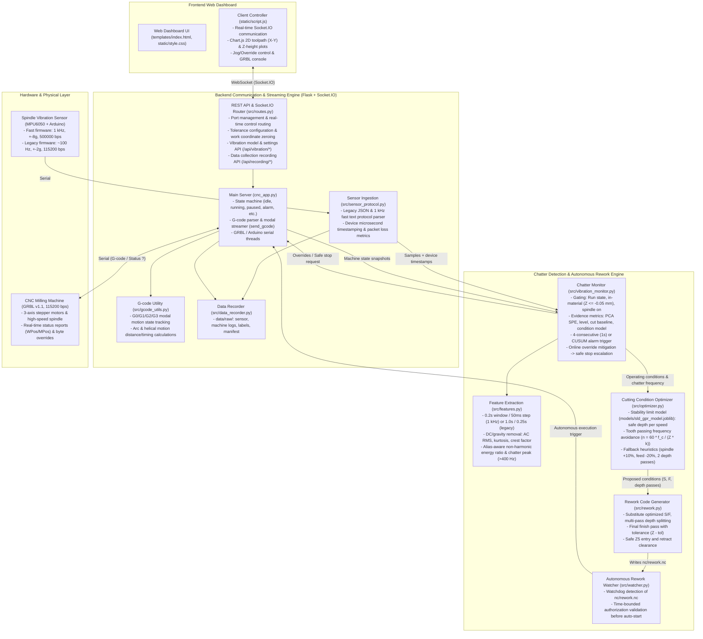
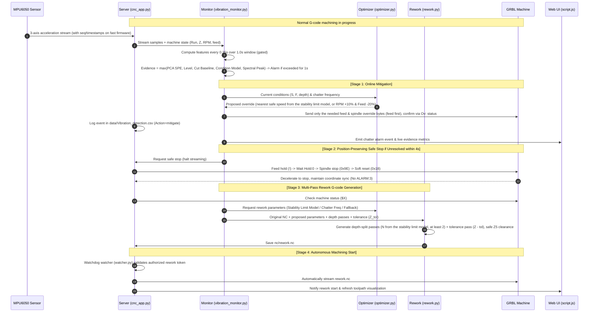
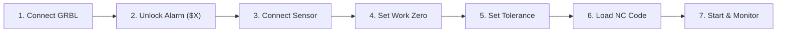

# CNC Milling Machine Real-Time Monitoring & Autonomous Smart Machining System

A smart manufacturing autonomous control system that integrates a GRBL (v1.1) 3-axis CNC milling machine with a spindle-mounted 3-axis accelerometer (MPU6050). It provides real-time toolpath and machine status monitoring and control via a web dashboard, detects **chatter vibrations in real time**, and performs **immediate online override adjustments (speed/feed) → position-preserving deceleration stop on persistent vibration → optimal cutting condition proposal → depth-split rework NC code generation → autonomous rework execution**. Experiment NC generation, sensor/machine data recording, dataset building, model training, and evaluation toolchains are fully integrated.

> For algorithmic analysis and design rationales, see [`edit_analysis.md`](edit_analysis.md). For proposal analysis and the P01–P13 phased restructuring roadmap, see [`edit_analysis2.md`](edit_analysis2.md). For historical code modifications, see [`edit_log.md`](edit_log.md).

---

## 1. System Architecture & Workflows

### 1.1 Overall System Architecture
The system consists of four layers: Frontend Web Dashboard, Backend Communication & Streaming Server (Flask + Socket.IO), AI Chatter Detection & Autonomous Control Engine, and Hardware (GRBL Controller + Arduino Sensor).



---

### 1.2 Chatter Detection & Autonomous Rework Sequence

The autonomous closed-loop control from chatter detection to self-healing rework is executed as follows:



---

## 2. Project Directory Structure

The project root ([`ProjectLab_System/`](file:///d:/Project_Lab/02_공모전_및_경진대회/ProjectLab%202026/ProjectLab_System)) is structured into modular packages:

```text
ProjectLab_System/
├── cnc_app.py                  # [Core Server] Flask, Socket.IO, GRBL & Arduino serial streamer
├── requirements.txt            # [Dependencies] Validated pinned Python packages (Python 3.12 - 3.14)
├── setup.bat / setup.sh        # [Setup] Virtual environment (.venv) creation + install + environment verification
├── run.bat / run.sh            # [Launcher] Run server with .venv Python executable
├── README.md                   # [Documentation] Comprehensive system guide and technical manual
├── edit_log.md                 # [Documentation] Historical change log (newest on top)
├── edit_analysis.md            # [Documentation] Detection & optimization redesign analysis (2026-10-31)
├── edit_analysis2.md           # [Documentation] cnc_edit_guide1031.md review and P01-P13 roadmap
├── cnc_edit_guide1031.md       # [Proposal] Engineering guidelines and recommendations
├── .gitignore                  # [Git] Version control exclusions (.venv, data/raw, logs, etc.)
├── .gitattributes              # [Git] End-of-line normalization (CRLF for .bat, LF for .sh)
├── .venv/                      # (Ignored) Local isolated virtual environment
│
├── src/                        # [Backend Core Modules]
│   ├── routes.py               # REST API endpoints and Socket.IO bidirectional event handlers
│   ├── features.py             # Feature computation (window by sensor rate, DC removal, AC RMS, kurtosis, spectral)
│   ├── vibration_monitor.py    # Chatter monitor (gating, multi-evidence scoring, online mitigation, safe stop)
│   ├── optimizer.py            # Cutting condition proposal (stability limit model -> chatter frequency -> fallback)
│   ├── rework.py               # Rework G-code generator (depth-split passes + tolerance finish, safe Z5 height)
│   ├── sensor_protocol.py      # Sensor format parser (legacy JSON & fast text, device timestamp tracking)
│   ├── data_recorder.py        # Data collection recorder (data/raw/ sensor, machine logs, and manifest)
│   ├── watcher.py              # In-process Watchdog file observer for nc/rework.nc
│   ├── gcode_utils.py          # Modal G-code parser (G0/G1/G2/G3, planes, arc/helical length calculation)
│   └── arduino_sensor.py       # Standalone sensor reader and synthetic simulator utility
│
├── models/                     # [Trained ML Models]
│   ├── detector_model.joblib   # (Generated by train_models.py) PCA-SPE detector per window setting, trained from the dataset
│   ├── condition_model.joblib  # (Generated by train_models.py) Speed, depth, chip area -> upper bound of stable vibration
│   ├── sld_gpr_model.joblib    # (Generated by train_models.py) Ramp tests -> stability limit depth vs tooth period (used by the optimizer)
│   └── legacy/                 # Obsolete models kept for reference; train_models.py moves retired formats here
│
├── data/                       # [Runtime Data & Datasets]
│   ├── current_position.txt    # Records machine coordinate (MPos Z) at machining start
│   ├── Vibration_detection.csv # Event log recorded upon chatter detection (Cause: largest evidence term, Trip: k_of_n / cusum / fast, Action: mitigate / stop / shadow)
│   ├── 학습 데이터/            # Sensor CSV datasets (19 normal cutting files; '이상' file excluded)
│   ├── raw/                    # (Ignored) Experiment runs: <run_id>_sensor.csv, <run_id>_machine.csv, manifest.csv
│   ├── dataset/                # (Ignored) Processed window features and labels for training
│   ├── synthetic/              # (Ignored) Benchmark synthetic runs generated by make_synthetic_runs.py
│   └── detector_settings.json  # (Ignored) Persisted runtime detector settings (online mitigation, decision mode, record-only two-tier, T² alarm)
│
├── nc/                         # [NC G-code Files]
│   ├── O0527.txt               # Linear and modal cutting test program
│   ├── O0807.txt               # 2.5D contouring test program
│   ├── O1001.nc                # CAM-generated complex 3D helical/pocket program
│   ├── experiments/            # Experiment NC programs and plan.csv (generated by make_experiment_nc.py)
│   └── rework.nc               # System-generated autonomous rework code
│
├── arduino/                    # [Sensor Firmware]
│   ├── MPU6050_fast/           # Fast firmware (1 kHz, +-8g, 184 Hz LPF, 500000 bps, recommended)
│   │   └── MPU6050_fast.ino
│   ├── MPU6050/                # Legacy firmware (~100 Hz, +-2g, 115200 bps)
│   │   └── MPU6050.ino
│   ├── MPU6050_standalone/     # Standalone firmware replica
│   │   └── MPU6050.ino
│   └── arduino_example/        # Analog sensor (ADXL335 + LM35) example sketch
│       └── sensor_example.ino
│
├── templates/                  # [Web UI]
│   └── index.html              # Dark-themed responsive dashboard for CNC monitoring and control
│
├── static/                     # [Static Web Assets]
│   ├── script.js               # Socket.IO client, Chart.js 2D/Z visualization, and control logic
│   ├── style.css               # Control center dark UI layout and animations
│   ├── vendor/                 # Local vendor libraries for offline operation (chart.js, socket.io)
│   ├── favicon.ico             # Web icon
│   └── alert.txt               # Audio asset notice
│
├── scripts/                    # [Automation & Utility Scripts]
│   ├── setup_env.py            # Automated venv creation, package installation, and verification
│   ├── check_env.py            # Runtime environment health check (Python, dependencies, models, assets)
│   ├── make_experiment_nc.py   # Experiment NC generator (ramp cut, grid combinations, air cut)
│   ├── build_dataset.py        # Dataset builder: data/raw -> data/dataset window features and labels
│   ├── train_models.py         # Model training: PCA-SPE detector, monotone condition model & ramp stability limit (SLD) with run-level CV
│   ├── evaluate_detector.py    # Detector evaluation: detection rate, latency from label start, false alarms
│   ├── make_synthetic_runs.py  # Synthetic benchmark runs with ground truth labels; --grid for condition-model grid tests
│   └── test_arduino_sensor.py  # Serial sensor module test utility
│
├── tests/                      # [Automated Test Suite]
│   ├── run_tests.py            # Unified test runner (unit, ui, e2e, bench)
│   ├── unit_checks.py          # Unit & integration tests for features, protocol, optimizer, and detector
│   ├── e2e_checks.py           # End-to-end workflow verification with GRBL simulator
│   ├── grbl_sim.py             # Lightweight serial GRBL 1.1 simulator
│   ├── ui_*_checks.js          # Headless UI logic tests (Node.js)
│   ├── bench_checks.py         # Benchmark suite comparing against fixed v1.1 baselines
│   └── baseline/               # Fixed performance baseline JSON files
│
├── docs/                       # [Technical Documentation]
│   └── README_ARDUINO.md       # Arduino wiring schematics, library installation, and sensor manual
│
├── analysis/                   # [Technical Reports]
│   ├── analyze.md              # Complete codebase analysis and defect identification
│   ├── analyze2.md             # Empirical defect analysis from physical CNC machine runs
│   └── full.md                 # System functionality and specification report
│
└── logs/                       # [Runtime Logs]
    ├── .gitkeep
    └── cnc_log_*.csv           # Execution logs with actual WPos coordinates, states, and timestamps
```

---

## 3. Core Capabilities & Technical Details

### 3.1 Real-Time Machining Path & Machine Monitoring
- **Actual Work Coordinate (WPos) Tracking**: Rather than plotting theoretical G-code commands, the dashboard parses real-time machine coordinates (`WPos`) returned by GRBL `?` queries. It plots the 2D toolpath (X-Y) and Z-axis depth profile in real time using Chart.js.
- **Delta Transmission Optimization**: To prevent browser memory exhaustion and UI lag during long machining jobs, only newly recorded coordinate deltas are sent over WebSockets (`ui_sent_len` tracking).
- **Real-Time Overrides & Jogging**: Operators can dynamically adjust spindle speed (+-10%, +-1%, reset to 100%) and feed rate via GRBL 1.1 real-time bytes during execution. Jog movements and work origin zeroing (`G10 L20 P1`) are supported when idle.

### 3.2 Modal G-code Parser ([`src/gcode_utils.py`](src/gcode_utils.py))
- Fully preserves modal states for motion codes (`G0`, `G1`, `G2`, `G3`), distance modes (`G90`/`G91`), active planes (`G17`/`G18`/`G19`), feed rate (`F`), and spindle speed (`S`).
- Resolves implicit modal lines (e.g. `X30 F70` without an explicit motion code) using the prior modal command. This accurately models execution duration and prevents planner buffer starvation that could lead to **unexpected mid-cut spindle shutdowns (`M5`) or buffer overrun locks**.
- Accurately computes true 3D toolpath lengths and helical arc distances for arc interpolation (`G2`/`G3`) with center offsets (`I`, `J`, `K`) or radius (`R`).

### 3.3 Real-Time Chatter Detection ([`src/vibration_monitor.py`](src/vibration_monitor.py), [`src/features.py`](src/features.py))
- **Unified Feature Extraction**: Operates on time-based sliding windows chosen from the sensor sampling rate.
  - **Fast sensors (≥ 400 Hz, 1 kHz firmware):** 0.2-second windows evaluated every 50 ms, plus the energy of the newest non-overlapping 50 ms block.
  - **Legacy sensors (~100 Hz):** 1.0-second windows evaluated every 0.25 seconds.
  - Detector models are trained per window setting. If the connected sensor has no model of its own setting, the other model is used and the model window says so.
  - Live evaluation uses the same time grid as offline dataset building.
  - Per-window mean removal eliminates DC gravity and sensor mounting orientation biases.
  - Calculates AC RMS, kurtosis, and crest factor per axis without destructive smoothing.
  - For sampling rates $\ge 400\text{ Hz}$ (fast firmware), computes the non-harmonic energy ratio (energy excluding spindle rotational harmonics) and identifies dominant chatter peak candidates ($f_c$).
  - **Alias-aware harmonic masking**: At 1 kHz the tooth-passing frequency (533–800 Hz for 2 flutes at 16,000–24,000 rpm) lies above the 500 Hz Nyquist limit and folds back into the band. Rotational harmonics up to the 8th order are therefore masked at their folded positions $|k f_{rot} - m f_s|$.
  - **Rotation frequency from the spectrum**: The actual rotation frequency is re-estimated within ±5% of the commanded speed. The estimate is the candidate whose 1st–4th harmonics (at their folded positions) jointly carry the most energy, so a single large chatter peak cannot capture it. This also compensates spindle-speed and sampling-rate errors.
  - **Masked-band limit**: If the masks cover more than half of the band, the non-harmonic ratio is not computed.
- **Gating Rules**: Detection is active only when all conditions hold: state is `running`, GRBL status is `Run`, tool is in-material ($Z \le -0.05\text{ mm}$), and spindle is rotating. A 0.75-second transient filter is applied following entry into material or parameter override changes.
- **Multi-Evidence Metric**: The anomaly score is computed as $\max(\text{PCA SPE}, \text{vibration level}, \text{cut baseline ratio}, \text{condition ratio}, \text{spectral peak})$, each divided by its own threshold.
- **Condition Model** (P09, trained by `scripts/train_models.py`):
  - **Physical variables:** feed per tooth $f_z = F/(n Z)$, chip area $A_{chip} = a_p f_z$, and $MRR = a_p a_e F$ ($a_p F$ when $a_e$ is unknown).
  - A monotone gradient-boosted model (squared-error loss) predicts log RMS of stable cutting from spindle speed, depth and chip area. The prediction never decreases with depth or chip area.
  - **Upper bound:** prediction × the 99% quantile of held-out-run residuals. Nested run-level cross-validation reports how often unseen runs stay under it (target ≈ 99%).
  - **Condition ratio** = RMS / upper bound. It is skipped when the flute count is unknown, outside the trained conditions, or when the sensor sampling rate differs from the training data by more than 10%. When it is available, the absolute `level` term is relaxed ×1.5 and acts as a backup.
  - The model belongs to its sensor setup (low-pass filter, mounting, tool, fixture): retrain it from a new grid test after any change.
- **PCA-SPE Detector** (replaces LOF):
  - **Inputs:** per-axis RMS, kurtosis and crest factor (log). Fast sensors add spectral entropy and the non-harmonic ratio when at least 95% of the training windows have them.
  - **Training:** standardize, then PCA keeping 99% of the variance, with at least two residual directions left for SPE.
  - **SPE** (squared prediction error) measures how far a window departs from the learned correlation structure. It is an alarm term.
  - **T²** (Hotelling) measures the distance from the training center within the principal components. It grows with load, so by default it is only shown as "outside the training range"; the `t2_alarm` setting adds it to the alarm terms.
  - Both thresholds are 0.999 quantiles of leave-one-session-out scores. Windows quieter than the lowest 10% of the training data are not scored.
  - The two features contributing most to SPE are written to the alarm log and to the `Cause` column of the detection log (e.g. `spe: kurt_z 46%, rms_z 21%`).
  - **Two training sources (P12):**
    - `scripts/train_models.py` trains one model per window setting from the recorded dataset and saves them to `models/detector_model.joblib`. The dataset carries the spindle speed, so the fast-sensor model includes the non-harmonic ratio.
    - The server uses that model for its window setting and trains the other setting from the CSVs in `data/학습 데이터` at start-up. Uploaded CSVs have no spindle speed.
    - Training windows leave out stable windows within 3 s before a chatter or transition label, because operators label late. `evaluate_detector.py` trains on the same windows.
- **Rolling Baseline**: The cut-baseline ratio uses the larger of two baselines:
  - **Cut-start baseline:** the first 2 seconds of the cut.
  - **Rolling baseline:** the median RMS of normal-looking windows in the 2 seconds before the current window, excluding windows that overlap it.
  - Legitimate load increases (wider engagement) are followed by the rolling part. Returning to normal cutting after a quiet stretch is not mistaken for a jump, because the cut-start part covers it.
  - The rolling part freezes while an alarm is active or once any evidence term reaches the release level (0.8), so slowly growing chatter is not absorbed.
  - It is rebuilt after a speed or feed change, but only when no alarm is active. During online mitigation it is kept, so recovery is judged against the pre-chatter level.
- **Decision Logic** (times are set in seconds and converted to the window step of the active model). Three modes are available:
  - **Consecutive (`k_of_n`, default):** the composite evidence stays ≥ 1 for `confirm_sec` (0.75 s): 4 windows at 0.25 s, 16 at 50 ms. A single impulse spanning a few overlapping 0.2 s windows cannot trigger it.
  - **CUSUM (`cusum`):** the time integral of ln(evidence) exceeds `cusum_threshold` (0.3), so larger anomalies trigger sooner.
  - **Two-tier (`two_tier`, fast sensors):** a Fast-Trip **or** a capped CUSUM.
    - **Fast-Trip:** the newest non-overlapping 50 ms block's RMS stays ≥ 3× the baseline for 3 consecutive blocks (0.15 s). Only vibration energy is used, so a single impact cannot trip it.
    - **Capped CUSUM:** evidence is capped at 2, so one large impulse cannot trip it. Sustained evidence of 2 trips in about 0.45 s, and 1.5 in about 0.74 s.
  - **Recovery:** evidence (and, in two-tier mode, block evidence) must stay below 0.8 for `release_sec` (0.75 s).
- **Record-Only Two-Tier (default on)**: On fast sensors, when the response mode is not `two_tier`, the two-tier rule runs alongside it and only records its alarms (log line `[기록 전용]`, detection record `Action=shadow`). Its result can be compared with the active rule before switching. Both settings are in the model management window.
- **Model Management Window (P12)** shows:
  - each window setting's detector (PCA-SPE) with its source (dataset or training folder), runs and features;
  - the thresholds and the decision rule with its times;
  - the share of recently judged windows outside the training range (T² ≥ threshold, last 60 s of judged windows), with advice to record those conditions when it reaches 10%;
  - the condition model's runs, margin and coverage, and the stability limit model's range.
  - Notes flag settings that cannot work as set: saved values that were ignored, two-tier mode on a 1 s model (no Fast-Trip), or a sensor rate more than 10% away from the model's training data.
- **Settings Validation (P12)**: Every detector setting has a type and an allowed range (`setting_problem`). Saved settings (`data/detector_settings.json`), changes from the screen, `evaluate_detector.py --set` and `scripts/check_env.py` all use the same check. A saved value that fails falls back to its default and is listed.

### 3.4 Chatter Mitigation & Cutting Condition Proposal ([`src/optimizer.py`](src/optimizer.py))
- **Stage 1 Online Mitigation**: Upon chatter confirmation, real-time GRBL override commands immediately adjust spindle speed and feed rate (from the stability limit model when one fits the tool, otherwise RPM +10%, Feed -20%). If vibration subsides within 4.0 seconds, machining proceeds. Limited to once per cutting pass.
  - **Fast override sending (P07):** only the commands needed from the current `Ov:` value are sent, without a reset unless that is shorter. Different commands go out together, feed first; a repeated command waits 15 ms.
  - The `Ov:` field of the next status report confirms the change. If it shows a missing step, only the remainder is resent. The detection → send → confirm times are logged.
- **Condition Proposal Hierarchy**:
  1. **Stability Limit Model** (`models/sld_gpr_model.joblib`, trained from ramp tests, P10/P11): gives a safe depth $a_{p,\text{safe}}(n) = \mu - 1.645\sigma$ for each tested speed (16000–24000 rpm, checked every 250 rpm).
     - Used only when the current tool matches the trained one: same flute count, and same tool number when both are known.
     - **Rework:** each speed needs $N = \lceil a_p / a_{p,\text{safe}} \rceil$ passes (at most 5, at least the detector's `rework_min_passes`, 2 by default). The speed with the shortest rework time ($N$ / feed) wins, then the one nearest the current speed. This is the guide's $\arg\max F/N$ with the feed capped at its current value.
     - **Online:** the depth cannot change mid-cut, so the spindle moves to the nearest speed (not the chattering one) whose safe depth covers the current depth.
     - Feed is never raised. A lower speed lowers the feed by the same ratio, so the feed per tooth does not grow.
     - Speeds with a safe depth below 0.05 mm ("manual check") and untested speeds are skipped. If no speed works, the next method is used and the log says why.
  2. **Chatter Frequency Avoidance**: Computes tooth passing frequency synchronization:
     $$n = \frac{60 \cdot f_c}{Z \cdot k}$$
     selecting the closest attainable spindle speed without exceeding feed-per-tooth limits.
     - Used only when the sensor sampling rate exceeds twice the tooth-passing frequency.
     - With the 1 kHz sensor the measured chatter peak can be an alias of a higher frequency, so this rule is skipped and the reason is logged.
  3. **Fallback Heuristics**: Preserves spindle speed, decreases feed rate by 20%, and splits cutting depth into 2 passes.

### 3.5 Safe Rework G-code Auto-Generation ([`src/rework.py`](src/rework.py))
- **Depth-Split Passes**: Because chatter is highly sensitive to axial depth of cut, the original depth is partitioned into incremental passes with optimized $S$ and $F$: as many as the stability limit model asks for, and at least 2 (1/2 depth $\rightarrow$ full depth).
- **Tolerance Finishing Pass**: Absolute Z levels in the final pass are offset deeper by the user-specified tolerance ($Z - \text{tolerance}$, 0.0 to 1.0 mm) to completely clean up chatter marks.
- **Z5 Safety Clearance**: Every rework pass ascends to safe clearance height ($Z+5.0\text{ mm}$) before rapid traversing (`G0`) to initial X-Y coordinates, preventing tool collisions with workpiece walls or clamps.

---

## 4. Installation & Environment Setup

### 4.1 System Requirements
- **OS**: Windows 10 / 11 (64-bit), Linux, or macOS.
- **Python**: 64-bit Python 3.12 – 3.14 (3.13 or 3.14 recommended).
- **Hardware**:
  - GRBL v1.1 compatible CNC milling machine controller. Online speed changes and the rework `S` word need a spindle whose speed GRBL controls (PWM, `$30` ≥ 24000).
  - Arduino board (Uno, Nano, Mega) or Teensy + MPU6050 accelerometer securely mounted to the spindle housing. No other sensor is needed; see [`docs/README_ARDUINO.md`](docs/README_ARDUINO.md) for what each firmware enables.
  - 2x USB serial cables (1 for CNC, 1 for the sensor board).

### 4.2 Automated Setup

The automated installer detects supported Python versions, creates `.venv`, installs pinned dependencies, and verifies the environment.

```bash
# Windows (Double-click or run in PowerShell/CMD)
setup.bat

# Linux / macOS
bash setup.sh
```

- Verifies packages, checks for trained models, and verifies offline web assets via [`scripts/check_env.py`](scripts/check_env.py).
- Supported flags: `--recreate` (rebuild venv from scratch), `--download-wheels` (download wheels for offline installation), `--no-pause` (do not wait for keypress on completion).

> [!NOTE]
> **Porting between PCs**: Virtual environments contain host-specific hardcoded paths. Do not copy `.venv` directly. Run `setup.bat` on the destination machine. For offline systems, run `setup.bat --download-wheels` on an online machine and copy the generated `wheels/` directory along with the project.

<details>
<summary>Manual Installation Instructions</summary>

```bash
# Create virtual environment with 64-bit Python 3.12 - 3.14
py -3.13 -m venv .venv          # Linux / macOS: python3.13 -m venv .venv

# Upgrade pip and install pinned dependencies
.venv\Scripts\python.exe -m pip install --upgrade pip
.venv\Scripts\python.exe -m pip install -r requirements.txt

# Run environment verification
.venv\Scripts\python.exe scripts\check_env.py
```
</details>

### 4.3 Sensor Firmware & Wiring

For detailed schematics and setup instructions, refer to [`docs/README_ARDUINO.md`](docs/README_ARDUINO.md).

1. **Hardware Wiring (I2C)**:
   - `VCC` $\rightarrow$ Arduino 5V (or 3.3V depending on module regulator)
   - `GND` $\rightarrow$ Arduino GND
   - `SDA` $\rightarrow$ Uno/Nano `A4` (Mega `Pin 20`)
   - `SCL` $\rightarrow$ Uno/Nano `A5` (Mega `Pin 21`)
2. **Arduino IDE Libraries**:
   - `MPU6050` (Electronic Cats / I2Cdevlib)
   - `ArduinoJson` (v6.x, legacy firmware only)
3. **Firmware Upload**:
   - **Recommended (High-Speed)**: [`arduino/MPU6050_fast/MPU6050_fast.ino`](arduino/MPU6050_fast/MPU6050_fast.ino) (1 kHz, $\pm 8\text{g}$, 184 Hz LPF, 500,000 bps).
   - **Legacy**: [`arduino/MPU6050/MPU6050.ino`](arduino/MPU6050/MPU6050.ino) (~100 Hz, $\pm 2\text{g}$, 115,200 bps).

---

## 5. Operation & User Guide

### 5.1 Starting the System

```bash
# Windows
run.bat

# Linux / macOS
bash run.sh

# Direct execution via virtual environment
.venv\Scripts\python.exe cnc_app.py
```

Access the web interface at:
👉 **`http://localhost:5000`**

*(Note: File monitoring for `rework.nc` runs inside the server process; `watcher.py` does not need to be started separately.)*

---

### 5.2 Step-by-Step Machining Workflow



1. **Connect GRBL Controller**:
   - Under "Port Control" in the upper-left, select the CNC COM port and click `Connect`.
   - If the machine reports `Alarm` state, click `Unlock Alarm` (`$X`) to transition to `Idle`.
2. **Connect Vibration Sensor**:
   - Under "Sensor Data", select the Arduino COM port, choose the baud rate (`500000` for fast firmware, `115200` for legacy), and click `Connect`.
   - Verify that incoming `ACC(X, Y, Z)` stream is updating.
3. **Set Work Coordinates (Zeroing)**:
   - Use Jog buttons (X+, X-, Y+, Y-, Z+, Z-) to move the tool to the workpiece reference position.
   - Click `Zero XY 0` and `Zero Z 0` (`G10 L20 P1`). Set Z0 at the top surface of the workpiece.
4. **Configure Tolerance**:
   - Enter the depth offset allowance for rework finishing (`0.0` to `1.0` mm) and click `Set`.
5. **Load NC File**:
   - Select the target G-code program ([`nc/O0527.txt`](nc/O0527.txt), etc.) and click `Load NC Code`.
6. **Start Machining**:
   - Click `Start Machining`.
   - Monitor real-time coordinates, 2D/Z trajectories, and the anomaly evidence metric.
7. **Autonomous Recovery Observation**:
   - If chatter persists for 1.0 second, the system first triggers online override mitigation (`Mitigating`).
   - If unresolved within 4.0 seconds, the system executes a position-preserving stop, generates depth-split `nc/rework.nc`, and automatically commences autonomous rework.

---

### 5.3 Sensor Data Collection & ML Pipeline

For collecting experimental training data and retraining models (see [`edit_analysis.md`](edit_analysis.md) Section 3):

1. **Preparation**: Flash the fast firmware and connect at 500,000 bps.
2. **Generate Experiment NC**:
   ```bash
   # Ramp cutting test (identify depth-of-cut chatter limits)
   .venv\Scripts\python.exe scripts\make_experiment_nc.py ramp --tool-d 6 --flutes 2 --ramp-max 1.0

   # Grid matrix test based on ramp stability limits
   .venv\Scripts\python.exe scripts\make_experiment_nc.py grid --tool-d 6 --flutes 2 --limits 16000=0.5,18000=0.7 --feeds 50,100,150

   # Spindle air cut test (baseline baseline noise characterization)
   .venv\Scripts\python.exe scripts\make_experiment_nc.py air --tool-d 6 --flutes 2
   ```
3. **Recording**: Open the "Data Collection" modal in the web interface.
   - Click `Start Recording` $\rightarrow$ `Start Machining`. Label segments (`Chatter`, `Transition`, `Air`) during cut $\rightarrow$ `Stop Recording`.
   - Raw records are saved to `data/raw/<run_id>_sensor.csv`, `<run_id>_machine.csv`, and `manifest.csv`.
4. **Dataset Building, Training & Evaluation**:
   ```bash
   # Extract window features and map labels
   .venv\Scripts\python.exe scripts\build_dataset.py

   # Train the detector, the condition model and the stability limit model (from ramp tests) with run-level CV
   .venv\Scripts\python.exe scripts\train_models.py

   # Evaluate detector benchmark metrics (optionally with the condition model)
   .venv\Scripts\python.exe scripts\evaluate_detector.py --condition-model models\condition_model.joblib
   ```

   - `train_models.py` trains all three models in one run and reports each:
     - **Detector** (`models/detector_model.joblib`, P12): a PCA-SPE model per window setting, with its features, components and thresholds calibrated on held-out runs.
     - **Condition model** and **stability limit model**: see below.
     - It ends with the list of saved models. Use `--skip-detector`, `--skip-condition` or `--skip-sld` to leave a model out.
   - All models are trained on the same normal windows. Stable windows within 3 s before a chatter or transition label are dropped, because operators press the label late; the run prints how many.
   - Model files of a retired format (the chatter-probability model `stability_model.joblib`, or an older condition model at the output path) are moved to `models/legacy/` instead of being deleted or overwritten.
   - Restart the server, or press **Reset Detector** (감지기 초기화) in the model management window, to load the new models. [`scripts/check_env.py`](scripts/check_env.py) loads and scores each saved model and checks the saved detector settings.
   - Enter the tool's flute count when recording: the condition model needs it for the chip area and skips runs without it.
   - The condition model reports how often held-out runs stay under its upper bound; check it is close to 99% before restarting the server.
   - **Ramp tests → stability limit (P10):** `build_dataset.py` re-detects each ramp's chatter onset from the signal within 3 s before the operator's label, which is late by the reaction time. It marks ramps that never chattered as censored (`ramp_limits.csv`). `train_models.py` then fits the stability limit against the tooth period $T = 60/(nZ)$ (Gaussian process, Matérn ν = 2.5) and reports a leave-one-speed-out check. The safe depth is mean − 1.645σ (`--kappa`) and is given only for tested speeds. The optimizer uses it for rework passes and online speed changes (Section 3.4).
5. **Trying the pipeline without a machine**: a synthetic grid test in the same recorder format can stand in for a real one until real grid data exists.

   ```bash
   .venv\Scripts\python.exe scripts\make_synthetic_runs.py --grid --out data\synthetic\grid\raw
   .venv\Scripts\python.exe scripts\build_dataset.py --raw data\synthetic\grid\raw --out data\synthetic\grid\dataset
   .venv\Scripts\python.exe scripts\train_models.py --dataset data\synthetic\grid\dataset --skip-detector --skip-sld --condition-out models\condition_grid.joblib
   ```

   Use `--skip-detector` and a separate `--condition-out` file so the synthetic models do not replace the ones the server loads. Likewise, `make_synthetic_runs.py --ramp` records 18 synthetic ramp tests with known limits; train from them with `--skip-detector --skip-condition --sld-out models\sld_synthetic.joblib`.

### 5.4 Test Suite & Benchmarks

Run automated verification tests without physical hardware:

```bash
# Unit, UI, and End-to-End tests (~3 min)
.venv\Scripts\python.exe tests\run_tests.py

# Detector benchmarks against synthetic scenarios and legacy baselines
.venv\Scripts\python.exe tests\run_tests.py bench
```

The benchmark evaluates two synthetic sets and the legacy data against the v1.1 baselines in [`tests/baseline/`](tests/baseline/):

- **Default set:** 28 runs, DLPF 184 Hz.
- **Stress set:** the same runs with DLPF 260 Hz and the spindle turning 2% faster than commanded.
- **Condition model:** each set is evaluated again with a condition model trained from a 108-run synthetic grid test recorded with the same sensor options.
- **Stability limit:** 18 synthetic ramp tests with known limits check the onset correction and whether the safe depth stays below the true limit every 250 rpm.
- **Optimizer:** for every chattering condition (depth above the true limit), the online and rework choices made with that model are checked against the true limit and compared with the default rule.

---

## 6. Safety Interlocks & Policies

- **Machining Interlocks**: During active machining (`running`) or feed hold (`paused`), hazardous controls (Jog buttons, coordinate zeroing, alarm resets, manual GRBL console inputs, and serial disconnects) are strictly disabled in the UI and backend.
- **Automatic Error Feed Hold**: Receipt of any `error:` response from GRBL immediately issues a feed hold (`!`), transitions to pause, and alerts the operator with the offending G-code line.
- **Tolerance Clamping**: Rework finishing tolerance is strictly clamped to a maximum of `1.0 mm` to eliminate excessive material removal or tool breakage risks.
- **Safe Homing Redirection (G28 / G30)**: Any `G28` or `G30` command in user programs is automatically rewritten to ascend to safe height (`G0 Z5`) prior to horizontal traversal (`G0 X0 Y0`), preventing bed or clamp crashes.
- **Time-Bounded Rework Authorization**: The in-process file watcher executes `nc/rework.nc` only when generated through the internal `arm_rework()` recovery pipeline within a 30-second authorization window. Manual text edits or external file writes are safely ignored.
- **Position-Preserving Deceleration Stop**: Machine stoppage during chatter follows a controlled deceleration sequence: `Feed Hold (!) -> Verify Hold:0 -> Spindle Stop (0x9E) -> Soft Reset (0x18)`. This avoids immediate open-loop motor cutoffs that cause lost stepper steps and maintain coordinate alignment.

---

## 7. Version History & Changelog

### 📌 v1.2 (2026-11-03) — Modernized Chatter Suppression & Phased Restructuring (P06–P12)

This major release completes phases P06 through P12 of the restructuring roadmap ([`edit_analysis2.md`](edit_analysis2.md)), introducing two-tier real-time decision logic, PCA-SPE statistical anomaly detection, physical cutting condition modeling, data-driven stability lobe diagram (SLD) optimization, and a unified dataset-trained detector pipeline.

#### 1. Detector Trained from the Dataset, Model Window & Settings Validation (P12)

- **Detector from the dataset ([`scripts/train_models.py`](scripts/train_models.py), [`src/vibration_monitor.py`](src/vibration_monitor.py))**:
  - `train_models.py` now trains the PCA-SPE detector (one model per window setting, `models/detector_model.joblib`), the condition model and the stability limit model in one run, and lists what it saved. It has new `--skip-detector` and `--detector-out` options.
  - The server uses the saved detector for its window setting and trains only the other setting from `data/학습 데이터`. The live fast-sensor model therefore includes the non-harmonic ratio (11 features), which uploaded CSVs cannot provide.
  - **Reset Detector** (감지기 초기화) re-reads all saved models, so a newly trained model is used without restarting the server.
- **Late labels**: stable windows within 3 s before a chatter or transition label are left out of detector, condition-model and evaluation training. On the synthetic ramps, whose labels are 1–2 s late, keeping them nearly doubles the level threshold (0.047 → 0.089 g).
- **Model window ([`static/script.js`](static/script.js))**: each window setting's detector with its source, the decision rule and its times, the share of recent windows outside the training range (T²), and the condition model's margin and coverage. Notes flag ignored saved settings, two-tier mode on a 1 s model, and sensor-rate mismatches.
- **Settings validation**: one type-and-range check per setting, used for saved settings, screen changes, `evaluate_detector.py --set` and [`scripts/check_env.py`](scripts/check_env.py). A hand-edited `"false"` string no longer turns online mitigation on.
- **Retired models**: `train_models.py` moves the old chatter-probability model and older-format files at its output paths to `models/legacy/` instead of deleting or overwriting them. `check_env.py` also loads and scores the dataset detector.
- **Docs**: [`docs/README_ARDUINO.md`](docs/README_ARDUINO.md) now covers:
  - what each existing hardware setup supports (MPU6050 with either firmware, Arduino or Teensy, an optional wideband sensor);
  - what the MPU6050 cannot do and what P02 must confirm on the machine;
  - how to train the 1 kHz detector after switching firmware.
- **Results**: unit 160/160, UI 19/19 and 43/43, e2e 131/131, bench 21/21.
  - Detections and false alarms are unchanged on every benchmark set, and the legacy, ramp and optimizer results are identical.
  - Latencies shifted slightly because the synthetic labels are exact and the guard only removes normal windows. The largest change is one fast-growing chatter in the stress set with the condition model, now caught by CUSUM at 0.54 s instead of Fast-Trip at 0.24 s.
  - A real server run on a project copy, rendered in headless Edge, showed the dataset model serving the fast window setting and the new model-window lines.

#### 2. Optimizer Uses the Stability Limit Model, Chatter-Probability Model Removed (P11)

- **Conditions from the stability limit ([`src/optimizer.py`](src/optimizer.py))**: The optimizer reads `models/sld_gpr_model.joblib` and uses the safe depth at each tested speed (16000–24000 rpm, every 250 rpm). It uses the model only when the current tool matches: same flute count, and same tool number when both are known.
  - **Rework:** each speed needs $N = \lceil a_p / a_{p,\text{safe}} \rceil$ passes (at most 5, at least the detector's `rework_min_passes`). The speed with the shortest rework time ($N$ / feed) wins, then the one nearest the current speed.
  - **Online:** the spindle moves to the nearest speed, other than the chattering one, whose safe depth covers the current depth.
  - Feed is never raised. A lower speed lowers the feed by the same ratio, so the feed per tooth does not grow, and the feed is rounded down to 0.1 mm/min.
  - When the model cannot be used (no model, another tool, unknown flutes or depth, no feasible speed), the chatter-frequency rule and then the default rule apply, and the log says why.
- **Chatter-probability model removed**: the GPC/logistic model (`models/stability_model.joblib`), its training options (`--p-max`, `--skip-stability`), loading and model-window line are gone. [`scripts/check_env.py`](scripts/check_env.py) says an old file can be deleted and names each missing model with what is lost without it.
- **Monitor & UI**: the monitor passes the tool number (NC META `tool`) and its 2-pass rework minimum to the optimizer, so the speed comparison counts the passes that will actually run. The model window shows the stability limit model's ramp count, tool and speed range.
- **Results (synthetic ramp model vs the true limit, 78 chattering conditions)**:

  | Response | Default rule only | Stability limit model (next method when not usable) |
  | :--- | :--- | :--- |
  | Online (same depth) | 61/78 within the limit, feed 80% | 66/78; all 56 picked by the model are within the limit, feed kept |
  | Rework (2-pass minimum, detector default) | 78/78, 2 passes, time 2.50 | 78/78, 2 passes, time 2.00 |
  | Rework (no minimum, for reference) | | 78/78, 1.28 passes on average, time 1.28 |

  - Time is in units of one pass at the current feed.
  - The 22 online cases the model could not take were all 0.55 mm deep, beyond every safe depth (at most 0.527 mm, because the ramps stopped at 0.55 mm). Real ramp tests should go deeper than the depths in use.
  - In the end-to-end test (GRBL simulator), a 20000 rpm, 0.2 mm cut with persistent chatter moved the spindle to 110% with the feed kept at 100%, then reworked at 21500 rpm in 2 passes.
  - Detection results are unchanged from P10.

#### 3. Stability Limit from Ramp Tests (P10)

- **Onset correction ([`scripts/build_dataset.py`](scripts/build_dataset.py))**: The operator labels chatter 1–2 s late, so label depths sit deeper than the real limit. The onset is re-detected within 3 s before the label as the knee of a "baseline line + rise + plateau" fit, on total or non-harmonic vibration amplitude, whichever shows it more clearly. `ramp_limits.csv` now carries the corrected depth, the label depth, the method and a `censored` flag for ramps that never chattered.
- **Stability limit model ([`scripts/train_models.py`](scripts/train_models.py), [`src/optimizer.py`](src/optimizer.py))**: A Gaussian process (Matérn ν = 2.5 + noise) of limit depth versus tooth period $60/(nZ)$, with censored ramps entered at their deepest tested depth. The safe depth is mean − 1.645σ, capped at the deepest tested depth, and is given only for tested speeds. Training reports a leave-one-speed-out check and warns when lobes may be narrower than the test spacing. The optimizer will use the model in P11.
- **Synthetic ramp tests ([`scripts/make_synthetic_runs.py`](scripts/make_synthetic_runs.py) `--ramp`)**: 18 ramps (9 speeds × 2, 0 → 0.55 mm over 24 s) with known limits, 1–2 s label delays and 3 censored speeds, in the recorder format.
- **Results (synthetic)**: The onset depth error drops from +0.031 mm (label) to +0.003 mm (corrected, worst 0.006 mm), and all 6 censored ramps are recognized.
  - With every speed included, the safe depth is below the true limit curve at 97% of 250 rpm steps (mean margin 0.079 mm). The one tie, at 23000 rpm, is where both test runs happened to sit above the curve.
  - Left out one speed at a time, the true onset stayed above the safe depth for only 67% of the chattering runs, because the synthetic lobes repeat every 4000 rpm while ramps are 1000 rpm apart. Real ramp data should add tests near the speeds to be used.

#### 4. Faster Override Response (P07) & Condition Model on Grid Data (P09)

- **Override sending ([`cnc_app.py`](cnc_app.py), P07)**: Only the commands needed from the current `Ov:` value are sent, with no reset unless that is shorter, and a plan never leaves 10–200% mid-way. Different commands go out together, feed first; a repeated command waits 15 ms. The next status report confirms the change, and a missing step is resent once. The default mitigation now sends 3 commands within 15 ms instead of 5 commands over about 150 ms, and the monitor logs detection → send → confirmation times.
- **Physical variables & condition model ([`src/features.py`](src/features.py), [`scripts/train_models.py`](scripts/train_models.py), P09)**: Feed per tooth, chip area and MRR feed a monotone gradient-boosted model of stable vibration (speed, depth, chip area). Its upper bound is the 99% quantile of held-out-run residuals, and nested run-level coverage is reported. The condition ratio replaces the old z-score, and the absolute level term becomes a ×1.5 backup when the ratio is available. Models in the old format are ignored.
- **Synthetic grid test ([`scripts/make_synthetic_runs.py`](scripts/make_synthetic_runs.py) `--grid`)**: 108 runs (9 speeds × 3 feeds × 4 depths) in the recorder format, with 8% run-to-run variation and chatter above a synthetic stability limit. It goes through the same `build_dataset` → `train_models` steps as a real grid experiment, which will replace it.
- **Results (benchmark, condition model trained on a grid with the same sensor setup)**:

  | Measure | P08 | P09 |
  | :--- | :--- | :--- |
  | Default set, `k_of_n`: detected / false alarms | 8/10 / 3 | 10/10 / 1 |
  | Default set, `two_tier`: detected / false alarms | 9/10 / 2 | 10/10 / 1 |
  | Stress set, `k_of_n` / `two_tier`: detected, false alarms | 8/10, 2 / 9/10, 1 | 10/10, 0 / 10/10, 0 |

  The grid shares its signal model with the evaluation runs, so these gains are optimistic. A condition model trained with a different low-pass filter raised 25 false alarms on the stress set: retrain it after any sensor, tool or fixture change. Final values come from real grid data (P13).

#### 5. PCA-SPE Detector Replacing LOF (P08)

- **PCA-SPE replaces LOF ([`src/vibration_monitor.py`](src/vibration_monitor.py))**: Standardized features → PCA (99% of the variance, at least two residual directions) → SPE and T² thresholds from leave-one-session-out scores. SPE is an alarm term. T² flags windows outside the training range and becomes an alarm term only with `t2_alarm`.
- **Inputs ([`src/features.py`](src/features.py))**: 9 vibration features; fast sensors add spectral entropy and the non-harmonic ratio when the training windows have them. A feature missing from a window is filled so that SPE uses only the features present.
- **Cause reporting**: The largest evidence term, and for SPE its two largest feature contributions, go to the alarm log and to a new `Cause` column in `Vibration_detection.csv`. Older files are upgraded in place by column name.
- **UI**: The model window shows the SPE/T² thresholds and features → components, with a switch for T² alarms. The live indicator adds "학습 범위 밖 조건" (outside the training range) when T² exceeds its threshold, and its tooltip lists T² and the SPE contributions.
- **Evaluation**: `scripts/evaluate_detector.py` counts detections and false alarms per evidence term (`by_cause`).
- **Results (benchmark, same decision settings as P06)**:

  | Measure | LOF (P06) | PCA-SPE (P08) |
  | :--- | :--- | :--- |
  | Slow-growing chatter, median latency (`k_of_n` / `two_tier`) | 1.72 s / 2.29 s | 1.60 s / 1.61 s |
  | Stress set, slow-growing chatter (`k_of_n` / `two_tier`) | 1.68 s / 2.07 s | 1.08 s / 0.71 s |
  | Synthetic false alarms (`k_of_n` / `two_tier`) | 3 / 2 | 3 / 2 |
  | Legacy data: false alarms / alarms on the abnormal file | 0 / 3 | 0 / 3 |

  Fast-growing chatter and the impact/tool-entry results are unchanged. With 95% of the variance (the original plan), SPE raised 2 false alarms on one legacy file whose X:Y vibration ratio differs from the others; keeping 99% moves such differences into T².
- **Known limitation**: Uploaded training CSVs carry no spindle speed, so the live fast-sensor model cannot use the non-harmonic ratio, which is where the synthetic gains come from. Resolved in P12: the detector is now trained from the dataset.

#### 6. Two-Tier Decision: Fast-Trip + CUSUM (P06)

- **Decision rules ([`src/vibration_monitor.py`](src/vibration_monitor.py))**: `k_of_n`, `cusum` and the new `two_tier` share one rule class. `two_tier` combines a Fast-Trip on non-overlapping 50 ms block energy (≥ 3× baseline for 0.15 s) with a CUSUM whose evidence is capped at 2.
- **Record-only mode (default)**: The response stays on `k_of_n` until real-data validation (P13). On fast sensors the two-tier rule runs record-only (`Action=shadow`). Both modes can be switched in the model management window.
- **Time settings in seconds**: `confirm_sec`, `release_sec`, `baseline_sec`, `cusum_threshold`, `fast_sec` replace the window counts `k`, `n`, `release_windows` and `baseline_windows`. They give the same counts at the 0.25 s step.
- **Detection log**: A new `Trip` column (`k_of_n` / `cusum` / `fast`) is added before `Action`. Files in the previous 11-column format are upgraded in place, keeping their records.
- **Results (synthetic benchmark, two-tier vs `k_of_n`)**:

  | Measure | `k_of_n` | `two_tier` |
  | :--- | :--- | :--- |
  | Fast-growing chatter, median latency | 0.90 s | 0.32 s (Fast-Trip: 0.22–0.32 s) |
  | Slow-growing chatter, median latency | 1.72 s | 2.29 s |
  | Detected | 8/10 | 9/10 |
  | False alarms | 3 | 2 |
  | False alarms on impacts or tool entry | 0 | 0 |

  Slow-growing chatter is slower because CUSUM accumulates marginal evidence slowly; this is to be tuned with real data (P13). The default `k_of_n` results and the legacy-data results are unchanged.

### 📌 v1.1.2 (2026-10-31) — Alias-Aware Spectrum (P03), Per-Sensor Windows (P04) & Rolling Baseline (P05)

- **Rolling Baseline ([`src/vibration_monitor.py`](src/vibration_monitor.py), P05)**:
  - The cut-baseline ratio now utilizes $\max(\text{cut-start baseline}, \text{rolling 2s baseline})$ over normal, non-overlapping windows.
  - Automatically freezes during active alarms and whenever any evidence metric reaches 0.8.
  - Rebuilt upon in-cut speed/feed changes only when no alarm is active, ensuring online mitigation is evaluated against the pre-chatter baseline.
  - Legacy-data normal false alarms dropped from 1 (v1.1) to 0, while abnormal file alarms remain stable at 3.
- **Per-Sensor Window Profiles & Real-Time Grid ([`src/features.py`](src/features.py), [`src/vibration_monitor.py`](src/vibration_monitor.py), P04)**:
  - High-speed sensors ($\ge 400\text{ Hz}$) adopt the `fast` profile (0.2s window, 50ms step, plus newest 50ms block energy), reducing abrupt chatter latency from 1.25s to 0.90s.
  - Legacy sensors preserve the 1.0s window / 0.25s step `legacy` profile.
  - Separate models trained and selected dynamically by sampling rate; decision counts rescaled to maintain equivalent time windows on the 50ms grid.
  - Per-window evaluation overhead benchmarked at 1.45ms (well within the 50ms real-time budget).
- **Alias-Aware Spectral Features & Spindle Tracking ([`src/features.py`](src/features.py), [`src/optimizer.py`](src/optimizer.py), P03)**:
  - Spindle harmonics up to the 8th order are masked where they fold under 1 kHz aliasing.
  - Spectral rotation frequency estimation (`estimate_rotation_hz`) corrects for spindle tachometer offsets and sampling jitter.
  - Guarded chatter-frequency optimization to execute only when sampling rate exceeds twice the tooth passing frequency.
  - Benchmark stress set ([`tests/bench_checks.py`](tests/bench_checks.py), `make_synthetic_runs.py --rpm-error`) added with fixed baseline ([`tests/baseline/v1.1_stress.json`](tests/baseline/v1.1_stress.json)).
- **Test Suite Expansion**:
  - Unit test suite expanded from 75 to 100 passing tests ([`tests/unit_checks.py`](tests/unit_checks.py)).

### 📌 v1.1.1 (2026-10-31) — Automated Test Suite & Evaluation Foundation (P01)
- **Repository Test Suite Integration ([`tests/`](tests/))**: Comprehensive unit/integration tests ([`unit_checks.py`](tests/unit_checks.py), 75/75 passing), E2E test with simulated serial GRBL ([`e2e_checks.py`](tests/e2e_checks.py), [`grbl_sim.py`](tests/grbl_sim.py)), and headless UI logic tests ([`ui_events_checks.js`](tests/ui_events_checks.js)).
- **Synthetic Run Generator ([`scripts/make_synthetic_runs.py`](scripts/make_synthetic_runs.py))**: Generates ground-truth labeled benchmark runs across 5 scenarios (stable cut, fast chatter, gradual chatter, impulse noise, tool entry).
- **Exact-Label Benchmark Infrastructure ([`scripts/build_dataset.py`](scripts/build_dataset.py), [`scripts/evaluate_detector.py`](scripts/evaluate_detector.py))**: Generates `labels.csv` with exact timing, evaluates detection latency from onset, and outputs side-by-side `--compare` regressions against fixed v1.1 baselines.
- **Proposal Review & Roadmap ([`edit_analysis2.md`](edit_analysis2.md))**: Technical analysis of `cnc_edit_guide1031.md` and establishment of the 13-step phased modernization roadmap.

### 📌 v1.1 (2026-10-31) — Redesigned Chatter Detection, Online Control & Fast Sensor Pipeline
- **Chatter Detection & Feature Modernization ([`src/features.py`](src/features.py), [`src/vibration_monitor.py`](src/vibration_monitor.py))**: Time-based 1s sliding window, DC/gravity removal, AC RMS, kurtosis, crest factor, and non-harmonic spectral peak evaluation. Eliminates distortive smoothing filters.
- **Two-Stage Autonomous Mitigation**: Stage 1 online override adjustment (spindle +10%, feed -20%); Stage 2 position-preserving deceleration stop (`Hold:0` verification) followed by multi-pass depth-split rework.
- **Physical Cutting Condition Optimizer ([`src/optimizer.py`](src/optimizer.py))**: Gaussian Process / Logistic chatter probability modeling, tooth passing harmonic avoidance, and conservative fallback heuristics.
- **1 kHz Fast Sensor Firmware & Protocol ([`arduino/MPU6050_fast/`](arduino/MPU6050_fast/), [`src/sensor_protocol.py`](src/sensor_protocol.py))**: 1 kHz sampling, $\pm 8\text{g}$, 184 Hz hardware LPF, burst FIFO reading, 500,000 bps serial, and microsecond device timestamp tracking.
- **End-to-End Data Collection & Experiment Toolchain**: Specialized data recorder, experiment NC generator, dataset builder, and model training utilities.
- **Offline Environment Readiness**: Pinned dependency bundle (`wheels/`) and local static vendor assets (`static/vendor/`) for fully air-gapped workshop computers.

### 📌 v1.0.1 (2026-10-31) — Modal G-code Architecture & Machine Safety Stabilization
- **Modal G-code Parser ([`src/gcode_utils.py`](src/gcode_utils.py))**: Resolves implicit modal coordinate blocks and accurately computes arc/helical path travel times, eliminating buffer starvation and unexpected mid-cut spindle shutoffs (`M5`).
- **Architecture Modularization**: Reorganized into clean modular packages (`src/`, `models/`, `data/`, `nc/`, `arduino/`, `docs/`, `scripts/`, `analysis/`) and eliminated host-specific hardcoded paths.
- **Integrated Rework Watchdog**: Embedded file observer directly inside the server process with tokenized 1-shot authorization.
- **Serial Streaming Reliability**: Fixed timeout retransmission bugs and isolated state query commands (`?`).

---

## 8. License & Project Information
- **Project**: ProjectLab 2026 - Real-Time CNC Smart Machining Autonomous Control System
- **Affiliation**: Kyungnam University Industry-Academic Cooperation Foundation / Project LAB
- **Patent Reference**: Real-Time Anomaly Detection and Autonomous Control System Based on Vibration Data Learning for CNC Machining Processes
