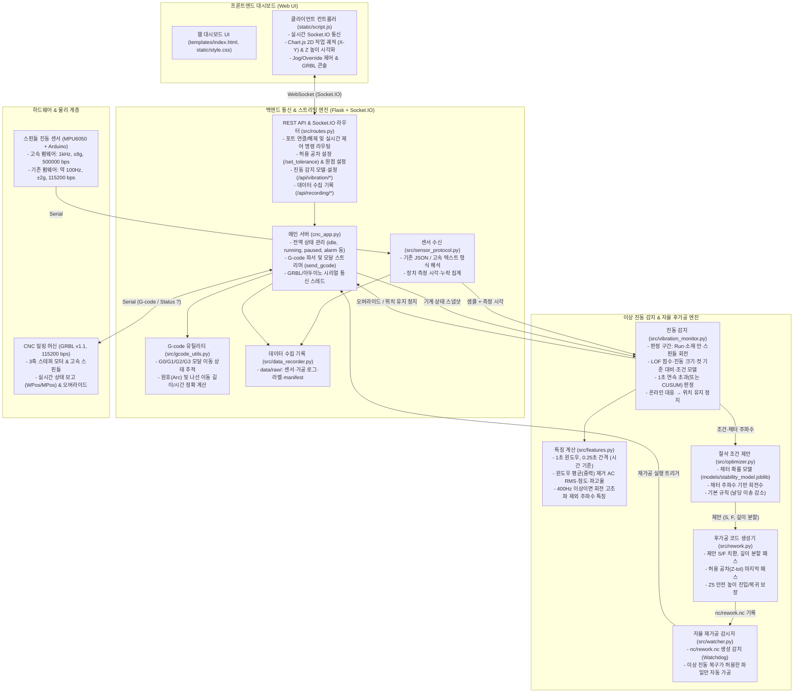
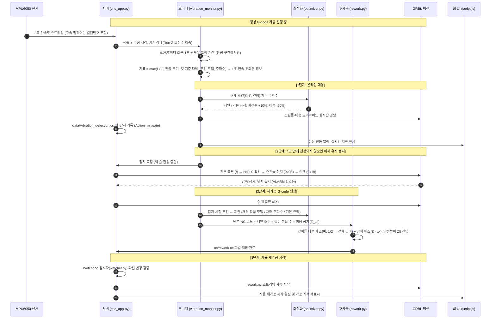

# CNC 밀링 머신 실시간 모니터링 및 자율제어 스마트 가공 시스템

GRBL(v1.1) 기반 CNC 밀링 머신과 스핀들에 장착된 3축 가속도 센서(MPU6050)를 연동하여, 웹 대시보드에서 가공 경로와 장비 상태를 실시간 모니터링 및 제어하고, 가공 중 발생하는 **이상 진동(채터, Chatter)을 실시간으로 감지하여 오버라이드로 회전수·이송을 즉시 조정(온라인 대응) → 계속되면 위치를 유지한 채 정지 → 절삭 조건 제안 → 깊이를 나눈 재가공 NC 코드 자동 생성 → 자율 재가공**을 수행하는 스마트 제조 자율제어 시스템입니다. 실험용 NC 생성, 데이터 수집 기록, 데이터셋·모델 학습·평가 도구를 함께 제공합니다.

> 감지·최적화 알고리즘의 설계 근거와 데이터 수집 계획은 [edit_analysis.md](edit_analysis.md), 변경 이력은 [edit_log.md](edit_log.md)를 참고하세요.

---

## 1. 시스템 아키텍처 및 흐름도

### 1.1 전체 시스템 아키텍처
본 시스템은 웹 브라우저 클라이언트, Flask + Socket.IO 백엔드 제어 서버, AI 이상 탐지 및 최적화 엔진, 그리고 GRBL 머신 및 아두이노 센서 하드웨어의 4계층으로 구성되어 있습니다.



---

### 1.2 이상 진동 감지 및 자율 재가공 동작 시퀀스

가공 중 이상 진동 발생부터 자동 복구까지의 자율 제어 루프는 다음과 같이 수행됩니다.



---

## 2. 프로젝트 디렉토리 구조 (전수 인벤토리)

프로젝트 루트([`ProjectLab_System/`](file:///d:/Project_Lab/02_공모전_및_경진대회/ProjectLab%202026/ProjectLab_System))는 유지보수성과 확장성을 위해 기능별로 모듈화되어 있습니다.

```text
ProjectLab_System/
├── cnc_app.py                  # [메인 서버] Flask, Socket.IO, GRBL/아두이노 시리얼 통신, G-code 스트리머
├── requirements.txt            # [의존성] 함께 검증한 고정 버전 Python 라이브러리 목록 (Python 3.12 ~ 3.14)
├── setup.bat / setup.sh        # [설치] 가상환경(.venv) 생성 + 패키지 설치 + 실행 환경 점검 (Windows / Linux·macOS)
├── run.bat / run.sh            # [실행] .venv의 파이썬으로 서버 시작
├── README.md                   # [문서] 시스템 종합 가이드 및 사용자 매뉴얼
├── edit_log.md                 # [문서] 수정 이력 (최신 항목이 위)
├── edit_analysis.md            # [문서] 감지·최적화 알고리즘 분석과 데이터 수집 계획 (2026-10-31, 현재 설계의 근거)
├── .gitignore                  # [Git] 버전 관리 제외 규칙 (가상환경, 임시 로그 등)
├── .gitattributes              # [Git] .bat은 CRLF, .sh는 LF 줄바꿈 유지
├── .venv/                      # (Git 제외) setup이 PC마다 새로 만드는 가상환경 — 다른 PC로 복사하지 않음
│
├── src/                        # [핵심 백엔드 로직 모듈]
│   ├── routes.py               # REST API 라우트 및 Socket.IO 양방향 이벤트 핸들러
│   ├── features.py             # 진동 특징 계산 (학습·실시간·데이터셋 공용: 시간 기준 윈도우, AC RMS·첨도·파고율, 주파수 특징)
│   ├── vibration_monitor.py    # 이상 진동 감지 (판정 구간, 증거값, 1초 연속/CUSUM 판정) 및 온라인 대응·위치 유지 정지·재가공 준비
│   ├── optimizer.py            # 절삭 조건 제안 (채터 확률 모델 → 채터 주파수 → 기본 규칙)
│   ├── rework.py               # 재가공 G-code(nc/rework.nc) 생성기 (깊이 분할 패스 + 공차 패스, Z 안전높이 처리)
│   ├── sensor_protocol.py      # 센서 수신 형식 해석 (기존 JSON / 고속 텍스트, 장치 측정 시각·누락 집계)
│   ├── data_recorder.py        # 데이터 수집 기록 (data/raw/의 센서·가공 로그·manifest)
│   ├── watcher.py              # nc/rework.nc 생성 감지용 Watchdog 파일 핸들러 (서버 내장형)
│   ├── gcode_utils.py          # G0/G1/G2/G3 모달(Modal) 상태 추적 및 원호/나선 이동 거리 계산기
│   └── arduino_sensor.py       # 독립형 아두이노 시리얼 리더 및 가상 센서 시뮬레이터 (테스트용)
│
├── models/                     # [학습 모델] scripts/train_models.py가 만듦 (없으면 기본 규칙으로 동작)
│   ├── stability_model.joblib  # (학습 후 생성) 회전수·이송·깊이 → 채터 확률
│   ├── condition_model.joblib  # (학습 후 생성) 회전수·이송·깊이 → 안정 가공의 기대 진동 크기
│   └── legacy/                 # 예전 RandomForest/LOF 모델 (현재 센서와 단위가 달라 사용하지 않음, README.md 참고)
│
├── data/                       # [실시간 런타임 데이터 및 학습셋]
│   ├── current_position.txt    # 가공 시작 시점의 기계 좌표(MPos Z축) 기록
│   ├── Vibration_detection.csv # 이상 진동 감지 기록 CSV (감지할 때마다 한 줄 추가, 형식은 5.4 참고)
│   ├── 학습 데이터/            # 이상 진동 감지 모델 학습용 센서 CSV (정상 19개 + 파일명에 '이상'이 들어간 1개는 학습 제외)
│   ├── raw/                    # (Git 제외) 데이터 수집 기록: <run_id>_sensor.csv, <run_id>_machine.csv, manifest.csv
│   ├── dataset/                # (Git 제외) scripts/build_dataset.py가 만든 학습·평가용 데이터셋
│   └── detector_settings.json  # (Git 제외) 모델 관리 창에서 바꾼 감지 설정 (온라인 대응, 판정 방식)
│
├── nc/                         # [NC G-code 파일]
│   ├── O0527.txt               # 직선/모달 절삭 테스트용 G-code
│   ├── O0807.txt               # 2.5D 윤곽 가공 테스트용 G-code
│   ├── O1001.nc                # CAM 생성 복합 원호/포켓 가공 G-code
│   ├── experiments/            # scripts/make_experiment_nc.py가 만든 실험용 NC와 plan.csv
│   └── rework.nc               # 이상 감지 시 시스템이 자동 생성하는 재가공 코드
│
├── arduino/                    # [아두이노 센서 펌웨어]
│   ├── MPU6050_fast/           # 고속 펌웨어 (1 kHz, ±8 g, 저역통과 184 Hz, 500000 bps): 새 데이터 수집 권장
│   │   └── MPU6050_fast.ino
│   ├── MPU6050/                # 기존 펌웨어 (약 100Hz, ±2 g, 115200 bps): 기존 학습 데이터와 같은 조건
│   │   └── MPU6050.ino
│   ├── MPU6050_standalone/     # MPU6050 단독 동작용 펌웨어
│   │   └── MPU6050.ino
│   └── arduino_example/        # 아날로그 센서(ADXL335 + LM35) 예제 펌웨어
│       └── sensor_example.ino
│
├── templates/                  # [웹 템플릿]
│   └── index.html              # 다크 테마 반응형 CNC 제어 및 실시간 모니터링 대시보드
│
├── static/                     # [프론트엔드 정적 리소스]
│   ├── script.js               # Socket.IO 클라이언트, Chart.js 2D/Z 궤적 시각화, 제어 로직
│   ├── style.css               # 관제 센터 스타일 다크 UI, 게이지, 버튼 애니메이션
│   ├── vendor/                 # 인터넷 없이 동작하도록 포함한 외부 라이브러리
│   │   ├── socket.io-4.7.2.min.js
│   │   └── chart-3.9.1.min.js
│   ├── favicon.ico             # 웹 파비콘
│   └── alert.txt               # 사운드 에셋 안내 파일
│
├── scripts/                    # [관리 및 학습 유틸리티]
│   ├── setup_env.py            # setup.bat / setup.sh가 실행하는 설치 스크립트 (.venv 생성·검사, 패키지 설치)
│   ├── check_env.py            # 실행 환경 점검 (Python·패키지 버전, 모델 로드, 학습 데이터, 웹 리소스)
│   ├── make_experiment_nc.py   # 데이터 수집 실험용 NC 생성 (경사 절입 시험, 조건 조합, 공회전)
│   ├── build_dataset.py        # data/raw → data/dataset (윈도우 특징·조건·판정 구간·라벨)
│   ├── train_models.py         # 데이터셋 → 채터 확률 모델·조건 모델 (실행 단위 교차 검증)
│   ├── evaluate_detector.py    # 감지기 교차 검증 (감지율, 감지 지연, 시간당 오경보)
│   └── test_arduino_sensor.py  # 센서 모듈 시뮬레이션 및 포트 연결 테스트 스크립트
│
├── docs/                       # [상세 기술 문서]
│   └── README_ARDUINO.md       # 아두이노 배선도, 라이브러리 설치 및 센서 연동 매뉴얼
│
├── analysis/                   # [시스템 분석 보고서]
│   ├── analyze.md              # 프로젝트 구조 및 코드 전수 분석 보고서
│   ├── analyze2.md             # 실제 CNC 장비 구동 로그 기반 결함 분석 및 해결 가이드
│   └── full.md                 # 시스템 전체 기능 및 구현 세부 보고서
│
└── logs/                       # [가공 런타임 로그]
    ├── .gitkeep
    └── cnc_log_*.csv           # 매 가공 시 실제 WPos 좌표, 상태, 시간 기록 로그 (자동 생성)
```

---

## 3. 핵심 기능 및 기술 구현

### 3.1 실시간 가공 경로 및 장비 모니터링
- **실제 공작물 좌표(WPos) 기반 렌더링**: G-code 지령 좌표가 아닌 GRBL이 `?` 쿼리에 응답하는 실제 장비 좌표를 파싱하여 Chart.js 기반 2D 작업 궤적(X-Y) 및 Z 높이 변화를 실시간 플롯합니다.
- **네트워크 최적화**: 매 렌더링 주기마다 전체 경로 대신 새롭게 추가된 점(델타 좌표)만 전송(`ui_sent_len` 관리)하여 브라우저 메모리 부하와 통신 지연을 방지합니다.
- **실시간 오버라이드 & 조그 제어**: 가공 중에도 스핀들 속도(±10%, ±1%, 100% 리셋) 및 이송 속도를 GRBL 1.1 실시간 바이트 코드로 즉각 변경할 수 있으며, 정지 상태에서는 미세 조그(Jog) 이동과 공작물 원점 설정(`G10 L20 P1`)을 지원합니다.

### 3.2 표준 모달(Modal) G-code 파서 ([`src/gcode_utils.py`](file:///d:/Project_Lab/02_공모전_및_경진대회/ProjectLab 2026\ProjectLab_System\src\gcode_utils.py))
- `G0`, `G1`, `G2`, `G3` 이동 모드와 좌표계(`G90`/`G91`), 작업 평면(`G17`/`G18`/`G19`), 피드(`F`), 스핀들(`S`)의 모달 상태를 완벽히 유지합니다.
- `X30 F70`처럼 이동 코드(G1 등)가 생략된 표준 CAM 코드도 직전 모드로 정확히 해석하여 이동 소요 시간을 계산함으로써, 플래너 버퍼 고갈로 인한 **가공 중 스핀들 조기 정지(`M5`)나 버퍼 폭주 사고를 원천 차단**합니다.
- 원호 보간(`G2`/`G3`)의 중심점 오프셋(`I`, `J`, `K`) 및 반경(`R`) 형식, 나선(Helical) 이동의 3D 공간상 실제 이동 거리를 정확히 계산합니다.

### 3.3 실시간 이상 진동(Chatter) 감지 ([src/vibration_monitor.py](src/vibration_monitor.py), [src/features.py](src/features.py))

설계 근거와 이전 방식의 문제점은 [edit_analysis.md](edit_analysis.md) 2장에 있습니다.

- **특징 계산 (학습·실시간·데이터셋 공통)**: 0.25초마다 최근 1초 윈도우(샘플 개수가 아니라 시간 기준)를 평가합니다.
  - 윈도우마다 평균(중력·센서 자세)을 빼고 축별 진동 크기(AC RMS)·첨도·파고율을 계산합니다. 스무딩은 하지 않고, 측정 범위를 벗어난 깨진 값만 버립니다.
  - 샘플링이 400 Hz 이상이고 간격이 일정하면(고속 펌웨어) 회전 주파수 고조파를 뺀 에너지 비율과 가장 큰 봉우리(채터 주파수 후보)를 추가로 계산합니다. 약 100 Hz 기존 펌웨어에서는 진동 크기 특징만 씁니다.
- **판정 구간**: 가공 중, GRBL `Run`, 공구가 소재 안(작업 좌표 Z ≤ -0.05 mm), 스핀들 회전 중일 때만 판정합니다. 진입 직후와 회전수·이송·오버라이드가 바뀐 직후 0.75초는 제외합니다.
- **증거값**: 다음 항목을 각 기준으로 나눈 값 중 가장 큰 값입니다 (1 이상 = 기준 초과).
  1. **LOF 점수**: 정상 가공 윈도우로 학습한 LocalOutlierFactor의 연속 점수 ÷ 파일(세션)을 하나씩 빼고 검증한 99.9% 분위수. 학습 데이터 하위 10%보다 조용한 윈도우는 제외합니다.
  2. **진동 크기**: AC RMS ÷ 정상 가공 윈도우의 99.9% 분위수
  3. **컷 기준 대비**: 같은 컷의 처음 2초(정상으로 보이는 윈도우) 진동 크기 대비 비율 ÷ 3
  4. **조건 모델** (학습한 경우): (회전수, 이송, 깊이)로 예상한 진동 크기 대비 z 점수 ÷ 3
  5. **주파수** (고속 센서): 고조파가 아닌 에너지 비율 ÷ 0.6 (봉우리가 뚜렷할 때)
- **판정**: 기본은 4개 연속 기준 초과(1초 연속). 모델 관리 창에서 누적합(CUSUM, 큰 이상은 더 빨리)으로 바꿀 수 있습니다. 해제는 0.8 미만이 4번 연속일 때입니다.
- **기본값의 근거**: `data/학습 데이터`를 파일 단위로 하나씩 빼고 검증해 정한 임시값입니다. 정상 가공 9분 동안 오경보 1회, '이상' 파일 경보 3회였습니다 (이전 방식은 둘 다 0회). 라벨이 있는 새 데이터로 `scripts/evaluate_detector.py`를 돌려 다시 맞추세요.
- **모델 관리 창**: 제어 영역의 `진동 감지 모델` 버튼으로 학습 상태·기준값을 확인하고, 정상 가공 데이터를 추가해 다시 학습하거나 감지 설정을 바꿀 수 있습니다 (5.3 참고).

### 3.4 이상 진동 대응과 절삭 조건 제안 ([src/optimizer.py](src/optimizer.py))

- **온라인 대응 (기본 켬)**: 경보가 나면 먼저 GRBL 실시간 오버라이드로 회전수·이송을 바꿉니다. 4초 안에 진동이 진정되면 그 조건으로 가공을 계속하고, 계속되면 위치를 유지한 채 정지합니다. 온라인 대응은 한 컷에 한 번만 합니다.
- **조건 제안 순서** (이송은 현재보다 늘리지 않음):
  1. **채터 확률 모델** (`models/stability_model.joblib`, 라벨 데이터로 학습): 채터 확률이 5% 미만인 (회전수, 이송, 깊이) 중 시간당 가공량(이송 ÷ 패스 수)이 가장 큰 조건. 현재 깊이로 안 되면 깊이를 2·3번으로 나눈 경우를 찾습니다.
  2. **채터 주파수** (고속 센서로 측정한 경우): 날 통과 주파수가 채터 주파수의 정수분의 1이 되도록 n = 60 × f_c / (날 수 × k) 중 현재와 가장 가까운 회전수 (날당 이송은 늘리지 않음).
  3. **기본 규칙** (모델·채터 주파수가 없을 때): 온라인 대응은 회전수 +10%(상한이면 -10%)·이송 -20%, 재가공은 회전수 유지·이송 -20%·깊이 2번 나눔.
- 예전 RandomForest/LOF 최적화 모델은 현재 센서 특징과 단위가 수백~수억 배 달라 "안전 후보 없음"만 냈으므로 쓰지 않습니다 ([models/legacy/README.md](models/legacy/README.md)).

### 3.5 안전 후가공 코드 자동 생성 ([src/rework.py](src/rework.py))

- **깊이 분할 패스**: 채터는 절입 깊이에 가장 민감하므로 원본 깊이를 나눠(기본 2번: 깊이의 1/2 → 전체 깊이) 제안 조건(S, F)으로 가공합니다. G91 상대좌표로 쓴 Z 이동은 나누지 않습니다.
- **공차 패스**: 가공 시 입력받은 허용 공차(0.0 ~ 1.0mm)만큼 모든 절대좌표 Z를 더 내려($Z - tolerance$) 채터 자국을 제거합니다.
- **Z5 안전 충돌 방지**: 각 패스 시작 시 공구를 안전 높이($Z+5.0\text{mm}$)로 올린 뒤 첫 가공 좌표(X, Y)로 수평 이동(`G0`)하고 수직 하강하므로 소재 측면이나 바이스와의 충돌을 막습니다.
- 파일 첫 줄에 조건을 정한 방법을 주석으로 남깁니다 (예: `(rework fallback: S20000 F160.0 depth passes 2)`).

---

## 4. 설치 및 환경 설정

### 4.1 시스템 요구사항
- **운영체제**: Windows 10 / 11 (64비트), Linux, macOS
- **Python**: 64비트 Python 3.12 ~ 3.14 (권장 3.13 또는 3.14)
  - `requirements.txt`는 함께 검증한 고정 버전입니다 (numpy 2.5 / scipy 1.18은 3.11 이하를 지원하지 않음).
  - `scripts/train_models.py`로 만든 `models/*.joblib`은 학습한 scikit-learn 버전(1.9.1)에 묶입니다. scikit-learn 버전을 바꾸면 다시 학습하세요 (`check_env.py`가 버전 차이를 알려줍니다).
- **하드웨어**:
  - GRBL v1.1 호환 CNC 밀링 머신 컨트롤러
  - 아두이노 보드 (Uno, Nano, Mega 등) + MPU6050 센서 모듈 (스핀들 하우징에 단단히 고정)
  - USB 시리얼 케이블 2개 (CNC용 1개, 아두이노용 1개)

### 4.2 파이썬 가상환경 생성 및 패키지 설치

설치 스크립트가 지원 버전의 파이썬을 찾아 `.venv`를 만들고, 고정 버전 패키지를 설치한 뒤 실행 환경을 점검합니다.

```bash
# Windows: 프로젝트 폴더의 setup.bat 더블클릭 또는
setup.bat

# Linux / macOS
bash setup.sh
```

- Windows에서는 `py` 런처의 3.14 → 3.13 → 3.12 순으로 찾고, 없으면 PATH의 `python`을 사용합니다 (64비트 3.12 ~ 3.14만 사용).
- 마지막에 `scripts/check_env.py`가 Python·패키지 버전, 학습된 모델(있으면) 로드, 학습 데이터, 웹 리소스를 점검해 `[정상]` / `[주의]` / `[실패]`로 표시합니다. 학습한 채터 확률·조건 모델이 아직 없으면 `[주의]`로 알리고 기본 규칙으로 동작합니다. 언제든 `.venv\Scripts\python.exe scripts\check_env.py`로 다시 점검할 수 있습니다.
- 옵션: `--recreate`(가상환경 새로 만들기), `--download-wheels`(오프라인 설치 파일 내려받기), `--no-pause`(Windows, 끝난 뒤 대기하지 않음).

> [!NOTE]
> **다른 PC로 옮길 때**: 가상환경은 만든 PC의 파이썬 경로를 가리키므로 `.venv`는 복사하지 말고, 옮긴 PC에서 `setup.bat`(또는 `bash setup.sh`)를 다시 실행하세요. 다른 PC나 경로에서 복사된 `.venv`가 있으면 setup이 이를 감지해 지우고 새로 만듭니다.

**인터넷이 없는 PC에 설치하기**: 인터넷이 되는 PC에서 `setup.bat --download-wheels`를 실행하면 `wheels/` 폴더에 설치 파일(Windows 64비트 Python 3.12 ~ 3.14용)을 내려받습니다. 프로젝트 폴더를 `wheels/`와 함께 옮기면 대상 PC의 setup이 인터넷 없이 `wheels/`에서 설치합니다. (Linux·macOS에서는 실행한 PC와 같은 OS·Python 버전용 파일만 내려받습니다.)

<details>
<summary>설치 스크립트 없이 직접 설치하기</summary>

```bash
# 64비트 Python 3.12 ~ 3.14로 가상환경 생성
py -3.13 -m venv .venv          # Linux / macOS: python3.13 -m venv .venv
# 패키지 설치
.venv\Scripts\python.exe -m pip install --upgrade pip
.venv\Scripts\python.exe -m pip install -r requirements.txt   # Linux / macOS: .venv/bin/python -m pip ...
# 환경 점검
.venv\Scripts\python.exe scripts\check_env.py
```

`requirements.txt`는 영문(ASCII)만 사용해야 합니다. 한글 Windows의 pip는 이 파일을 CP949로 읽기 때문에 한글 주석이 있으면 설치가 실패합니다.
</details>

### 4.3 아두이노 센서 펌웨어 업로드 및 배선

자세한 내용은 [`docs/README_ARDUINO.md`](file:///d:/Project_Lab/02_공모전_및_경진대회/ProjectLab%202026/ProjectLab_System/docs/README_ARDUINO.md)를 참조하세요.

1. **하드웨어 배선 (I2C 통신)**:
   - `VCC` $\rightarrow$ 아두이노 5V (레귤레이터 내장 모듈) 또는 3.3V
   - `GND` $\rightarrow$ 아두이노 GND
   - `SDA` $\rightarrow$ Uno/Nano의 `A4` (Mega는 `Pin 20`)
   - `SCL` $\rightarrow$ Uno/Nano의 `A5` (Mega는 `Pin 21`)
2. **Arduino IDE 라이브러리 설치**:
   - `MPU6050` (by Electronic Cats / I2Cdevlib)
   - `ArduinoJson` (v6.x, 기존 펌웨어만)
3. **펌웨어 업로드**:
   - 새 데이터 수집: [arduino/MPU6050_fast/MPU6050_fast.ino](arduino/MPU6050_fast/MPU6050_fast.ino) (1 kHz, ±8 g, 화면에서 통신 속도 500000 선택). 실제 보드에서 아직 검증하지 않았으니 처음에 시리얼 모니터로 출력을 확인하세요.
   - 기존 학습 데이터와 같은 조건: [arduino/MPU6050/MPU6050.ino](arduino/MPU6050/MPU6050.ino) (약 100Hz, 115200 bps).

---

## 5. 실행 및 사용 방법

### 5.1 메인 시스템 실행

```bash
# Windows: run.bat 더블클릭 또는
run.bat

# Linux / macOS
bash run.sh

# 직접 실행 (가상환경의 파이썬 사용)
.venv\Scripts\python.exe cnc_app.py      # Linux / macOS: .venv/bin/python cnc_app.py
```

`.venv`가 없거나 다른 PC에서 복사된 것이면 `run.bat`이 먼저 `setup.bat`을 실행하라고 안내합니다. 서버가 구동되면 웹 브라우저를 열고 다음 주소로 접속합니다:
👉 **`http://localhost:5000`**

*(별도의 `watcher.py`는 실행할 필요가 없습니다. 서버 내부에서 자동으로 감시 스레드가 구동됩니다.)*

---

### 5.2 작업 단계별 상세 가이드


1. **GRBL 컨트롤러 포트 연결**:
   - 웹 대시보드 좌측 상단 "포트 제어"에서 CNC가 연결된 COM 포트를 선택하고 `연결` 클릭.
   - 머신이 알람(`Alarm`) 상태인 경우 `알람해제` 버튼(`$X`)을 클릭하여 대기(`Idle`) 상태로 전환.
2. **아두이노 진동 센서 연결**:
   - "센서 데이터" 패널에서 아두이노 COM 포트와 통신 속도(기존 펌웨어 115200, 고속 펌웨어 500000)를 선택하고 `연결` 클릭.
   - 실시간 가속도 값 `ACC(X: ..., Y: ..., Z: ...)`가 정상 수신되는지 확인.
3. **공작물 원점(Work Zero) 설정**:
   - Jog 버튼(X+, X-, Y+, Y-, Z+, Z-)을 사용하여 절삭 시작 위치로 공구를 이동.
   - `Zero XY 0`(X·Y 영점) 또는 `Zero Z 0`(Z 영점) 버튼 클릭 (`G10 L20 P1`). Z0은 소재 윗면으로 맞춥니다 (판정 구간이 Z < 0을 '소재 안'으로 봄).
4. **허용 공차(Tolerance) 입력**:
   - 재가공 마지막 패스에서 추가로 절삭할 허용 공차(단위: mm, 범위: `0.0` ~ `1.0`)를 "허용 공차 입력"에 넣고 `확인` 클릭.
5. **NC 코드 파일 로드**:
   - "NC 코드"에서 실행할 파일([nc/O0527.txt](nc/O0527.txt) 등)을 선택하고 `NC 코드 불러오기` 클릭.
   - 화면에 총 라인 수와 예상 경로가 로드됩니다.
6. **가공 시작 및 실시간 모니터링**:
   - `가공 시작` 버튼 클릭.
   - 실제 작업 좌표(WPos)에 따른 공구 경로와 Z축 높이를 모니터링합니다. 제어 영역의 `· 지표 0.42`는 실시간 이상 진동 지표입니다 (1 이상이면 기준 초과, 공구가 소재 밖이면 "판정 구간 밖").
   - 필요 시 스핀들/이송 오버라이드 버튼으로 속도를 미세 조정할 수 있습니다.
7. **이상 진동 감지 및 자율 재가공 관찰**:
   - 이상 진동이 1초 동안 계속되면 먼저 오버라이드로 회전수·이송을 바꿉니다 (`· 온라인 대응 중`). 4초 안에 진정되면 그 조건으로 가공을 계속합니다.
   - 계속되면 피드 홀드로 감속 정지한 뒤(위치 유지) 조건을 제안해 깊이를 나눈 `nc/rework.nc`를 만들고 **자동으로 재가공을 시작**합니다.
   - 온라인 대응을 끄면(5.3) 감지 즉시 정지·재가공합니다.

### 5.3 진동 감지 모델 관리

제어 영역 아래의 상태 문구(`진동 감지 모델: 학습됨 (정상 데이터 N개 파일)`)로 감지 모델이 동작 중인지 확인할 수 있습니다. `학습 안 됨`(노란색)이면 이상 진동 감지가 꺼진 상태입니다. `진동 감지 모델` 버튼을 누르면 관리 창이 열립니다.

- **상태 확인**: 학습에 사용한 파일 목록, 샘플·가공 윈도우 수, 기준값(진동 크기 g, LOF 점수), 조건 제안 방식(채터 확률 모델 유무), 연결된 센서를 보여줍니다.
- **감지 설정**: 온라인 대응 켜기/끄기, 판정 방식(1초 연속 초과 / 누적합 CUSUM). `data/detector_settings.json`에 저장되며 가공 중에도 다음 판정부터 적용됩니다.
- **모델 학습 (정상 데이터 추가)**: 정상 가공 센서 CSV(`AccX`, `AccY`, `AccZ` 열 포함, UTF-8 또는 CP949)를 선택하고 `모델 학습`을 누르면 `data/학습 데이터/`에 저장한 뒤 폴더 전체로 모델을 다시 학습합니다. 데이터 수집 기록의 `data/raw/<run_id>_sensor.csv`(안정 가공 실행)를 그대로 쓸 수 있습니다.
  - 파일 이름에 `이상`이 들어간 파일, `master_dataset.csv`, 열이 없거나 100행 미만인 파일은 거부합니다. 같은 이름의 파일은 덮어쓰지 않고 `_1`, `_2`를 붙여 저장합니다.
  - 학습에 실패하면 올린 파일을 지우고 기존 모델을 그대로 사용합니다. 학습은 데이터 양에 따라 수 초 정도 걸립니다 (학습 파일 20개 기준 약 2초).
  - 추가한 파일을 빼려면 `data/학습 데이터/`에서 지운 뒤 `감지기 초기화`를 누르세요.
- **감지기 초기화**: `data/학습 데이터/`의 파일로 모델을 다시 학습하고 감지 버퍼·판정 상태를 비웁니다.
- 가공 중(가공·일시정지 상태)에는 학습과 초기화를 할 수 없습니다.

### 5.4 이상 진동 감지 기록 (`data/Vibration_detection.csv`)

이상 진동을 감지할 때마다(온라인 대응·정지 모두) 한 줄씩 추가되는 UTF-8 CSV입니다.

```csv
DetectedAt,X,Y,Z,SpindleRPM,FeedRate,SpindleOverride,FeedOverride,Evidence,ChatterHz,Action
2025-11-28 18:05:07,0.000,70.000,0.840,,,100,,,,
2026-10-31 14:00:40,7.567,0.000,-0.200,20000,100.0,100,100,1.34,,mitigate
```

| 열 | 내용 |
| --- | --- |
| `DetectedAt` | 감지 시각 (`YYYY-MM-DD HH:MM:SS`) |
| `X`, `Y`, `Z` | 감지 시점의 작업 좌표 (mm) |
| `SpindleRPM`, `FeedRate` | 오버라이드를 반영한 실제 스핀들 속도(RPM)와 이송 속도(mm/min), 알 수 없으면 빈칸 |
| `SpindleOverride`, `FeedOverride` | 감지 시점의 오버라이드 (%) |
| `Evidence` | 경보를 낸 증거값 (1 이상 = 기준 초과, 수동·확정 정지는 빈칸) |
| `ChatterHz` | 주파수 특징으로 찾은 채터 주파수 (고속 센서에서만) |
| `Action` | `mitigate`(오버라이드 대응) 또는 `stop`(정지 후 재가공) |

헤더가 다른 예전 파일이 있으면 `Vibration_detection.csv.old`로 보관하고 새 CSV를 시작합니다. 수동 재가공(`make_rework`)은 이 파일이 있을 때만 `rework.nc`를 만듭니다.

### 5.5 데이터 수집과 모델 학습

라벨이 있는 데이터를 모아 감지 기준과 조건 제안 모델을 다시 맞추는 절차입니다 (실험 설계: [edit_analysis.md](edit_analysis.md) 3장).

1. **측정 준비**: 고속 펌웨어를 올리고 센서를 단단히 고정합니다. 화면에서 통신 속도 500000으로 연결합니다.
2. **실험용 NC 생성**: 작업 좌표 원점(X0 Y0 Z0)을 소재 모서리 윗면으로 맞춘 뒤 NC를 만듭니다.

   ```bash
   # 1단계: 회전수별 경사 절입 시험 (채터가 시작되는 깊이 찾기)
   .venv\Scripts\python.exe scripts\make_experiment_nc.py ramp --tool-d 6 --flutes 2 --ramp-max 1.0
   # 2단계: 안정 한계 기준 조건 조합 (ramp 결과를 --limits로)
   .venv\Scripts\python.exe scripts\make_experiment_nc.py grid --tool-d 6 --flutes 2 --limits 16000=0.5,18000=0.7 --feeds 50,100,150
   # 회전수별 공회전 (스핀들 자체 진동 기준)
   .venv\Scripts\python.exe scripts\make_experiment_nc.py air --tool-d 6 --flutes 2
   ```

   `nc/experiments/<계획>/`에 실행마다 NC 파일과 순서표 `plan.csv`가 생깁니다. 깊이는 공구 지름의 0.5배까지만 허용합니다.
3. **기록**: 실험 NC를 불러온 뒤 제어 영역의 `데이터 수집` 창을 엽니다. NC의 META 주석으로 조건 칸이 채워집니다.
   - `기록 시작` → `가공 시작` → 채터가 들리거나 보이면 `구간 시작`/`구간 끝`(라벨: 채터·전이·비가공) → 가공이 끝나면 `기록 종료`
   - 가공면 사진 파일 이름과 채터 자국 위치를 메모에 남기면 라벨 검증에 도움이 됩니다.
   - `data/raw/`에 `<run_id>_sensor.csv`(장치 시각·일련번호), `<run_id>_machine.csv`(GRBL 상태·좌표·실제 회전수/이송), `manifest.csv`(조건·라벨)가 쌓입니다. 용량이 커서 Git에서 제외하므로 따로 백업하세요.
4. **데이터셋·학습·평가**:

   ```bash
   .venv\Scripts\python.exe scripts\build_dataset.py      # data/dataset/ (windows.csv, runs.csv, ramp_limits.csv)
   .venv\Scripts\python.exe scripts\train_models.py       # models/stability_model.joblib, condition_model.joblib
   .venv\Scripts\python.exe scripts\evaluate_detector.py  # 실행 단위 교차 검증: 감지율, 감지 지연, 시간당 오경보
   ```

   - `train_models.py`는 실행 단위 교차 검증 결과와, '안전'으로 본 조건에서 실제 채터가 난 비율을 보여줍니다. 데이터가 적으면 채터 확률이 5% 미만인 조건이 없어 경고가 나오며, 그동안은 기본 규칙을 씁니다.
   - `evaluate_detector.py --set k=3 --set self_ratio=2.5`처럼 판정 설정을 바꿔 비교한 뒤 `src/vibration_monitor.py`의 `DETECTION_DEFAULTS`를 고칩니다. `--legacy`는 예전 `data/학습 데이터`로 평가합니다.
   - 새 모델은 서버를 다시 시작하면 적용됩니다.

---

## 6. 안전 제약 및 인터록 정책

작업자의 안전과 장비 및 공작물 보호를 위해 시스템 전반에 강력한 인터록 정책이 적용되어 있습니다.

- **가공 중 하드웨어 조작 인터록**: 가공 진행 중(`running`) 또는 일시정지(`paused`) 상태에서는 조그 이동, 원점 설정, 알람 해제, 수동 GRBL 콘솔 명령, 시리얼 포트 연결 해제 등 위험을 유발할 수 있는 UI 조작이 강제로 비활성화됩니다.
- **GRBL 에러 감지 및 자동 보호**: GRBL로부터 `error:` 응답을 수신하면 시스템은 즉시 피드 홀드(`!`)를 전송하여 일시정지 상태로 전환하고, 오류가 발생한 G-code 라인을 화면에 경고합니다.
- **허용 공차 상한 제한**: 과절삭 및 공구 파손을 원천 차단하기 위해 입력 가능한 허용 공차는 최대 `1.0mm`로 하드웨어적/소프트웨어적으로 엄격히 제한됩니다.
- **G28 / G30 안전 고도 처리**: NC 파일 내에 테이블 충돌을 유발할 수 있는 `G28`/`G30`(원점 복귀) 명령이 포함된 경우, 시스템은 반드시 안전 높이(`G0 Z5`) 상승 후 수평 이동(`G0 X0 Y0`)하도록 명령을 안전하게 치환하여 실행합니다.
- **재가공 파일 인가 검증**: 이상 진동 복구 과정이 `arm_rework()`로 자동 가공을 1회 허용한 뒤 30초 안에 만들어진 `nc/rework.nc`만 감시자가 자동 가공합니다. 사용자가 직접 편집·저장한 파일은 무시하고 로그로 알립니다.
- **위치 유지 정지**: 이상 진동으로 멈출 때는 피드 홀드(`!`)로 감속 정지 → `Hold:0` 확인 → 스핀들 정지(0x9E) → 소프트 리셋 순서로 진행합니다. GRBL은 이동 중 리셋(ALARM:3) 뒤에는 위치를 보장하지 않으므로, 재가공 좌표를 믿을 수 있도록 이 순서를 씁니다. 5초 안에 `Hold:0`이 오지 않으면 바로 리셋하고 원점 확인을 안내합니다.
- **긴급정지 버튼**: 작업자의 `긴급정지`는 지금처럼 즉시 소프트 리셋합니다 (이동 중이면 ALARM:3이 나며, 해제 후 원점을 확인하세요).
- **온라인 대응 범위**: 오버라이드는 GRBL 허용 범위(10~200%) 안에서만 바꾸고, 이송은 현재보다 늘리지 않으며, 한 컷에 한 번만 합니다. 모델 관리 창에서 끌 수 있습니다.

---

## 7. 버전 이력 및 진행 사항

### 📌 v1.1 주요 개선 내역 (2026-10-31) — 이상 진동 감지·온라인 제어 재설계 및 데이터 수집 파이프라인

상세 분석 및 설계 근거는 [`edit_analysis.md`](edit_analysis.md), 작업별 세부 수정 내역은 [`edit_log.md`](edit_log.md)를 참고하세요.

1. **이상 진동(채터) 감지 및 실시간 특징 추출 전면 재설계 ([`src/features.py`](src/features.py), [`src/vibration_monitor.py`](src/vibration_monitor.py))**:
   - **특징 계산 모듈 단일화 (`features.py`)**: 학습·실시간·데이터셋 파이프라인의 특징 계산 로직 통일.
   - **시간 기준 윈도우링**: 1초 윈도우, 0.25초 스텝의 시간 기반 슬라이딩 윈도우 적용.
   - **중력 및 센서 자세 영향 제거**: 윈도우별 평균값(DC 성분)을 제거하여 센서 부착 각도에 상관없이 일관된 AC RMS, 첨도(Kurtosis), 파고율(Crest Factor) 산출.
   - **채터 주파수 추출**: 400Hz 이상 샘플링 시 주축 회전 주파수 고조파를 제외한 잔여 에너지 비율, 지배적 피크 주파수(채터 후보 주파수 $f_c$), 스펙트럼 엔트로피 계산.
   - **신호 보존**: 채터 고주파 성분을 왜곡하던 Median/Hampel 스무딩을 제거하고 계측 범위 외 결측치만 필터링.
   - **정밀 감지 코어 (`DetectionCore`)**: LOF 점수(99.9% 분위수 기준), 진동 크기, 컷 초기 대비 비율, 조건 모델 예측 z-score 등을 결합한 종합 증거값 기반 1초(4연속 윈도우) 또는 CUSUM 이상 판정. 진입 및 조건 변경 직후(0.75초) 필터링으로 오경보 최소화.

2. **2단계 자율 대응 및 위치 보존 안전 정지 (`safe_stop()`)**:
   - **1단계 온라인 완화 대응**: 이상 감지 즉시 최적화 알고리즘이 제안한 스핀들 속도(+10%) 및 이송 속도(-20%) 오버라이드를 가공 중 실시간 전송 (한 컷당 1회).
   - **2단계 위치 보존 안전 정지**: 4초 내 진동 미해제 시 즉각적인 리셋 대신, `피드 홀드(!) → Hold:0 정지 확인 → 스핀들 정지(0x9E) → 소프트 리셋(0x18)` 순으로 감속 정지하여 공구 파손을 막고 GRBL 기계 좌표(WPos) 손실(ALARM:3) 없이 정밀 위치 유지.
   - **깊이 분할 다패스 재가공 ([`src/rework.py`](src/rework.py))**: 절입 깊이를 2분할 등 다단계 패스로 나누어 절삭 부하를 대폭 줄이고 마지막 패스에 허용 공차($Z - tolerance$)를 적용하여 가공면 복구.

3. **물리 법칙 기반 절삭 조건 최적화기 재구축 ([`src/optimizer.py`](src/optimizer.py))**:
   - 단위가 불일치하던 구버전 모델(`regr_model.joblib`, `lof_model.joblib`)을 `models/legacy/`로 안전 격리.
   - 채터 확률 모델(`models/stability_model.joblib`) $\rightarrow$ 채터 주파수 회피 회전수($n = 60 \cdot f_c / (Z \cdot k)$) $\rightarrow$ 절삭 안정성 기본 규칙(회전수 +10%, 이송 -20%, 재가공 이송 -20% 및 깊이 2분할)의 3단계 적응형 제안 알고리즘 구현.

4. **1 kHz 고속 센서 펌웨어 및 프로토콜 고도화 ([`arduino/MPU6050_fast/`](arduino/MPU6050_fast/), [`src/sensor_protocol.py`](src/sensor_protocol.py))**:
   - **신규 고속 펌웨어 (`MPU6050_fast.ino`)**: 1 kHz 샘플링, ±8g 레인지, 184 Hz 하드웨어 LPF, FIFO 버스트 읽기, 500,000 bps 시리얼 전송 지원.
   - **센서 프로토콜 엔진 (`sensor_protocol.py`)**: 기존 JSON 포맷 및 고속 패킷 스트림 동시 지원, 장치 내부 마이크로초 타임스탬프 누적 동기화, 패킷 손실 및 FIFO 오버플로 실시간 진단.

5. **가공 실험 및 머신러닝 데이터 수집 파이프라인 구축 ([`src/data_recorder.py`](src/data_recorder.py), `scripts/`)**:
   - **데이터 수집기 (`data_recorder.py`)**: 실행 단위로 `<run_id>_sensor.csv`(장치 시각/가속도), `<run_id>_machine.csv`(GRBL 상태/실제 회전수/좌표), `manifest.csv`(가공 조건, 공구 정보, 구간 라벨) 동시 기록.
   - **실험용 NC 생성기 (`scripts/make_experiment_nc.py`)**: 경사 절입(Ramp), 조건 격자(Grid), 공회전(Air) 실험 코드 및 실행 계획 자동 생성 (META 주석 자동 삽입).
   - **데이터셋 빌더 (`scripts/build_dataset.py`)**: 센서 시계열과 기계 로그를 정확히 매핑하여 윈도우 단위 학습 데이터셋(`data/dataset/`) 자동 생성.
   - **모델 학습기 (`scripts/train_models.py`)**: 가우시안 프로세스/로지스틱 기반 채터 확률 및 안정 진동 크기 예측 모델 교차 검증 학습.
   - **감지기 벤치마크 평가기 (`scripts/evaluate_detector.py`)**: 파일/실행 단위 감지율, 검출 지연, 시간당 오경보율 정량 평가.

6. **웹 대시보드 UI 고도화 및 오프라인 환경 지원**:
   - "데이터 수집" 전용 모달 창 추가: 가공 조건(재질, 공구 직경, 날 수, 회전수, 이송, 절입 깊이) 입력 및 실시간 라벨링(채터, 전이, 비가공) 기능.
   - 감지 설정 모달: 온라인 대응 ON/OFF 토글, 판정 방식(연속 초과 / CUSUM) 실시간 설정.
   - 차트 및 소켓 통신 라이브러리 로컬 번들링(`static/vendor/`)으로 외부 인터넷 없는 작업장 PC 완전 오프라인 구동 보장.
   - 실행 및 설치 자동화 스크립트(`setup.bat`, `setup.sh`, `run.bat`, `run.sh`, `scripts/setup_env.py`, `scripts/check_env.py`) 제공.

---

### 📌 v1.0.1 주요 개선 내역 (2026-10-31)

1. **G-code 모달(Modal) 파서 신설 및 버퍼 폭주 해결 ([`src/gcode_utils.py`](file:///d:/Project_Lab/02_공모전_및_경진대회/ProjectLab%202026/ProjectLab_System/src/gcode_utils.py))**:
   - 표준 모달 이동 명령(`G0/G1/G2/G3`) 및 좌표계 추적기 구현.
   - `X30 F70`과 같이 이동 코드가 생략된 줄에서 대기 시간 없이 0초 만에 통과하여 스핀들이 조기 정지(`M5`)되거나 GRBL 버퍼가 폭주하던 치명적 결함을 완벽히 해결.
   - 복합 곡선/원호 가공(`O1001.nc`)의 나선 및 아크 이동 거리 계산 지원.
2. **프로젝트 아키텍처 전면 모듈화 및 디렉토리 표준화**:
   - 루트에 산재해 있던 백엔드 소스를 `src/`로 통합, 학습 데이터는 `data/`, 펌웨어는 `arduino/`, 문서는 `docs/`, 분석 보고서는 `analysis/`로 체계화.
   - 타 PC 기준의 하드코딩 절대 경로(`C:\Users\ace\...`)를 모두 제거하고 프로젝트 루트 기준 상대 경로(`BASE_DIR`)로 표준화.
3. **자율 재가공 감시자(Watchdog) 서버 내장화**:
   - 별도 프로세스로 실행해야 했던 `watcher.py`를 `cnc_app.py` 내부 백그라운드 스레드로 완전 통합.
   - 다중 실행으로 인한 중복 재가공 충돌 방지 및 안전 인가 토큰 검증 로직 탑재.
4. **GRBL 시리얼 통신 안정성 및 타임아웃 재전송 로직 수정**:
   - G-code 스트리밍 중 타임아웃 재전송 시 중복 라인이 전송되던 논리 오류 수정.
   - 상태 질의(`?`)와 G-code 전송 간 시리얼 버퍼 간섭 제거.
5. **실시간 렌더링 성능 최적화**:
   - 웹 클라이언트(Chart.js)로 전체 가공 경로를 반복 전송하던 방식을 신규 점만 델타로 전송(`ui_sent_len`)하도록 개선하여 장시간 가공 시 브라우저 렉 현상 해결.
6. **안전 인터록 및 공차 검증 강화**:
   - 가공 중 오조작 방지 락, 공차 최대값(1.0mm) 제한, G28/G30 안전 고도 치환 적용.

---

## 8. 라이선스 및 문의
- **프로젝트**: ProjectLab 2026 - CNC 스마트 가공 자율제어 시스템
- **주관**: 경남대학교 산학협력단 / 프로젝트 LAB
- **특허 출원 관련**: CNC 가공공정에 대한 진동 데이터 학습 기반 실시간 이상탐지 및 자율제어 시스템
