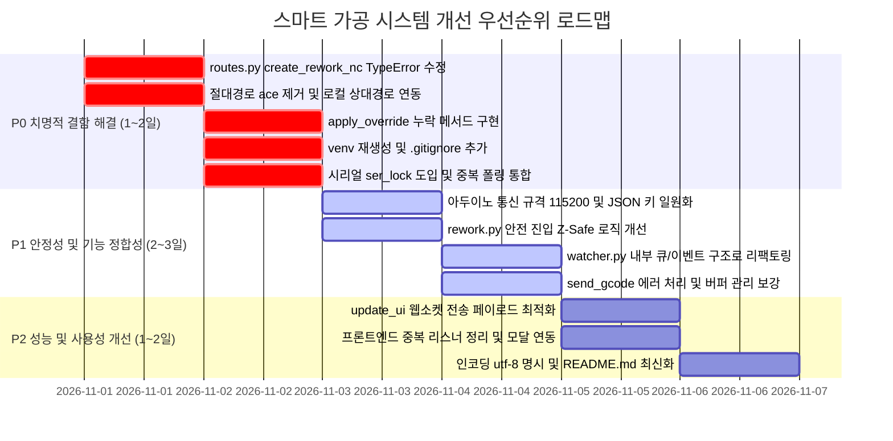

# CNC 밀링 머신 실시간 모니터링 및 스마트 가공 시스템 종합 분석 보고서 (full.md)

- **작성 일시**: 2026-10-30
- **대상 프로젝트**: `ProjectLab_System` (`d:\Project_Lab\02_공모전_및_경진대회\ProjectLab 2026\ProjectLab_System`)
- **작성 목적**: 시스템 전체 아키텍처, 런타임 제어 흐름, 코드 결함 및 잠재 버그, 모듈/환경 간 불일치 종합 진단 및 단계별 개선 가이드 수립

---

## 목차
1. [프로젝트 개요 및 아키텍처](#1-프로젝트-개요-및-아키텍처)
   - 1.1 시스템 핵심 목표 및 작동 원리
   - 1.2 전체 시스템 아키텍처 다이어그램
   - 1.3 모듈별 역할 및 책임 매핑
   - 1.4 멀티스레드 및 비동기 파이프라인 구조
2. [상세 실행 흐름 (Runtime Flow)](#2-상세-실행-흐름-runtime-flow)
   - 2.1 서버 부팅 및 데몬 스레드 기동
   - 2.2 하드웨어 연결 및 초기화 (CNC & 아두이노)
   - 2.3 NC 코드 로딩 및 G-code 스트리밍/보간
   - 2.4 실시간 진동 모니터링 및 이상치 판단 파이프라인
   - 2.5 비상 정지(Soft Reset) 및 절삭 조건 최적화
   - 2.6 복구 NC 코드(rework.nc) 생성 및 자동 재가공 루프
3. [잠재적 버그, 예외 처리 누락, 논리적 결함 종합 식별](#3-잠재적-버그-예외-처리-누락-논리적-결함-종합-식별)
   - 3.1 [치명적] `routes.py` 내 `create_rework_nc` 인자 불일치 (TypeError)
   - 3.2 [치명적] `vibration_monitor.py` / `train_models.py` 절대 경로 하드코딩
   - 3.3 [치명적] `routes.py`의 미구현 메서드 `apply_override` 호출 (AttributeError)
   - 3.4 [심각] 시리얼 포트(`ser`) 동기화 락(Lock) 부재 및 이중 쿼리 충돌
   - 3.5 [심각] `rework.py`의 Z축 선행 하강으로 인한 공작물 충돌/파손 위험
   - 3.6 [심각] `watcher.py`와 `cnc_app.py` 간의 소켓 순환 참조 및 부팅 지연
   - 3.7 [성능] `update_ui`의 누적 경로 배열 무제한 브로드캐스팅 (UI 렉/프리징)
   - 3.8 [논리 결함] `send_gcode`의 에러 응답 처리 미흡 및 버퍼 카운팅 오류
   - 3.9 [UI/이벤트] `vibration_alert` 삼중 등록 및 미구현 모달 제어 핸들러
4. [모듈 간 의존성 및 환경/규격 불일치 문제](#4-모듈-간-의존성-및-환경규격-불일치-문제)
   - 4.1 가상환경(`venv`) 이식성 상실 문제
   - 4.2 아두이노 통신 규격(Baudrate & JSON Key) 사분오열
   - 4.3 실행 엔트리 문서(README.md) 불일치
   - 4.4 Spindle Override 명령 바이트 불일치
   - 4.5 파일 입출력 인코딩(`utf-8` vs `cp949`) 혼용
5. [개선 및 수정을 위한 우선순위 가이드 (P0 ~ P2)](#5-개선-및-수정을-위한-우선순위-가이드-p0--p2)
   - 5.1 P0: 시스템 즉시 구동 및 크래시 방지 (즉시 수정)
   - 5.2 P1: 가공 안전성 및 기능 정합성 보강 (단기 수정)
   - 5.3 P2: 성능 최적화 및 유지보수성 향상 (중기 개선)
   - 5.4 주요 결함 수정 코드 스니펫 모음

---

# 1. 프로젝트 개요 및 아키텍처

## 1.1 시스템 핵심 목표 및 작동 원리
본 시스템은 소형 CNC 밀링 머신(GRBL 펌웨어 기반)을 웹 브라우저를 통해 실시간으로 모니터링하고 원격 제어함과 동시에, 스핀들 헤드에 부착된 3축 가속도계(MPU6050 센서) 데이터를 수집하여 가공 중 발생하는 채터링(Chatter) 등 **이상 진동을 실시간으로 감지**하고, 이상 감지 시 즉각 가공을 중단한 후 **머신러닝 기반 절삭 조건 최적화 모델을 통해 최적 스핀들 속도(S) 및 이송 속도(F)를 도출하여 복구 가공(Rework) 경로를 자동 생성/실행**하는 스마트 가공 시스템입니다.

## 1.2 전체 시스템 아키텍처 다이어그램

```mermaid
flowchart TB
    subgraph ClientLayer ["1. 클라이언트 계층 (Web Frontend)"]
        HTML["index.html (HTML5, Viewport)"]
        CSS["style.css (다크 테마, Grid/Flex Layout)"]
        JS["script.js (Socket.IO Client, Chart.js)"]
    end

    subgraph ServerLayer ["2. 애플리케이션 및 라우팅 계층 (Flask Backend)"]
        App["cnc_app.py\n- Flask Server (Port 5000)\n- SocketIO Server\n- CNC State Machine"]
        Routes["routes.py\n- REST API Endpoints\n- Socket.IO Event Handlers"]
    end

    subgraph IntelligenceLayer ["3. 인텔리전스 및 데이터 처리 계층"]
        VMon["vibration_monitor.py\n- VibrationMonitor Class\n- STFT Feature Extraction\n- LOF Anomaly & RMS Baseline"]
        Opt["optimizer.py\n- CuttingConditionOptimizer Class\n- RandomForest STFT 예측\n- Multi-stage Staged Grid Search"]
        Rework["rework.py\n- create_rework_nc()\n- 2-Pass Rework Code Generator"]
        Watcher["watcher.py\n- FileHandler (watchdog)\n- File-triggered Events"]
    end

    subgraph HardwareLayer ["4. 하드웨어 통신 계층 (Serial)"]
        CNC["CNC 밀링 머신\n(GRBL v1.1, 115200 bps)"]
        Arduino["아두이노 센서 보드\n(MPU6050, 115200 bps)"]
    end

    HTML --- JS
    CSS --- HTML
    JS <==>|WebSocket (Event/Data)| App
    JS <-->|HTTP POST/GET| Routes
    App <---> Routes
    App <---> VMon
    VMon <---> Opt
    Opt <---> Rework
    Watcher -.->|Localhost Socket.IO| App
    App <==>|Serial (ser)| CNC
    App <==>|Serial (arduino_serial)| Arduino
```

## 1.3 모듈별 역할 및 책임 매핑

| 파일명 | 크기 | 주요 클래스/함수 | 핵심 역할 및 책임 |
| :--- | :--- | :--- | :--- |
| [cnc_app.py](file:///d:/Project_Lab/02_공모전_및_경진대회/ProjectLab%202026/ProjectLab_System/cnc_app.py) | 72KB (1,586줄) | `send_gcode()`, `read_arduino_serial()`, `check_alarm()`, `check_connection()`, `update_ui()` | 애플리케이션 메인 엔트리. Flask/SocketIO 초기화, GRBL 128B 버퍼 스트리밍 제어, 실시간 위치 보간, 아두이노 데이터 수신 스레드 가동, 상태 머신 관리 |
| [routes.py](file:///d:/Project_Lab/02_공모전_및_경진대회/ProjectLab%202026/ProjectLab_System/routes.py) | 53KB (1,070줄) | `init_routes()`, `handle_connect_port()`, `handle_jog()`, `create_rework_file()`, `handle_load_rework_file()` | HTTP 라우트(`/`, `/upload_csv`, `/make_rework` 등) 및 소켓 이벤트 핸들러(조그 이동, 오버라이드 명령, 긴급정지, 포트 연결 등) 등록 |
| [vibration_monitor.py](file:///d:/Project_Lab/02_공모전_및_경진대회/ProjectLab%202026/ProjectLab_System/vibration_monitor.py) | 35KB (629줄) | `VibrationMonitor`, `extract_features()`, `train_model()`, `analyze_realtime_data()`, `handle_abnormal_vibration()` | 3축 가속도 데이터 윈도우 수집(1000개), Hampel/Median 필터링, STFT 연산, LOF 및 RMS 기반 이상 진동 판정, 긴급 정지 트리거 및 최적화 연계 |
| [optimizer.py](file:///d:/Project_Lab/02_공모전_및_경진대회/ProjectLab%202026/ProjectLab_System/optimizer.py) | 7.5KB (201줄) | `CuttingConditionOptimizer`, `g_predict()`, `is_safe()`, `update_residual()`, `optimize_staged()` | 사전 학습된 회귀 모델(`regr_model.joblib`)과 LOF 모델(`lof_model.joblib`)을 활용하여 실시간 잔차 업데이트 후 5단계 격자 탐색으로 안전 최적 가공 파라미터($S, F$) 결정 |
| [rework.py](file:///d:/Project_Lab/02_공모전_및_경진대회/ProjectLab%202026/ProjectLab_System/rework.py) | 6.0KB (147줄) | `create_rework_nc()` | 원본 G-code 파싱 후 설정 명령 필터링, 최적 조건($S, F$) 및 허용 공차($Z - \text{tolerance}$)를 반영한 2-Pass 재가공 NC 파일 생성 |
| [watcher.py](file:///d:/Project_Lab/02_공모전_및_경진대회/ProjectLab%202026/ProjectLab_System/watcher.py) | 6.4KB (167줄) | `FileHandler` | `watchdog` 라이브러리로 디렉토리 감시. `Vibration_detection.csv` 생성 시 `reset_path` 및 `make_rework` 요청, `rework.nc` 감지 시 `load_rework_file` 요청 전송 |
| [train_models.py](file:///d:/Project_Lab/02_공모전_및_경진대회/ProjectLab%202026/ProjectLab_System/train_models.py) | 2.0KB (58줄) | `train_and_save_models()` | STFT 데이터셋을 읽어 RandomForest 및 LOF 모델을 오프라인 학습시켜 `.joblib` 파일로 덤프하는 스크립트 |
| [arduino_sensor.py](file:///d:/Project_Lab/02_공모전_및_경진대회/ProjectLab%202026/ProjectLab_System/arduino_sensor.py) | 12KB (253줄) | `SensorSimulator`, `main()` | 실물 하드웨어 부재 시 사인파 기반 가상 가속도/진동 데이터를 생성하거나 실제 시리얼 포트를 릴레이하는 독립 시뮬레이터 |
| [MPU6050.ino](file:///d:/Project_Lab/02_공모전_및_경진대회/ProjectLab%202026/ProjectLab_System/MPU6050.ino) | 2.6KB (90줄) | `setup()`, `loop()` | 아두이노 C++ 펌웨어. MPU6050 센서에서 가속도 및 자이로 값을 읽어 JSON 직렬화 후 시리얼(115200 bps)로 전송 |

## 1.4 멀티스레드 및 비동기 파이프라인 구조
서버 프로세스 내에서 동작하는 스레드 구성은 다음과 같습니다:

1. **Main Process Thread**: Socket.IO 이벤트 루프 및 Werkzeug 웹 서버 실행 (`socketio.run`)
2. **`alarm_thread` (Daemon)**: [cnc_app.py:1553](file:///d:/Project_Lab/02_공모전_및_경진대회/ProjectLab%202026/ProjectLab_System/cnc_app.py#L1553) $\rightarrow$ 주기적(3초)으로 `?\n` 전송 후 GRBL 알람 상태 감시
3. **`connection_thread` (Daemon)**: [cnc_app.py:1557](file:///d:/Project_Lab/02_공모전_및_경진대회/ProjectLab%202026/ProjectLab_System/cnc_app.py#L1557) $\rightarrow$ 주기적(5초)으로 `?\n` 전송 후 포트 생존 여부 확인
4. **`arduino_thread` (Daemon)**: [cnc_app.py:1561](file:///d:/Project_Lab/02_공모전_및_경진대회/ProjectLab%202026/ProjectLab_System/cnc_app.py#L1561) $\rightarrow$ 0.5ms 주기로 아두이노 시리얼 라인을 읽어 JSON 파싱 후 소켓 브로드캐스트 및 `vibration_monitor.process_sensor_data()` 전달
5. **`nc_file_watcher_thread` (Daemon)**: [cnc_app.py:1565](file:///d:/Project_Lab/02_공모전_및_경진대회/ProjectLab%202026/ProjectLab_System/cnc_app.py#L1565) $\rightarrow$ `watchdog.Observer` 실행
6. **`machining_thread` (Daemon)**: [routes.py:284](file:///d:/Project_Lab/02_공모전_및_경진대회/ProjectLab%202026/ProjectLab_System/routes.py#L284) $\rightarrow$ 가공 시작 시 가동되어 `send_gcode()`를 순차 실행

---

# 2. 상세 실행 흐름 (Runtime Flow)

## 2.1 서버 부팅 및 데몬 스레드 기동
```
[사용자 실행] python cnc_app.py
  │
  ├─> logs/ 디렉토리 존재 확인 및 자동 생성
  ├─> threading.Thread(target=check_alarm, daemon=True).start()
  ├─> threading.Thread(target=check_connection, daemon=True).start()
  ├─> threading.Thread(target=read_arduino_serial, daemon=True).start()
  ├─> threading.Thread(target=start_nc_file_watcher, daemon=True).start()  <-- (문제 발생: SocketIO 클라이언트가 미가동 서버에 연결 시도)
  ├─> list_serial_ports() 실행하여 콘솔에 포트 목록 표시
  └─> socketio.run(app, host='0.0.0.0', port=5000, allow_unsafe_werkzeug=True)
```

## 2.2 하드웨어 연결 및 초기화 (CNC & 아두이노)
1. **CNC 연결**: 사용자가 UI에서 포트 선택 후 `connect_port` 이벤트 발생 $\rightarrow$ `connect_serial(port)` 호출 $\rightarrow$ 115200 bps 시리얼 오픈 $\rightarrow$ `\r\n\r\n` 플러시 후 2초 대기 $\rightarrow$ `state = "alarm_unlocked"` 또는 `"alarm"` 전환.
2. **아두이노 연결**: `connect_sensor` 이벤트 $\rightarrow$ `connect_arduino(port)` $\rightarrow$ 115200 bps 시리얼 오픈 $\rightarrow$ `arduino_connected = True` $\rightarrow$ `read_arduino_serial` 스레드가 활성화되어 데이터 스트림 수신 시작.

## 2.3 NC 코드 로딩 및 G-code 스트리밍/보간
1. 사용자가 `.nc` 또는 `.txt` 파일 선택 후 업로드 $\rightarrow$ [routes.py:220](file:///d:/Project_Lab/02_공모전_및_경진대회/ProjectLab%202026/ProjectLab_System/routes.py#L220) `handle_load_nc_file` 호출.
2. [cnc_app.py:503](file:///d:/Project_Lab/02_공모전_및_경진대회/ProjectLab%202026/ProjectLab_System/cnc_app.py#L503) `load_nc_code`가 코드 줄바꿈 정리 및 빈 줄 제거, 공구 경로 파싱 및 예상 가공 시간(`calculate_estimated_time`) 계산.
3. 사용자가 "가공 시작" 클릭 $\rightarrow$ `machining_thread` 기동 (`send_gcode`).
4. **버퍼 제어**: GRBL RX 버퍼(128바이트)가 넘치지 않도록 `buffer_used + line_len <= 112`를 확인하며 라인을 전송하고 `pending_lines`에 추가.
5. **응답 대기**: `pending_lines`에서 하나씩 꺼내며 `ok` 수신 확인(최대 5초 타임아웃).
6. **실시간 위치 보간**: `G0`, `G1` 명령인 경우 시작점과 끝점 사이의 거리를 계산하여 1mm 단위로 세분화(`steps = int(max(distance, 1))`)하고, 계산된 이동 속도(`step_time`)만큼 `time.sleep`하며 `update_ui()`를 호출하여 차트 좌표 브로드캐스트.

## 2.4 실시간 진동 모니터링 및 이상치 판단 파이프라인
1. 아두이노가 500ms(또는 고주기) 간격으로 전송하는 JSON 데이터를 `read_arduino_serial`이 수신.
2. [vibration_monitor.py:330](file:///d:/Project_Lab/02_공모전_및_경진대회/ProjectLab%202026/ProjectLab_System/vibration_monitor.py#L330) `process_sensor_data(sensor_data)` 호출.
3. **스무딩 & 이상치 제거**: 3-샘플 Median 필터 및 Hampel 필터(MAD 기반)를 거쳐 `sensor_data_buffer`에 적재.
4. 버퍼 크기가 `BUFFER_SIZE(1000)` 이상 쌓이면 [vibration_monitor.py:185](file:///d:/Project_Lab/02_공모전_및_경진대회/ProjectLab%202026/ProjectLab_System/vibration_monitor.py#L185) `analyze_realtime_data` 호출:
   - 각 축(AccX, AccY, AccZ) 정규화(`StandardScaler`).
   - 슬라이딩 윈도우(`window_size=100`, `step_size=25`) 분할.
   - 단시간 푸리에 변환(STFT)을 통해 4개 통계 특징값(Mean, Std, Max, Energy) 추출 (총 12차원 벡터).
   - LOF 모델(`lof_model.predict`)로 이상치 세그먼트 비율 계산.
   - 윈도우별 RMS 계산 후 사전 학습 베이스라인 임계치(`mean + 1.5 * std`) 초과 비율 계산.
   - LOF 이상치와 RMS 초과 비율 조합으로 최종 이상 진동(`final_is_abnormal`) 판정.

## 2.5 비상 정지(Soft Reset) 및 절삭 조건 최적화
1. 이상 진동이 `MIN_ABNORMAL_DURATION(1.0초)` 이상 지속되면 [vibration_monitor.py:436](file:///d:/Project_Lab/02_공모전_및_경진대회/ProjectLab%202026/ProjectLab_System/vibration_monitor.py#L436) `handle_abnormal_vibration()` 진입.
2. **긴급 정지**: GRBL에 즉시 소프트 리셋 바이트 `b"\x18"` (Ctrl-X) 송신 $\rightarrow$ `controllers.state = "emergency"`.
3. 웹 UI에 이상 진동 경고 팝업 및 주황색 상태 갱신 발행.
4. `Vibration_detection.csv` 파일에 감지 시각, 현재 좌표($X, Y, Z$), 스핀들 속도 기록.
5. **절삭 조건 최적화 (`optimizer.py`)**:
   - 실시간 STFT 12차원 특징값과 현재 가공 파라미터($n, F$)를 회귀 모델에 전달하여 잔차 업데이트 ($r = \phi_{now} - \hat{\phi}$).
   - `optimize_staged(c0)`를 실행하여 5단계 격자 탐색 진행:
     - 1단계: $\pm3\%$ 탐색
     - 2단계: $\pm5\%$ 탐색
     - 3단계: $\pm10\%$ 3x3 격자
     - 4단계: $\pm20\%$ 5x5 격자
     - 5단계: 전 도메인(S: 16000~24000, F: 50~150) 10x10 격자
   - 각 후보군 중 LOF 점수가 안전 기준($\tau \ge 1.0$)을 만족하고 가공 시간($1/F$)이 최소인 최적 조건 $(S_{opt}, F_{opt})$ 도출.

## 2.6 복구 NC 코드(rework.nc) 생성 및 자동 재가공 루프
1. [rework.py](file:///d:/Project_Lab/02_공모전_및_경진대회/ProjectLab%202026/ProjectLab_System/rework.py)의 `create_rework_nc`를 호출하여 2-Pass 가공 경로 생성:
   - Pass 1: 최적 파라미터($S_{opt}, F_{opt}$)를 적용한 원본 절삭 깊이($Z_{orig}$) 가공
   - 중간 안전 복귀: `M5` $\rightarrow$ `G0 Z5` $\rightarrow$ `G0 X0 Y0 Z0`
   - Pass 2: 사용자 지정 공차만큼 깊이를 보정한($Z_{new} = Z_{orig} - \text{tolerance}$) 마무리 가공
   - 최종 복귀: `M5` $\rightarrow$ `G0 Z5` $\rightarrow$ `G0 X0 Y0 Z0` $\rightarrow$ `M30`
2. `vibration_monitor.py`가 GRBL 소프트 리셋(`\x18`) 후 2초 대기 $\rightarrow$ 알람 해제 명령(`$X\n`) 전송 $\rightarrow$ `state = "alarm_unlocked"`.
3. 백그라운드 [watcher.py](file:///d:/Project_Lab/02_공모전_및_경진대회/ProjectLab%202026/ProjectLab_System/watcher.py)가 생성된 `rework.nc`를 감지하여 Socket.IO 이벤트 `load_rework_file`을 트리거 $\rightarrow$ [routes.py:1027](file:///d:/Project_Lab/02_공모전_및_경진대회/ProjectLab%202026/ProjectLab_System/routes.py#L1027)에서 새 가공 스레드를 실행하여 재가공 완수.

---

# 3. 잠재적 버그, 예외 처리 누락, 논리적 결함 종합 식별

## 3.1 [치명적] `routes.py` 내 `create_rework_nc` 인자 불일치 (TypeError)
- **발생 위치**: [routes.py:971-976](file:///d:/Project_Lab/02_공모전_및_경진대회/ProjectLab%202026/ProjectLab_System/routes.py#L971-L976)
- **원인 코드**:
  ```python
  # routes.py:
  success = create_rework_nc(
      controllers.gcode_lines,        # 1번째 위치 인자
      controllers.tolerance_value,    # 2번째 위치 인자
      controllers.current_feedrate,   # 3번째 위치 인자
      23000                           # 4번째 위치 인자
  )
  ```
  ```python
  # rework.py:
  def create_rework_nc(current_n, current_F, optimal_n, optimal_F, x_pos, y_pos, z_pos, gcode_lines=None, tolerance_value=0.0, output_path="rework.nc"):
  ```
- **결함 내용**:
  `rework.py`의 함수는 최소 7개의 위치 인자를 요구합니다 (`current_n`, `current_F`, `optimal_n`, `optimal_F`, `x_pos`, `y_pos`, `z_pos`).
  그러나 `routes.py`는 4개의 인자만 넘기고 있으며, 심지어 1번째 인자로 리스트 형태의 `gcode_lines`를 `current_n` 자리에 전달하고 있습니다.
- **영향도**: 사용자가 웹에서 재가공 생성을 요청하거나 소켓 이벤트 `make_rework` 호출 시 무조건 **`TypeError: create_rework_nc() missing 3 required positional arguments`가 발생**하여 프로세스가 중단됩니다.

## 3.2 [치명적] `vibration_monitor.py` / `train_models.py` 절대 경로 하드코딩
- **발생 위치**:
  - [vibration_monitor.py:298-304](file:///d:/Project_Lab/02_공모전_및_경진대회/ProjectLab%202026/ProjectLab_System/vibration_monitor.py#L298-L304)
    ```python
    base_path = "C:\\Users\\ace\\Desktop"
    normal_data_files = ["master_dataset.csv"]
    ```
  - [train_models.py:12](file:///d:/Project_Lab/02_공모전_및_경진대회/ProjectLab%202026/ProjectLab_System/train_models.py#L12)
    ```python
    STFT_DATASET_PATH = "C:\\Users\\ace\\Desktop\\stft_dataset_3axis.csv"
    ```
- **결함 내용**:
  이전 작업자의 특정 윈도우 사용자 계정명(`ace`)과 바탕화면 경로가 하드코딩되어 있습니다.
- **영향도**:
  서버 구동 시 `vibration_monitor.initialize_analyzer()`가 무조건 `FileNotFoundError`를 내고 `self.is_trained = False`로 남게 됩니다. 이로 인해 실시간 분석 함수인 `analyze_realtime_data()`는 매번 `"모델이 학습되지 않았습니다"`를 반환하여 **이상 진동 감지 기능이 영구적으로 작동하지 않습니다.**

## 3.3 [치명적] `routes.py`의 미구현 메서드 `apply_override` 호출 (AttributeError)
- **발생 위치**: [routes.py:923](file:///d:/Project_Lab/02_공모전_및_경진대회/ProjectLab%202026/ProjectLab_System/routes.py#L923)
- **원인 코드**:
  ```python
  @socketio.on('set_feed_override')
  def handle_set_feed_override(data):
      value = int(data.get('value', 100))
      result = controllers.apply_override("feed", value)  # <-- cnc_app.py에 미존재
  ```
- **결함 내용**: `cnc_app.py`에는 `apply_override`라는 함수나 속성이 정의되어 있지 않습니다.
- **영향도**: 웹 인터페이스에서 Feed Override 슬라이더를 조작하는 순간 백엔드에서 **`AttributeError: module 'cnc_app' has no attribute 'apply_override'`** 예외가 발생합니다.

## 3.4 [심각] 시리얼 포트(`ser`) 동기화 락(Lock) 부재 및 이중 쿼리 충돌
- **발생 위치**: [cnc_app.py](file:///d:/Project_Lab/02_공모전_및_경진대회/ProjectLab%202026/ProjectLab_System/cnc_app.py) 전체 (`check_alarm`, `check_connection`, `send_gcode`, `routes.py` 핸들러)
- **결함 내용**:
  - `cnc_app.py`와 `routes.py` 어디에도 `threading.Lock`이 선언되어 있지 않습니다.
  - 특히 [cnc_app.py:698](file:///d:/Project_Lab/02_공모전_및_경진대회/ProjectLab%202026/ProjectLab_System/cnc_app.py#L698)의 `check_alarm()`(3초 주기)과 [cnc_app.py:1288](file:///d:/Project_Lab/02_공모전_및_경진대회/ProjectLab%202026/ProjectLab_System/cnc_app.py#L1288)의 `check_connection()`(5초 주기)은 둘 다 시리얼 포트에 `b"?\n"`을 쓰고 응답을 `readline()`으로 읽어옵니다.
- **영향도**:
  - 두 스레드가 동시에 실행되면 한 스레드가 보낸 `?` 명령의 응답을 다른 스레드가 가로채거나, `ser.reset_input_buffer()`로 지워버립니다.
  - 이로 인해 멀쩡한 연결 상태에서도 `consecutive_failures`가 누적되어 허위 연결 끊김 경고가 발생하며, 가공 중에는 `send_gcode`의 `ok` 응답을 엉뚱한 스레드가 읽어가 가공이 5초간 멈추는 프리징 현상이 발생합니다.

## 3.5 [심각] `rework.py`의 Z축 선행 하강으로 인한 공작물 충돌/파손 위험
- **발생 위치**: [rework.py:91-105](file:///d:/Project_Lab/02_공모전_및_경진대회/ProjectLab%202026/ProjectLab_System/rework.py#L91-L105)
- **원인 코드**:
  ```python
  rework_gcode.extend([
      "G21", "G90",
      f"M3 S{int(optimal_n)}",
      f"G1 Z{original_z_value:.3f} F{int(optimal_F)}"  # <-- 1단계: 가공 깊이 Z로 바로 하강!
  ])
  for line in before_z_lines_cutting:                  # <-- 2단계: 원래 Z 하강 전에 있던 이동을 깊이 들어간 상태에서 실행!
      rework_gcode.append(_apply_optimal_params(line, optimal_n, optimal_F))
  ```
- **결함 내용**:
  원본 G-code에서 공구가 원점에서 가공 시작 지점(XY)으로 공중 이동하던 라인(`before_z_lines`)이, 재가공 코드에서는 이미 소재 내부($Z=-0.2$ 등)로 파고든 이후에 실행됩니다.
- **영향도**:
  회전 중인 엔드밀이 소재를 측면으로 강하게 들이받아 **공구 파손(Tool Breakage), 스핀들 모터 과부하, 또는 공작물이 뜯겨나가는 심각한 하드웨어 손상 사고**를 유발할 수 있습니다.

## 3.6 [심각] `watcher.py`와 `cnc_app.py` 간의 소켓 순환 참조 및 부팅 지연
- **발생 위치**: [cnc_app.py:1565](file:///d:/Project_Lab/02_공모전_및_경진대회/ProjectLab%202026/ProjectLab_System/cnc_app.py#L1565), [watcher.py:26-53](file:///d:/Project_Lab/02_공모전_및_경진대회/ProjectLab%202026/ProjectLab_System/watcher.py#L26-L53)
- **결함 내용**:
  - `cnc_app.py`에서 서버를 띄우기 전(L1577 `socketio.run` 이전)에 `start_nc_file_watcher()` 스레드가 먼저 시작됩니다.
  - `FileHandler.__init__`에서 `self.connect_socket()`을 호출하여 `http://localhost:5000`에 접속을 시도하는데, 서버가 아직 포트를 열지 않았으므로 5초 간격으로 5회 재시도(총 25초)하며 에러 로그를 대량 출력합니다.
  - 동일한 파이썬 프로세스 내에서 내부 함수 호출 대신 외부 네트워크 소켓 클라이언트를 열어 통신하는 비효율적인 아키텍처입니다.

## 3.7 [성능] `update_ui`의 누적 경로 배열 무제한 브로드캐스팅 (UI 렉/프리징)
- **발생 위치**: [cnc_app.py:1273-1284](file:///d:/Project_Lab/02_공모전_및_경진대회/ProjectLab%202026/ProjectLab_System/cnc_app.py#L1273-L1284)
- **원인 코드**:
  ```python
  socketio.emit('position_update', {
      'x': x_vals[-1], 'y': y_vals[-1], 'z': z_vals[-1],
      'path_x': x_vals, 'path_y': y_vals, 'path_z': z_vals,  # <-- 매 1mm 보간 스텝마다 전체 배열 전송
      ...
  })
  ```
- **결함 내용**:
  가공 거리가 1000mm를 넘어가면 `x_vals` 배열 크기가 수만 개로 증가합니다. `send_gcode`의 보간 루프는 매 0.01~0.1초마다 이 수만 개의 부동소수점 배열을 통째로 JSON 직렬화하여 웹소켓으로 쏩니다.
- **영향도**:
  서버 CPU 점유율이 치솟고 네트워크 대역폭이 포화되며, 브라우저의 JavaScript Chart.js 렌더링이 멈춰 **화면이 완전히 프리징(응답 없음)** 됩니다.

## 3.8 [논리 결함] `send_gcode`의 에러 응답 처리 미흡 및 버퍼 카운팅 오류
- **발생 위치**: [cnc_app.py:1118-1138](file:///d:/Project_Lab/02_공모전_및_경진대회/ProjectLab%202026/ProjectLab_System/cnc_app.py#L1118-L1138)
- **결함 내용**:
  - GRBL로부터 `error` 응답을 받았을 때 `pending_lines.insert(0, ...)`로 명령을 다시 큐에 집어넣지만, 바로 아래에서 `break`하여 재시도 루프(`for attempt in range(3)`)를 빠져나옵니다.
  - 그러고는 실패한 명령임에도 불구하고 L1140 이하의 이동 좌표 보간(`x_vals.append`)을 그대로 수행합니다.
- **영향도**:
  실제 머신은 에러로 인해 해당 좌표로 이동하지 않았음에도 소프트웨어 상에서는 이동한 것으로 간주하여 가공 경로 시각화와 실제 물리 좌표 간의 괴리가 발생합니다.

## 3.9 [UI/이벤트] `vibration_alert` 삼중 등록 및 미구현 모달 제어 핸들러
- **발생 위치**:
  - [static/script.js](file:///d:/Project_Lab/02_공모전_및_경진대회/ProjectLab%202026/ProjectLab_System/static/script.js) (L575 부근 및 L1120 부근 등 2회 등록)
  - [templates/index.html:322](file:///d:/Project_Lab/02_공모전_및_경진대회/ProjectLab%202026/ProjectLab_System/templates/index.html#L322) (인라인 스크립트로 1회 등록)
- **결함 내용**:
  - `socket.on('vibration_alert', ...)` 이벤트 리스너가 동일 클라이언트에 3중으로 바인딩되어 알림 팝업 타이머와 클래스 조작이 3번씩 중복 실행됩니다.
  - 반면 `index.html`에 선언된 `vibration-settings-modal` 내의 `train-model-btn`, `reset-vibration-analyzer`, `execute-recovery-btn` 버튼은 `script.js`에 클릭 이벤트 핸들러가 아예 구현되어 있지 않아 클릭해도 아무 반응이 없습니다.

---

# 4. 모듈 간 의존성 및 환경/규격 불일치 문제

## 4.1 가상환경(`venv`) 이식성 상실 문제
- **상태**: 현재 리포지토리의 `venv/pyvenv.cfg` 파일 내용:
  ```ini
  home = C:\Users\ace\anaconda3
  include-system-site-packages = false
  version = 3.13.5
  executable = C:\Users\ace\anaconda3\python.exe
  command = C:\Users\ace\anaconda3\python.exe -m venv C:\Users\ace\Desktop\하태환 1120\하태환\시스템_0805\시스템\시스템\venv
  ```
- **문제점**:
  - 파이썬 가상환경은 인터프리터 경로가 절대 경로로 하드코딩되므로 다른 PC로 복사하면 완전히 깨집니다.
  - 현재 시스템(`C:\Users\knuser`)에서 `.\venv\Scripts\python.exe`를 실행하면 `did not find executable at 'C:\Users\ace\anaconda3\python.exe'` 에러가 발생하며 전혀 실행되지 않습니다.

## 4.2 아두이노 통신 규격(Baudrate & JSON Key) 사분오열
시스템 전반에 걸쳐 센서 데이터 프로토콜이 4갈래로 쪼개져 있습니다:

| 소스 코드 / 문서 | 시리얼 통신 속도 (Baudrate) | 데이터 포맷 (JSON 키) | 비고 |
| :--- | :--- | :--- | :--- |
| [README_ARDUINO.md](file:///d:/Project_Lab/02_공모전_및_경진대회/ProjectLab%202026/ProjectLab_System/README_ARDUINO.md) | **9600 bps** | `accelX`, `accelY`, `accelZ`, `vibration`, `temp` | 사용자 가이드 문서 |
| [arduino_example/sensor_example.ino](file:///d:/Project_Lab/02_공모전_및_경진대회/ProjectLab%202026/ProjectLab_System/arduino_example/sensor_example.ino) | **9600 bps** | `accelX`, `accelY`, `accelZ`, `vibration`, `temp` | ADXL335 예제 펌웨어 |
| [arduino_sensor.py](file:///d:/Project_Lab/02_공모전_및_경진대회/ProjectLab%202026/ProjectLab_System/arduino_sensor.py) | **1000000 bps** (도움말: 9600) | `accelX`, `accelY`, `accelZ`, `vibration`, `temp` | 파이썬 센서 시뮬레이터 |
| [MPU6050.ino](file:///d:/Project_Lab/02_공모전_및_경진대회/ProjectLab%202026/ProjectLab_System/MPU6050.ino) | **115200 bps** | `{"accel": {"x", "y", "z"}, "gyro": {"x", "y", "z"}}` | 실제 장착 MPU6050 펌웨어 |
| [cnc_app.py](file:///d:/Project_Lab/02_공모전_및_경진대회/ProjectLab%202026/ProjectLab_System/cnc_app.py) (`read_arduino_serial`) | **115200 bps** | `accel` 객체 또는 단순 `{"x", "y", "z"}`만 파싱 | 메인 백엔드 수신부 |

- **문제점**:
  사용자가 가이드 문서나 예제 스케치, 혹은 `arduino_sensor.py`를 실행할 경우, `cnc_app.py`는 `accelX` 키를 인식하지 못하고 `data.get('accel', {})`에서 빈 딕셔너리를 반환하여 **가속도 값이 항상 (0, 0, 0)으로 수렴**합니다.

## 4.3 실행 엔트리 문서(README.md) 불일치
- [README.md:23](file:///d:/Project_Lab/02_공모전_및_경진대회/ProjectLab%202026/ProjectLab_System/README.md#L23)에는 `python app.py`로 서버를 시작하라고 명시되어 있으나, 리포지토리에는 `app.py`라는 파일이 존재하지 않습니다 (실제 엔트리는 `cnc_app.py`).

## 4.4 Spindle Override 명령 바이트 불일치
- GRBL v1.1 실시간 커맨드 스펙:
  - `0x99`: Spindle Override 100% Reset
  - `0x9A`: Spindle Override +10%
  - `0x9B`: Spindle Override -10%
  - `0x9C`: Spindle Override +1%
  - `0x9D`: Spindle Override -1%
- [static/script.js](file:///d:/Project_Lab/02_공모전_및_경진대회/ProjectLab%202026/ProjectLab_System/static/script.js)에서는 `-10%` 버튼 클릭 시 `{ cmd: "0x9C" }`를 emit하고, [routes.py:874](file:///d:/Project_Lab/02_공모전_및_경진대회/ProjectLab%202026/ProjectLab_System/routes.py#L874)에서는 `cmd == '0x9C'`일 때 `ser.write(b'\x9B')`를 하드코딩하여 땜질해 두었습니다. 프로토콜 명세와 구현이 뒤엉켜 있어 추후 유지보수 시 심각한 혼선을 야기합니다.

## 4.5 파일 입출력 인코딩(`utf-8` vs `cp949`) 혼용
- [rework.py:140](file:///d:/Project_Lab/02_공모전_및_경진대회/ProjectLab%202026/ProjectLab_System/rework.py#L140): `open(output_path, 'w', encoding='utf-8')`
- [cnc_app.py:1420](file:///d:/Project_Lab/02_공모전_및_경진대회/ProjectLab%202026/ProjectLab_System/cnc_app.py#L1420): `open(file_path, "r", encoding='cp949')`
- [routes.py:1032](file:///d:/Project_Lab/02_공모전_및_경진대회/ProjectLab%202026/ProjectLab_System/routes.py#L1032): `open('rework.nc', 'r')` (인코딩 미지정 $\rightarrow$ 윈도우 OS 기본값 CP949 사용)
- 한글 코멘트나 특수 기호가 포함된 NC 파일을 처리할 때 `UnicodeDecodeError`가 발생할 위험이 상존합니다.

---

# 5. 개선 및 수정을 위한 우선순위 가이드 (P0 ~ P2)



## 5.1 P0: 시스템 즉시 구동 및 크래시 방지 (즉시 수정)

### [P0-1] `routes.py`의 `create_rework_file` 호출 파라미터 정합성 수정
- **목표**: `create_rework_nc` 함수 호출 시 7개 필수 인자를 전달하도록 수정하여 `TypeError` 완전 해소.
- **수정 대상**: [routes.py:971-976](file:///d:/Project_Lab/02_공모전_및_경진대회/ProjectLab%202026/ProjectLab_System/routes.py#L971-L976)

### [P0-2] `vibration_monitor.py` / `train_models.py` 절대 경로 제거
- **목표**: 하드코딩된 `C:\Users\ace\Desktop` 경로를 제거하고, 현재 프로젝트 내의 `학습 데이터/` 디렉토리와 연동하여 어느 PC에서든 LOF/RMS 모델이 정상 초기화되도록 조치.
- **수정 대상**: [vibration_monitor.py:298-301](file:///d:/Project_Lab/02_공모전_및_경진대회/ProjectLab%202026/ProjectLab_System/vibration_monitor.py#L298-L301), [train_models.py:12](file:///d:/Project_Lab/02_공모전_및_경진대회/ProjectLab%202026/ProjectLab_System/train_models.py#L12)

### [P0-3] `cnc_app.py`에 `apply_override` 구현
- **목표**: Feed 및 Spindle Override 슬라이더 조작 시 `AttributeError`가 발생하지 않고, GRBL 실시간 커맨드(`\x90`, `\x91`, `\x92` 등)를 송신할 수 있는 함수 작성.
- **수정 대상**: [cnc_app.py](file:///d:/Project_Lab/02_공모전_및_경진대회/ProjectLab%202026/ProjectLab_System/cnc_app.py)

### [P0-4] 가상환경(`venv`) 재생성 및 리포지토리 격리
- **목표**: 오염된 `venv` 폴더를 삭제하고, 현재 환경에 맞게 신규 생성 후 `.gitignore`에 등록하여 타 환경과의 의존성 충돌 차단.

### [P0-5] 시리얼 통신 `ser_lock` 구현 및 상태 체크 스레드 단일화
- **목표**: `ser_lock = threading.Lock()`을 선언하여 모든 시리얼 I/O를 임계 구역으로 보호하고, `check_alarm()`과 `check_connection()`의 중복 쿼리 루프를 하나의 통합 헬스체크 루프로 병합.

---

## 5.2 P1: 가공 안전성 및 기능 정합성 보강 (단기 수정)

### [P1-1] 아두이노 통신 프로토콜 표준화 및 하위 호환 파서 탑재
- **목표**:
  1. 표준 통신 속도를 **115200 bps**로 일원화 ([README_ARDUINO.md](file:///d:/Project_Lab/02_공모전_및_경진대회/ProjectLab%202026/ProjectLab_System/README_ARDUINO.md), [arduino_sensor.py](file:///d:/Project_Lab/02_공모전_및_경진대회/ProjectLab%202026/ProjectLab_System/arduino_sensor.py), [sensor_example.ino](file:///d:/Project_Lab/02_공모전_및_경진대회/ProjectLab%202026/ProjectLab_System/arduino_example/sensor_example.ino) 수정).
  2. [cnc_app.py](file:///d:/Project_Lab/02_공모전_및_경진대회/ProjectLab%202026/ProjectLab_System/cnc_app.py)의 `read_arduino_serial`에서 신규 포맷(`accel: {x,y,z}`)과 구형 포맷(`accelX, accelY, accelZ`)을 모두 파싱하도록 방어 로직 추가.

### [P1-2] `rework.py` 공구 충돌 방지 Safe Retract 시퀀스 보강
- **목표**:
  절삭 깊이($Z$)로 내려가기 전에 **반드시 시작 위치 $(X, Y)$로 먼저 공중 급속 이송(`G0 Z5.0`, `G0 X.. Y..`)한 후 $Z$ 절삭 깊이로 진입**하도록 G-code 생성 구조를 전면 수정하여 공구 충돌 차단.

### [P1-3] `watcher.py` 구조 개선 (소켓 순환 제거)
- **목표**:
  감시자가 백엔드 내부에서 동작할 때는 별도의 Socket.IO 클라이언트를 띄우지 않고, `VibrationMonitor` 내부에서 직접 이벤트를 처리하거나 threading 이벤트/콜백 형태로 변경하여 부팅 시 25초 접속 에러를 제거.

### [P1-4] `send_gcode`의 에러 응답 및 버퍼 롤백 로직 수정
- **목표**:
  GRBL이 `error:`를 응답했을 때 단순히 넘어가서 좌표를 보간해 버리지 않고, 에러 발생 시 가공 일시정지(`pause = True`) 및 사용자 알림을 띄우고 버퍼 상태를 정확히 유지하도록 보강.

---

## 5.3 P2: 성능 최적화 및 유지보수성 향상 (중기 개선)

### [P2-1] `update_ui` 웹소켓 전송 페이로드 최적화
- **목표**:
  매 스텝마다 수만 개의 누적 좌표 배열(`path_x`, `path_y`, `path_z`)을 전송하는 대신, 실시간 좌표인 `(x, y, z)`만 고주기로 전송하고 전체 경로는 NC 로드 시 1회만 전달하여 브라우저 프리징 완전 해소.

### [P2-2] 프론트엔드 이벤트 리스너 정리 및 모달 연동
- **목표**:
  - `script.js`와 `index.html`에 3중 등록된 `vibration_alert` 리스너를 `script.js` 1곳으로 단일화.
  - `index.html`에 방치된 모달 버튼(`train-model-btn`, `execute-recovery-btn`)의 이벤트 리스너 작성 및 미사용 UI 정돈.

### [P2-3] 입출력 인코딩 `utf-8` 명시 및 문서 최신화
- **목표**:
  - 모든 `open()` 함수 호출부에 `encoding='utf-8'` 옵션 필수 부여.
  - `README.md`의 실행 커맨드를 `python cnc_app.py`로 수정하고 시스템 설정 매뉴얼 최신화.

---

## 5.4 주요 결함 수정 코드 스니펫 모음

### Snippet 1: [routes.py] `create_rework_file` 호출부 수정 (P0-1)
```python
# routes.py:970 부근 수정
# 기존의 잘못된 4개 인자 호출을 올바른 7개 이상 인자 호출로 변경
cur_spindle = getattr(controllers, 'current_spindle', 16000) or 16000
cur_feed = getattr(controllers, 'current_feedrate', 100) or 100
cur_x = controllers.x_vals[-1] if controllers.x_vals else 0.0
cur_y = controllers.y_vals[-1] if controllers.y_vals else 0.0
cur_z = controllers.z_vals[-1] if controllers.z_vals else 0.0

success = create_rework_nc(
    current_n=cur_spindle,
    current_F=cur_feed,
    optimal_n=23000,                  # 최적 스핀들 속도
    optimal_F=cur_feed,               # 최적 이송 속도
    x_pos=cur_x,
    y_pos=cur_y,
    z_pos=cur_z,
    gcode_lines=controllers.gcode_lines,
    tolerance_value=controllers.tolerance_value,
    output_path="rework.nc"
)
```

### Snippet 2: [vibration_monitor.py] 로컬 데이터셋 상대 경로 연동 (P0-2)
```python
# vibration_monitor.py:293 initialize_analyzer() 내부 수정
base_dir = os.path.dirname(os.path.abspath(__file__))
train_data_dir = os.path.join(base_dir, "학습 데이터")

all_normal_data = []
if os.path.exists(train_data_dir):
    csv_files = [f for f in os.listdir(train_data_dir) if f.endswith('.csv')]
    for file_name in csv_files[:5]:  # 상위 5개 데이터셋을 활용해 베이스라인 학습
        file_path = os.path.join(train_data_dir, file_name)
        try:
            df = pd.read_csv(file_path)
            # 컬럼명 매핑 (AccX, AccY, AccZ 또는 accelX, accelY, accelZ 지원)
            col_map = {'accelX': 'AccX', 'accelY': 'AccY', 'accelZ': 'AccZ'}
            df = df.rename(columns=col_map)
            if all(col in df.columns for col in ['AccX', 'AccY', 'AccZ']):
                vals = df[['AccX', 'AccY', 'AccZ']].dropna().values
                all_normal_data.extend(vals)
        except Exception as e:
            logger.warning(f"데이터셋 로드 오류 ({file_name}): {e}")
```

### Snippet 3: [cnc_app.py] `apply_override` 구현 추가 (P0-3)
```python
# cnc_app.py에 추가할 오버라이드 처리 함수
def apply_override(target, value):
    """
    GRBL v1.1 실시간 오버라이드 명령 적용
    target: "feed" 또는 "spindle"
    value: 목표 퍼센트 값 (예: 100)
    """
    global ser, feed_override, spindle_override
    if not ser or not ser.is_open:
        return {"status": "error", "message": "시리얼 포트가 연결되지 않았습니다."}
    
    try:
        if target == "feed":
            # 100% 리셋 명령: 0x90
            if value == 100:
                ser.write(b'\x90')
            feed_override = value
            socketio.emit('feed_override_update', {'value': value})
            return {"status": "success", "message": f"Feed Override {value}% 설정됨"}
        elif target == "spindle":
            # 100% 리셋 명령: 0x99
            if value == 100:
                ser.write(b'\x99')
            spindle_override = value
            socketio.emit('spindle_override_update', {'value': value})
            return {"status": "success", "message": f"Spindle Override {value}% 설정됨"}
        return {"status": "error", "message": f"알 수 없는 타겟: {target}"}
    except Exception as e:
        return {"status": "error", "message": str(e)}
```

### Snippet 4: [cnc_app.py] 센서 수신 파서 하위 호환성 확보 (P1-1)
```python
# cnc_app.py: read_arduino_serial() 내 JSON 파싱부 보강
# 구형 accelX/Y/Z 및 신규 accel:{x,y,z} 양방향 파싱
acc_x, acc_y, acc_z = 0.0, 0.0, 0.0
if 'accel' in data and isinstance(data['accel'], dict):
    acc_x = float(data['accel'].get('x', 0))
    acc_y = float(data['accel'].get('y', 0))
    acc_z = float(data['accel'].get('z', 0))
elif 'accelX' in data:
    acc_x = float(data.get('accelX', 0))
    acc_y = float(data.get('accelY', 0))
    acc_z = float(data.get('accelZ', 0))
elif 'x' in data and 'y' in data and 'z' in data:
    acc_x = float(data.get('x', 0))
    acc_y = float(data.get('y', 0))
    acc_z = float(data.get('z', 0))
```

### Snippet 5: [rework.py] 공구 충돌 방지 Safe Retract 시퀀스 (P1-2)
```python
# rework.py: create_rework_nc() 내부 경로 생성 순서 개선
# 안전 높이(Z=5.0)로 먼저 복귀 후 시작 XY로 이동하고 나서 절삭 깊이로 진입
rework_gcode.extend([
    "G21",
    "G90",
    "G0 Z5.0",                          # 1. 안전 높이로 상승
    f"M3 S{int(optimal_n)}",             # 2. 스핀들 가동
])

# 3. Z 절삭 하강 전의 XY 접근 이동을 '안전 높이(Z=5.0)'에서 먼저 수행
for line in before_z_lines_cutting:
    rework_gcode.append(_apply_optimal_params(line, optimal_n, optimal_F))

# 4. 가공 시작 XY 지점에 도달한 후 비로소 절삭 Z 깊이로 수직 진입
rework_gcode.append(f"G1 Z{original_z_value:.3f} F{int(optimal_F)}")

# 5. 메인 절삭 경로 수행
for line in after_z_lines_cutting:
    rework_gcode.append(_apply_optimal_params(line, optimal_n, optimal_F))
```

---
*보고서 파일 생성 완료: [full.md](file:///d:/Project_Lab/02_공모전_및_경진대회/ProjectLab%202026/ProjectLab_System/full.md)*
