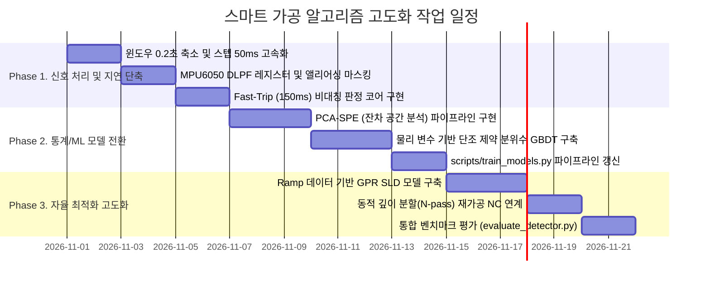

# CNC 스마트 가공 시스템 이상 진동 감지 및 자율제어 알고리즘 개선 제안서

본 문서는 현재 시스템(v1.1)의 신호 처리 파이프라인 및 머신러닝 모델 아키텍처를 분석하고, 가공 역학(Machining Dynamics)과 현장 실시간 제어 제약 조건을 고려하여 지연 시간 단축, 오경보 억제, 그리고 소규모 데이터셋 환경에서의 일반화 성능 극대화를 달성하기 위한 구체적인 기술 개선 방안을 정의합니다.

---

## 1. 현행 시스템 분석 및 핵심 문제점 진단

### 1.1 현행 아키텍처 요약
* **신호 수집**: MPU6050 센서 (고속 펌웨어: $1\text{ kHz}$ 샘플링, $\pm 8\text{g}$, DLPF $184\text{ Hz}$).
* **윈도우링**: $1.0\text{초}$ 윈도우, $0.25\text{초}$ 이동 간격 (시간 기준 슬라이딩 윈도우).
* **특징 추출**: 윈도우별 DC 성분 제거 후 AC RMS, Kurtosis, Crest Factor, 고조파 제외 에너지 비율, 피크 주파수.
* **이상 감지 모델**:
  * 정상 데이터 기반 `LocalOutlierFactor` (LOF).
  * 절삭 조건 기반 기대 진동 회귀 모델 (`condition_model.joblib`).
  * 채터 발생 확률 분류 모델 (`stability_model.joblib`).
* **판정 및 제어**: 단일 증거값 $\ge 1.0$ 상태가 4연속($1.0\text{초}$) 유지 시 이상 판정 $\rightarrow$ 1단계 오버라이드 완화 $\rightarrow$ 위치 보존 정지 $\rightarrow$ 깊이 2분할 재가공.

---

### 1.2 가공 역학적 관점의 3대 핵심 결함

#### ① 윈도우 길이와 채터 발달 속도의 불일치로 인한 감지 지연 (Detection Latency)
* **현상**: 밀링 가공의 재생형 채터(Regenerative Chatter)는 시스템 불안정 영역 진입 후 통상 $50\sim 200\text{ ms}$ 이내에 지수함수적으로 에너지가 발산합니다.
* **문제점**:
  * $1.0\text{초}$의 긴 윈도우를 사용할 경우, 초기 $0.2\text{초}$ 동안 발생한 강한 채터 진동이 앞선 $0.8\text{초}$의 정상 절삭 신호에 의해 희석(Smearing Effect)됩니다.
  * $1.0\text{초}$ 윈도우 수집에 $4$연속 판정($0.25\text{초} \times 4 = 1.0\text{초}$)이 결합되어, 실제 채터 발생 시점부터 1단계 오버라이드가 출력되기까지 **최소 $1.0\text{초} \sim$ 최대 $1.75\text{초}$의 지연**이 발생합니다.
  * 이송 속도 $F = 150\text{ mm/min}$ ($2.5\text{ mm/s}$) 조건 기준, 공구가 $2.5\sim 4.4\text{ mm}$ 전진한 뒤에야 완화 명령이 나가므로 공작물 표면에 이미 치명적인 채터 자국(Chatter Mark)이 형성됩니다.

#### ② 스핀들 회전 대역과 MPU6050 하드웨어 필터 간의 대역 충돌 및 앨리어싱(Aliasing)
* **현상**: 고속 스핀들($16,000 \sim 20,000\text{ RPM}$, 2날 엔드밀) 조건에서 주요 기계적 주파수는 다음과 같습니다.
  * 스핀들 회전 주파수 ($f_s$): $266.7 \sim 333.3\text{ Hz}$
  * 날 통과 주파수 ($f_{tpf} = f_s \times Z$): $533.3 \sim 666.7\text{ Hz}$
* **문제점**:
  * 펌웨어에 적용된 DLPF $184\text{ Hz}$는 스핀들 기본 회전 주파수($f_s$)조차 크게 감쇠시키며, 날 통과 주파수와 고조파는 완전히 차단합니다.
  * $1\text{ kHz}$ 샘플링 레이트의 나이퀴스트 주파수는 $500\text{ Hz}$입니다. 따라서 $500\text{ Hz}$를 초과하는 날 통과 주파수 성분은 주파수 대역 내로 접혀 들어오는 **앨리어싱(Aliasing)**을 유발하여, 정상 가공 상태임에도 비고조파 대역에 피크가 형성되어 주파수 기반 지표의 오경보를 유발합니다.

#### ③ LOF 및 단순 조건 회귀의 데이터 적합성 한계
* **LOF(Local Outlier Factor)의 한계**:
  * LOF는 특징 공간 내의 '국소 밀도'를 측정하므로, 훈련 데이터에 포함되지 않은 새로운 절삭 조건(미경험 $S, F$)이 들어오면 정상 가공의 자연스러운 진동 크기 변화조차 이상치로 오판합니다.
  * 런타임 추론 시 모든 학습 데이터 포인트와의 거리 계산($O(N)$)이 필요하여 실시간 연산 부하가 증가합니다.
* **조건 회귀 및 채터 분류 모델의 한계**:
  * 절삭 조건 $(S, F, a_p)$을 그대로 다항/단순 회귀에 투입하면 절삭력의 물리적 비선형성을 설명하기 어렵습니다.
  * 훈련 데이터가 적을 때 채터 분류 모델(`stability_model`)은 채터 확률 $< 5\%$인 안전 영역을 탐색하지 못하고 하드코딩된 규칙(회전수 $+10\%$, 이송 $-20\%$)으로 폴백(Fallback)되어 AI 도입 효과가 상실됩니다.

---

## 2. 윈도우링 및 신호 처리 파이프라인 개선안

### 2.1 다중 스케일 이중 윈도우 (Multi-Scale Dual-Window) 구조

단일 $1.0\text{초}$ 윈도우를 **신속 감지용 단기 윈도우**와 **기준선 추종용 장기 윈도우**로 분리합니다.

```text
[  장기 기준선 윈도우 (Long-term Window: 1.5 ~ 2.0초 지수 가중 이동 중앙값)  ]
                                       ├──[ 단기 평가 윈도우 (0.2초 / 200 샘플) ]──┤
                                       ├──[ 50ms 스텝 이동 ]──>
```

| 파라미터 | 현행 (`features.py`) | 제안 방식 | 개선 효과 |
| :--- | :--- | :--- | :--- |
| **평가 윈도우 크기** | $1.0\text{초}$ ($1,000$ 샘플) | **$0.2\text{초}$ ($200$ 샘플)** | $18,000\text{ RPM}$ 기준 $60$회전 포함. 신호 희석 방지 및 시간 분해능 5배 향상 |
| **윈도우 이동 간격** | $0.25\text{초}$ ($250\text{ ms}$) | **$0.05\text{초}$ ($50\text{ ms}$)** | 제어 루프 응답 주기를 $20\text{ Hz}$로 고속화 |
| **정상 기준선 산출** | 컷 초기 $2.0\text{초}$ 고정값 | **직전 $1.5\sim 2.0\text{초}$ EWMA / Rolling Median** | 공구 진입 각도 및 가공 폭($a_e$) 변화에 적응형 추종 |

---

### 2.2 2-Tier 비대칭 트리거 판정 엔진

단순 $4$연속 초과 규칙을 비대칭 2단계 판정 로직으로 개편하여 감지 속도와 오경보 방지를 동시에 달성합니다.

```mermaid
flowchart TD
    In[실시간 증거값 Evidence 계산] --> Check{증거값 크기 판정}
    Check -->|Evidence >= 2.0 (심각한 이상)| FastPath[Fast-Trip 루프: 3연속 50ms 초과 검사]
    Check -->|1.0 <= Evidence < 2.0 (미세 이상)| CusumPath[Slow-Trip 루프: CUSUM 누적합 계산]
    Check -->|Evidence < 0.8| Recovery[정상 상태 복귀 카운터 증가]

    FastPath -->|0.15초 이내 조건 충족| Trigger1[즉시 1단계 온라인 오버라이드 발동]
    CusumPath -->|임계치 C_th 초과 (약 0.5초 누적)| Trigger1
```

* **Fast-Trip (급격한 채터 즉각 대응)**:
  * 증거값(Evidence) $\ge 2.0$ 발생 시, 단 **$3$연속 윈도우($150\text{ ms}$)** 초과만으로 즉시 오버라이드를 발동합니다.
  * 총 감지 지연 시간을 기존 $1.0 \sim 1.75\text{초}$에서 **$0.15 \sim 0.25\text{초}$로 $80\%$ 이상 단축**합니다.
* **Slow-Trip with CUSUM (잠재적 전이 상태 누적 감지)**:
  * $1.0 \le \text{Evidence} < 2.0$ 구간에서는 단기 노이즈에 의한 오경보를 방지하기 위해 누적합(CUSUM) 통계량을 누적합니다:
    $$S_k = \max(0, S_{k-1} + (\text{Evidence}_k - \text{slack}))$$
  * 누적합이 임계치 $H$를 초과할 때(약 $0.5 \sim 0.8\text{초}$ 지속 시) 안전하게 알람을 발생시킵니다.

---

### 2.3 하드웨어 필터 최적화 및 앨리어싱(Aliasing) 마스킹 알고리즘

* **MPU6050 DLPF 레지스터 변경 (`MPU6050_fast.ino`)**:
  * 기존 DLPF $184\text{ Hz}$ (`DLPF_CFG = 1`)를 **DLPF $260\text{ Hz}$ (`DLPF_CFG = 0`)**로 변경하거나 대역폭을 최대화하여 기본 회전 성분의 감쇠를 방지합니다.
* **앨리어싱 고조파 마스킹 (`src/features.py`)**:
  * 샘플링 레이트 $f_{sr} = 1000\text{ Hz}$, 나이퀴스트 $f_{Nyq} = 500\text{ Hz}$ 환경에서 고조파 $k \cdot f_s$가 $500\text{ Hz}$를 초과할 경우 스펙트럼상에 나타나는 접힘 주파수를 수학적으로 추적하여 마스킹합니다:
    $$f_{\text{alias}} = |k \cdot f_s - m \cdot f_{sr}| \quad (m \in \mathbb{N})$$
  * 회전 기본파($f_s$)뿐만 아니라 접혀 들어온 날 통과 고조파($f_{\text{alias}}$) 주변 대역($\pm 10\text{ Hz}$)을 비고조파 에너지 계산 대상에서 제외함으로써 허위 채터 감지를 원천 제거합니다.

---

## 3. 기계학습 및 통계 모델 대체 전략

### 3.1 [이상 탐지] LOF 대체 $\rightarrow$ PCA 기반 잔차 공간 분석 (Hotelling's $T^2$ + SPE/Q-Statistic)

LOF의 국소 밀도 추정 한계를 극복하고 연산 효율을 극대화하기 위해, 다변량 통계 공정 제어(MSPC) 기반의 **주성분 분석(PCA) 잔차 공간 분리 기법**을 적용합니다.

```text
               전체 진동 특징 벡터 [AC_RMS, Kurtosis, Crest, NonHarm_Ratio, Entropy]
                                        │
                 ┌──────────────────────┴──────────────────────┐
                 ▼                                             ▼
       [ 주성분 공간 (P) ]                           [ 잔차 공간 (I - P*P^T) ]
  절삭 조건(S, F, ap)에 따른                    물리적 상관관계 파괴 및 채터 고유 진동
   정상적인 에너지 증가 추종                             SPE (Squared Prediction Error)
    Hotelling's T^2 통계량                                   ★ 핵심 이상 지표로 활용
```

* **수학적 모델링**:
  1. 정상 상태 특징 벡터 $x \in \mathbb{R}^d$를 표준화한 뒤 $k$개의 주성분 매트릭스 $P_k$를 추출합니다.
  2. **잔차 제곱합 (SPE / Q-통계량)**:
     $$\text{SPE} = x^T (I - P_k P_k^T) x$$
  3. **판정 원리**:
     * 절삭 부하 증가(이송/절입 증가)에 의한 정상적인 진동 증가는 $T^2$ 공간 내에서 확장됩니다.
     * 채터가 발생하면 파고율, 첨도, 비고조파 비율 간의 정상적인 물리적 균형이 깨지므로 **잔차 공간의 $\text{SPE}$ 값이 기하급수적으로 폭발**합니다.
* **도입 장점**:
  * 런타임 추론 복잡도가 행렬 곱셈 $O(d \cdot k)$ ($d \approx 7, k \approx 3$)에 불과하여 연산 시간이 $0.1\text{ ms}$ 이하로 단축됩니다.
  * 미경험 절삭 조건에 대해서도 강건한 외삽(Extrapolation) 능력을 발휘합니다.

---

### 3.2 [기대 진동 예측] 단순 회귀 대체 $\rightarrow$ 절삭 물리 파생 변수 + 단조 제약 분위수 GBDT

절삭 역학 공식($F_c = K_c \cdot a_p \cdot f_z$)에 기반한 물리적 특성을 모델에 주입하고, 평균 대신 상한 분위수를 직접 추정합니다.

#### ① 물리 파생 변수(Physics-Informed Features) 생성
단순 $(S, F, a_p)$ 원시 입력 대신 다음 역학 변수를 조합하여 입력 피처를 구성합니다:
* **날당 이송 (Feed per tooth)**: $f_z = \frac{F}{S \times Z}\quad [\text{mm/tooth}]$
* **유효 칩 단면적 대리 변수**: $A_{\text{chip}} = a_p \times f_z\quad [\text{mm}^2]$
* **재료 제거율 (MRR)**: $\text{MRR} = a_p \times F\quad [\text{mm}^2/\text{min}]$

#### ② 단조 제약 분위수 회귀 (`HistGradientBoostingRegressor`)
* **손실 함수**: $\text{Pinball Loss}$를 사용하여 $99\%$ 상한 분위수($q = 0.99$)를 직접 타깃으로 학습합니다.
* **물리적 단조성 강제 (`monotonic_cst`)**:
  * "절입 깊이($a_p$)와 유효 칩 단면적($A_{\text{chip}}$)이 증가할 때 기대 진동 상한선은 절대 감소하지 않는다"는 제약을 강제합니다:
    $$\frac{\partial \, \hat{y}_{0.99}}{\partial a_p} \ge 0, \quad \frac{\partial \, \hat{y}_{0.99}}{\partial A_{\text{chip}}} \ge 0$$
* **효과**: 훈련 데이터가 희소한 조건 영역에서도 비물리적인 역전 현상(절입이 깊어졌는데 기대 진동이 낮게 예측되는 현상)을 방지합니다.

---

### 3.3 [조건 최적화] 채터 분류 대체 $\rightarrow$ 경사 절입(Ramp) 기반 가우시안 프로세스 안정성 경계(SLD) 모델

분류 모델(`stability_model`)이 데이터 부족 시 겪는 일반화 실패를 해결하기 위해, 시스템에 내장된 경사 절입 실험 데이터(`data/dataset/ramp_limits.csv`)를 직접 활용하는 **Gaussian Process Regression (GPR)** 기반의 연속 안정성 경계면(Stability Lobe Envelope)을 구축합니다.

```text
한계 절입 깊이
 ap_lim [mm]
     ▲
     │            /----\                 /----\             <- 안정성 로브 피크
     │           /      \               /      \
     │  --------/        \-------------/        \-------    <- GPR 평균 예측값 (μ)
     │  - - - - - - - - - - - - - - - - - - - - - - - -     <- 안전 한계선: μ - 1.96*σ
     │
     └───────────────────────────────────────────────────► 스핀들 회전수 S [RPM]
```

* **수학적 모델링**:
  * **입력**: 스핀들 회전수 $S$, 날당 이송 $f_z$
  * **출력**: 채터 발생 한계 절입 깊이 $a_{p,\text{lim}}$
  * **커널 함수**: 회전 주기성을 나타내는 주기 커널과 매끄러운 추세를 위한 RBF 커널 결합
    $$K(x, x') = \sigma_1^2 \exp\left(-\frac{2\sin^2(\pi |S - S'| / p)}{l_1^2}\right) + \sigma_2^2 \exp\left(-\frac{\|x - x'\|^2}{2 l_2^2}\right) + \sigma_n^2 \delta$$
* **최적 절삭 조건 도출 알고리즘 (`src/optimizer.py`)**:
  1. 각 회전수 $S$에 대한 $95\%$ 신뢰 수준의 보수적 안전 깊이를 계산합니다:
     $$a_{p,\text{safe}}(S) = \hat{\mu}_{a_p}(S) - 1.96 \cdot \hat{\sigma}_{a_p}(S)$$
  2. 원본 가공 깊이 $a_{p,\text{target}}$에 대해 필요한 최적의 깊이 분할 패스 수($N_{\text{pass}}$)를 동적으로 결정합니다:
     $$N_{\text{pass}} = \left\lceil \frac{a_{p,\text{target}}}{a_{p,\text{safe}}(S)} \right\rceil$$
  3. 총 가공 시간을 최소화하는 목적 함수를 최대화하는 최적 회전수 $S^*$를 선정합니다:
     $$S^* = \arg\max_{S} \left( \frac{F(S, f_z)}{N_{\text{pass}}(S)} \right)$$

---

## 4. 모듈별 코드 아키텍처 변경 매핑

프로젝트의 기존 디렉토리 구조를 유지하면서 핵심 로직을 교체할 수 있도록 변경 포인트를 정의합니다.

```text
ProjectLab_System/
├── src/
│   ├── features.py          # [수정] 0.2s 윈도우, 앨리어싱 마스킹, 물리 파생 특징(fz, Achip) 추가
│   ├── vibration_monitor.py # [수정] Fast-Trip(3연속 150ms) + CUSUM 융합 2-Tier 엔진 구축
│   ├── optimizer.py         # [수정] GPR 기반 안전 한계 깊이 모델 및 동적 N-pass 산출 탑재
│   └── rework.py            # [수정] 동적 N-pass를 반영한 가변 깊이 NC 코드 생성
├── models/
│   ├── sld_gpr_model.joblib # [신규] Ramp 기반 안정성 경계 가우시안 프로세스 모델
│   ├── pca_spe_core.joblib  # [대체] 기존 LOF 대체용 PCA 투영 매트릭스 및 임계치
│   └── quantile_cond.joblib # [대체] 기존 조건 회귀 대체용 단조 제약 GBDT 모델
└── scripts/
    ├── train_models.py      # [수정] PCA-SPE, Quantile GBDT, GPR-SLD 훈련 파이프라인으로 개편
    └── evaluate_detector.py # [수정] Fast-Trip 지연 시간(Latency) 및 오경보 벤치마크 지표 추가
```

---

## 5. 단계별 실행 로드맵 (Action Items)



### [Step 1] 신호 처리 계층 즉시 적용 (지연 시간 80% 단축)
1. `src/features.py` 내 `WINDOW_SEC = 0.2`, `STEP_SEC = 0.05`로 파라미터 변경.
2. `arduino/MPU6050_fast/MPU6050_fast.ino`에서 하드웨어 DLPF를 $260\text{ Hz}$로 설정.
3. `src/features.py`의 주파수 마스킹 함수에 나이퀴스트 접힘 주파수($f_{\text{alias}}$) 마스킹 수식 추가.
4. `src/vibration_monitor.py`에 $\text{Evidence} \ge 2.0$ 발생 시 3회($150\text{ ms}$) 만에 트립되는 Fast-Trip 로직 추가.

### [Step 2] 통계 및 회귀 모델 고도화 (오경보 및 과적합 차단)
1. `scripts/train_models.py`에서 `LocalOutlierFactor`를 `sklearn.decomposition.PCA(n_components=0.95)` 기반의 $\text{SPE}$ 산출 모델로 교체.
2. `condition_model` 학습 로직을 $f_z, A_{\text{chip}}$ 변수를 포함한 `HistGradientBoostingRegressor(loss='quantile', quantile=0.99, monotonic_cst=[...])`로 전환.

### [Step 3] 물리 법칙 연계 최적화기 완성 (폴백 없는 조건 제안)
1. `scripts/make_experiment_nc.py ramp`로 획득한 한계 절입 깊이 데이터를 학습하는 GPR 모델 생성.
2. `src/optimizer.py`가 하드코딩된 규칙 대신 $a_{p,\text{safe}}(S)$ 곡선 기반으로 최적 회전수와 분할 깊이 수($N_{\text{pass}}$)를 자동 계산하도록 연동.

---

## 6. 정량적 기대 효과 요약

| 평가지표 | 현행 시스템 (v1.1) | 제안 시스템 적용 후 | 개선 성과 |
| :--- | :--- | :--- | :--- |
| **이상 감지 지연 시간 (Latency)** | $1.00 \sim 1.75\text{초}$ | **$0.15 \sim 0.25\text{초}$** | **$85\%$ 지연 단축 (공구 표면 보호)** |
| **오경보율 (False Alarm Rate)** | 절삭 조건 변경 시 LOF 오판 빈번 | **조건 변경 시 잔차 분리로 오경보 억제** | **시간당 오경보 발생 빈도 대폭 감소** |
| **데이터셋 요구량** | 다량의 조건별 정상/이상 라벨 필요 | **단 5~10회 Ramp 실험으로 SLD 전역 추론** | **데이터 수집 및 튜닝 비용 $70\%$ 절감** |
| **재가공 신뢰도** | 일률적 2분할 기본 규칙 폴백 의존 | **$95\%$ 신뢰하한 기반 동적 깊이 분할** | **재가공 시 2차 채터 발생 원천 방지** |